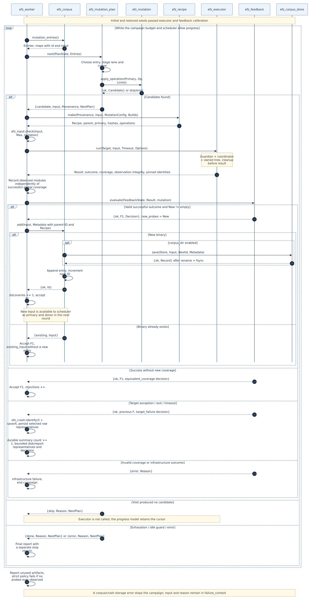
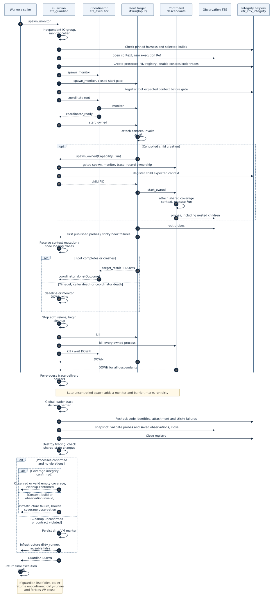

# EFZ architecture

**English** · [Русский](i18n/ru/architecture.md) · [Español](i18n/es/architecture.md) · [简体中文](i18n/zh-CN/architecture.md) · [All languages](i18n/README.md)

This document describes the current EFZ runtime from source code as of
**September 13, 2026**. EFZ is a coverage-guided fuzzer on Erlang/OTP: it mutates
`binary()`, executes `Module:run/1`, collects source-instrumented coverage and
returns successful inputs with new coverage to the active corpus. These inputs
then become available as parents and donors for subsequent mutations. The runtime
runs in one BEAM VM and accepts one worker.

This description concerns the implemented system. Distributed execution, complete
isolation of OTP applications and exact campaign resume are outside this
architecture.

The purpose of every directory and file, including tests, examples and archived
materials, is described in the [repository map](repository-map.md).

## Navigation

- [1. Main modules and UML](#modules)
- [2. Processes, supervision and state owners](#processes)
- [3. Preparing artifacts and starting a campaign](#startup)
- [4. Closed feedback loop](#feedback)
- [5. Executing one input](#execution)
- [6. Coverage and decisions](#coverage)
- [7. Corpus and persistent storage](#corpus)
- [8. Scheduler, mutation and replay](#mutation)
- [9. Input limits, errors and completion](#failures)
- [10. Isolation and OTP integration boundaries](#boundaries)
- [11. Validation and further reading](#evidence)

Diagrams are available as generated SVG and editable Mermaid sources. They use
UML structural/class diagrams with `module`, `gen_server`, `process`, `ETS`
stereotypes and UML sequence diagrams. This maps Erlang modules, processes and
resources onto UML; the implementation has no object-oriented classes. A general
module dependency does not imply a separate process or asynchronous call.
[Format and rendering](diagrams/README.md).

<a id="modules"></a>
## 1. Main modules and UML



[Open SVG](diagrams/modules.svg) · [Mermaid source](diagrams/modules.mmd)

The diagram shows the main staged-runtime dependencies. The build transform,
coverage hooks, random path and helper modules are listed below to keep the
diagram readable. A dashed arrow denotes a module dependency.

| Component | Actual modules / entry points | Purpose and role in the runtime |
|---|---|---|
| CLI | [fuzz.escript](../scripts/fuzz.escript), [efz_cli](../src/efz_cli.erl):`main/1` | Arguments, raw seed files, artifact discovery, API calls and final `report.term` |
| Public API | [efz](../src/efz.erl):`start/1`, `await/1`, `stats/0`, `stop/0` | Start the application and campaign; wait for a report; stop |
| Application | [efz_app](../src/efz_app.erl), [efz_sup](../src/efz_sup.erl) | Root supervisor and application lifecycle |
| Campaign config | [efz_config](../src/efz_config.erl):`prepare/1` | Strict schema, callbacks, limits, artifact preflight and corpus restore |
| Instrumentation | [efz_instrument](../src/efz_instrument.erl), [efz_instrument_pt](../src/efz_instrument_pt.erl) | Compile selected sources with hooks and a manifest; validate/load artifacts |
| Manifest / validation plan | [efz_cov_manifest](../src/efz_cov_manifest.erl) | Probe identities, allowed builds/probes and observed-coverage validation |
| Campaign coordinator | [efz_fuzzer](../src/efz_fuzzer.erl) | Create services, monitor the worker, manage `await` waiters and final report |
| Worker supervision | [efz_worker_sup](../src/efz_worker_sup.erl) | One temporary worker; no automatic recovery of campaign state |
| Fuzz loop | [efz_worker](../src/efz_worker.erl):`handle_info/2` | Calibration → scheduling → mutation → execution → feedback → retain/report |
| Harness contract | [efz_target](../src/efz_target.erl), user `Module:run/1` | Accept binary input; adapt it to the real parser/target |
| Executor | [efz_executor](../src/efz_executor.erl):`run/4` | API, root outcome, wait for final result and guardian DOWN |
| Lifecycle guardian | [efz_guardian](../src/efz_guardian.erl) | Independent ownership of root/descendants, deadline, DOWN/trace barriers, snapshot and dirty-runner policy |
| Coverage context / hooks | [efz_cov](../src/efz_cov.erl), [efz_cov_rt](../src/efz_cov_rt.erl) | Execution-specific ETS and `hit/1` from instrumented code |
| Coverage integrity | [efz_cov_integrity](../src/efz_cov_integrity.erl) | Harness/build pins, protected PID/context registry, sticky context/code-load failures and observation states |
| Feedback | [efz_feedback](../src/efz_feedback.erl):`evaluate/3` | Pure classification and coverage-difference function; state lives in the worker |
| Active corpus | [efz_corpus](../src/efz_corpus.erl) | Entries, integer IDs, deduplication and inputs for the scheduler; optional persistence |
| Durable corpus | [efz_corpus_store](../src/efz_corpus_store.erl) | SHA-256 entries, metadata, build policy, validation and restore |
| Staged planner | [efz_mutation_plan](../src/efz_mutation_plan.erl):`prepare/2`, `new/1`, `next/2` | Scheduler, stage lanes, lazy cursors, bounded visits and explicit RNG state |
| Mutation operators | [efz_mutation](../src/efz_mutation.erl) | Apply concrete operations to binary input with bounds checks |
| Dictionary | [efz_dictionary](../src/efz_dictionary.erl) | Load/normalize tokens and establish dictionary identity during preparation |
| Random mode | [efz_mutator](../src/efz_mutator.erl), [efz_mutator_random](../src/efz_mutator_random.erl):`mutate/2` | Alternative production path through a callback; uses the same executor/feedback |
| Recipe / replay | [efz_recipe](../src/efz_recipe.erl), [efz_replay](../src/efz_replay.erl), [efz_replay_cli](../src/efz_replay_cli.erl) | Exact bytes, provenance, EFZR codec, regeneration and explicit execution replay |
| Input contract | [efz_input](../src/efz_input.erl) | Campaign byte limit, binary validation and bounded file reads |
| Crash disk policy | [efz_crash_store](../src/efz_crash_store.erl) | Durable occurrence count, bounded representatives, writer lock and EFZG index |
| Crash artifacts | [efz_crash](../src/efz_crash.erl):`save/4` | Occurrence ID, normalized signature, bounded representatives, atomic raw input/result/recipe/expectation |
| Filesystem operations | [efz_fs](../src/efz_fs.erl) | Structured I/O errors, write/fsync/close, atomic file/group publication |
| Statistics | [efz_stats](../src/efz_stats.erl) | Calibration/execution/discovery/crash/timeout/infrastructure counters |

`fixtures/` and `test/` contain targets and checks. `examples/` contains ready-made
harness/campaign scenarios; the simple example is included in `rebar.config`
as a source root. `bench/` contains separate measurement drivers, not the
application scheduler. `efz_scripted_mutator` is used in some older tests, but
is not the default and does not participate in the real staged-lineage validation.

<a id="processes"></a>
## 2. Processes, supervision and state owners



[Open SVG](diagrams/processes.svg) · [Mermaid source](diagrams/processes.mmd)

A filled diamond denotes a supervisor child or a process-owned resource; the
exact relationship is labeled. A solid `start_link / shutdown` line is an ordinary
OTP link. A dashed `spawn_monitor` line means creation and monitoring,
**not supervision**. `ExecutionGuardian`, `ExecutionCoordinator`, `TargetProcess`,
`ValidationPlan`, `ExecutionCoverage` denote runtime roles in the diagram, not
new Erlang module names.

```text
application efz
└── efz_sup                       supervisor: one_for_all, intensity 0
    └── efz_fuzzer                temporary child, gen_server
        ├── efz_corpus            start_link from init/1
        ├── efz_stats             start_link from init/1
        └── efz_worker_sup        start_link; one_for_one, 5 restarts / 10 sec
            └── efz_worker       one temporary child
                └── guardian     spawn_monitor; independent I/O group leader
                    ├── coordinator  root classification
                    ├── root         gated target process
                    └── descendants  all through efz_target:spawn/1, spawn_link/1
```

Nesting below `efz_fuzzer` shows lifecycle ownership: **`efz_fuzzer` itself is not
a supervisor**. It sets `trap_exit`, creates three linked services and stops them
on termination in worker supervisor → stats → corpus order. The worker is also
monitored separately.

If the worker crashes, the campaign returns
`{infrastructure_failure,{worker_down,Reason}}`. The worker is not restarted:
`restart => temporary` takes precedence over the supervisor's permitted restart
intensity. On `EXIT` from a linked service, `efz_fuzzer` terminates the campaign.
These failure paths are not equivalent to a normal target exception result.

| State | Owner | Representation and lifetime |
|---|---|---|
| Active queue and `next` ID | `efz_corpus` | List of maps in `gen_server` state; until campaign stop |
| Global coverage | `efz_worker` | `feedback.global`: exact probe set and pinned builds; opt-in hit-count also stores `global_features` |
| Staged cursors / RNG / pending round | `efz_worker` | `mutation_state` returned by `efz_mutation_plan`; not a separate process |
| Validation allowlist | `efz_worker` in default prepared mode | Unnamed `protected` ETS `efz_coverage_plan`; disappears when its owner dies |
| Current-input coverage | Execution guardian | New unnamed `public` ETS `efz_execution_coverage`; deleted after execution |
| Execution context | Root and controlled descendants | `'$efz_execution_context'` key in the process dictionary; contains ref, ETS handle, owner PID |
| Integrity registry and evidence | Execution guardian | Protected ETS `efz_coverage_observers`: PID → expected context, pins; guardian state stores attachment, observed probes and first error |
| Lifecycle, monitors, trace barriers | `efz_guardian` | One execution; final result after all supported processes terminate |
| Dirty VM marker | `persistent_term` | `{efz_guardian, dirty_runner}`; not reset by `efz:stop/0` |
| Runtime counters | `efz_stats` | Map in `gen_server`; synchronous `inc/1` |
| Decisions, crash representatives, failure context | `efz_worker` | Report state; complete data only for significant events/a bounded trace |
| Report and `await` callers | `efz_fuzzer` | `report` and `waiters`; report available until `stop` |
| Persisted corpus / findings | Filesystem | Survive EFZ/VM shutdown |

Global coverage is not stored in the observation ETS table. There is no global
“current input” or `persistent_term` feedback cache. After a finite campaign
finishes, the worker and validation plan remain alive until `efz:stop/0`.

<a id="startup"></a>
## 3. Preparing artifacts and starting a campaign

### Instrumentation before startup

```text
ordinary .erl + selected modules + compiler options
→ efz_instrument:compile/2
→ efz_instrument_pt:parse_transform/2
→ instrumented .beam with efz_manifest attribute + .efz-manifest sidecar
→ efz_instrument:preflight/1
→ validated manifests and loaded modules
```

The transform inserts hooks into clause/outcome bodies, not patterns or guards.
The build namespace depends on normalized forms, significant compiler options
and toolchain identity. Through the manifest, a probe ordinal maps to function,
arity, source location and structural location. Different builds have different
full probe identities; an ordinal alone does not identify coverage.

`efz_instrument` manages include paths, macros and temporary code paths. Only the
facade writes artifacts; the transform works on forms and allocates no runtime
ETS or campaign state. Ordering with arbitrary additional parse transforms is
unsupported: such transforms are rejected. The embedded manifest is checked
against the safely decoded sidecar; data is compared, not ETF map byte order.

### Campaign startup

1. `efz_cli:main/1` reads arguments and seed files as raw binaries, finds
   artifacts and checks output-directory availability. The CLI itself does not
   automatically run the compiler or implement the fuzz loop.
2. `efz:start/1` starts the application and adds a temporary `efz_fuzzer` child
   through `supervisor:start_child/2`.
3. `efz_fuzzer:start_link/1` calls `efz_config:prepare/1` **before** creating the
   campaign `gen_server`: schema, input bounds, mutation settings, preflight,
   `code:ensure_loaded/1` and `run/1` export validation. Arbitrary MFA is not accepted.
4. With `corpus_dir`, saved entries are loaded and validated. Initial and restored
   inputs are merged with content-identity deduplication.
5. `efz_fuzzer:init/1` creates corpus, stats and worker supervisor. The corpus
   assigns fresh integer IDs and persists initial seeds if necessary.
6. The worker prepares the validation plan and staged state, obtains
   `efz_corpus:all()` and sends itself `iterate`.
7. Calibration executes **every** initial/restored seed through the executor
   and feedback. The mutation phase then begins.

Calibration currently means a single pass to initialize coverage, not repeated
stability analysis or flaky-probe detection. Even `max_iterations => 0` performs
calibration; `max_iterations` limits only mutation executions.

| Input contract | Value |
|---|---|
| Harness | `Module:run(binary()) -> term()`; a separate adapter is optional |
| Target config | `target => Module`; `function` / `arity` are rejected |
| Input | Raw `binary()`, without string decoding or automatic term conversion |
| `max_input_bytes` | Top-level campaign key: default 4096, inclusive 0..1048576 |
| Worker count | Only `workers => 1` |
| API defaults | `mutation_mode => random`, `max_iterations => infinity` |
| CLI defaults | Staged, 1000 mutation executions |
| Coverage defaults | `automatic`, backend `ets`, validation `prepared` |

The size limit applies to seeds, restore, both mutation modes, execution, crash
inputs and replay. The old nested `mutation.max_input_bytes` is not a campaign
option; `efz_config` passes the limit into the normalized planner config.
Complete schema and launch commands: [CLI](cli.md), [input/storage contract](input-and-storage.md).

<a id="feedback"></a>
## 4. Closed feedback loop



[Open SVG](diagrams/feedback-loop.svg) · [Mermaid source](diagrams/feedback-loop.mmd)

Main staged call path:

```text
efz_worker:handle_info(iterate, State)
→ efz_corpus:mutation_entries/0
→ efz_mutation_plan:next(PlanState, Entries)
→ efz_mutation:apply_operation(Primary, Operation, Limits)
→ efz_recipe:make(Provenance, Input, MutationConfig, Builds)
→ efz_executor:run(TargetModule, Input, Timeout, ExecutorOptions)
→ efz_feedback:evaluate(FeedbackState, Result, mutation)
→ efz_corpus:add(Input, Metadata)                 [new successful coverage]
→ efz_corpus_store:save(Store, Input, Id, Meta)    [if corpus_dir enabled]
→ append to entries, reply {ok, Id}
→ worker adopts FeedbackState1 and sends itself iterate
→ a future efz_mutation_plan:next/2 sees the new entry
```

The diagram shows control flow; not every arrow is an Erlang message.
`mutation_entries/0` and `add/2` are synchronous `gen_server:call`s; planner,
mutation, recipe and feedback are ordinary calls in the worker process. Durable
save runs in the corpus process and must finish before append/ack. A save error
does not change the active queue. The worker adopts the new feedback state after
a successful retain path.

A successfully discovered input gets a new integer ID. `Metadata.parent` and
`Recipe.parent` point to its primary's ID. The recipe also contains the `primary`
binary and `primary_id = SHA256(primary)`. Saving an input to disk alone does
not imply queue admission: the append in `efz_corpus:add_checked/3` provides
that connection.

A new entry need not become the **very next** mutation. The scheduler finishes
the current round snapshot and includes new IDs in a future round. This prevents
continuous corpus growth from starving older entries. Donors come from current
active-corpus entries, including discoveries.

In [efz_feedback_loop_tests](../test/efz_feedback_loop_tests.erl), real dictionary
insertion with separate `A`, `B`, `C` tokens proves the chain
`<<>> → <<"A">> → <<"AB">> → <<"ABC">>`, parent IDs, exact harness delivery,
new probes and replay in a fresh VM. There are no scripted outputs, mock corpus
or mock coverage.

<a id="execution"></a>
## 5. Executing one input



[Open SVG](diagrams/executor.svg) · [Mermaid source](diagrams/executor.mmd)

`efz_executor:run/4` creates an independent `efz_guardian`. The guardian owns the
root, controlled descendants, observation ETS, deadline and trace session. A
separate coordinator classifies the root result and `DOWN`. The root starts
only after monitor installation is confirmed. Coordinator death triggers
guardian cleanup.

A separate `Request` for replying to the caller and execution `Ref` for coverage
are used. The final result is published after killing/draining all owned
processes, per-process trace barriers, snapshot/validation, ETS removal and
VM-contamination checks. The caller additionally waits for normal guardian
`DOWN` before returning from `run/4`.

| Interaction | Message / mechanism |
|---|---|
| Continue fuzz loop | `self() ! iterate` in the worker |
| Worker ↔ corpus | `gen_server:call` for entries/add |
| Target → coordinator | `{target_result, Ref, TargetPid, Outcome}` |
| Coordinator → guardian | `{coordinator_ready, Pid}`, then `{coordinator_done, Pid, Outcome}` |
| Controlled parent → guardian | `{spawn_owned, Capability, ParentPid, Request, Fun}` |
| Guardian → parent → child | `{Request,{ok,Pid}}`, then `{start_owned,Capability}` |
| VM → guardian | `DOWN` for every owned process and `trace_delivered` after its death |
| Broken active ETS → guardian | `{efz_cov_failure, Ref, invalid_table}` |
| Guardian → worker | `{Request, GuardianPid, Result}` and guardian `DOWN` |
| Worker → campaign coordinator | `{campaign_done, WorkerPid, Report}` |

The root directly calls `M:run(Input)`. A return term, including `{error,Reason}`,
remains success; caught error/throw produces a crash with a stack, exit produces
`{exit,Reason}`. On timeout or root completion, the guardian stops admission and
kills remaining descendants with `kill`, independently of links and `trap_exit`.
It then waits for confirmation.

`cleanup.status => confirmed` and `runner_reusable => true` mean that the supported
lifecycle finished without detected violations. A cleanup or shared-state error
produces `dirty_runner`, blocking new targets in this VM even after stop. If the
caller dies, the guardian cleans up without a result recipient. An
`efz:await/1` timeout stops only waiting, not the campaign. Complete contract,
supported spawn API and limits of automatic checks: [execution isolation](execution-isolation.md).

<a id="coverage"></a>
## 6. Coverage and decisions

The [bitmap backend](coverage-bitmap-architecture.md) design describes storage,
lifecycle and validation criteria. The backend is not implemented yet: the
current `ets`/`ets_member` and `efz_feedback` rules remain the active contract.

The metric is **`clause_outcome_probe`**: custom points in clause/outcome bodies.
This is not OTP native coverage, `cover` or bitmap edge coverage. Default feedback
uses probe presence; opt-in `coverage_feedback => hit_count` also counts buckets.
The full identity of an automatic probe is:

```erlang
{ModuleAtom, BuildSHA256, ProbeIdInteger}
```

Each hit checks the process-dictionary context against the protected PID registry
and synchronously accesses observation ETS. The `ets` backend does `insert_new`
for `{ {probe, Id} }`. `ets_member` first checks for an entry in external ETS
and skips repeated insertion. Both preserve the exact identity set, require no
final target flush and check table availability on every hit. The first insert
notifies the guardian; loss of a published observation is detected at snapshot.

After the root and descendants finish, the guardian performs `snapshot/1` and
validation. Default `prepared` uses the worker's immutable protected ETS allowlist.
`per_execution` uses `validate_observed/3` and manifests. The reference path is
retained for differential tests and measurements, not as a second set of
coverage semantics.

The exact decision is in [efz_feedback:evaluate/3](../src/efz_feedback.erl):

```text
Result.builds must match pinned FeedbackState.builds.
If coverage_status == ok and outcome == {ok, ReturnValue}:
    New = Observed − Global
    Global1 = Global ∪ Observed
    calibration: reason = seed_calibration
    mutation + empty New: reason = equivalent_coverage
    mutation + nonempty New: reason = new_coverage
Target failure: global coverage unchanged; reason = target_failure.
Coverage / infrastructure failure: error; worker stops the campaign.
```

In experimental hit-count mode, the same guardian-owned ETS contains
`{{probe, ProbeIdentity}, Count}`. `ets:update_counter/4` atomically increments
the count; the exact probe set remains a projection of keys. `efz_cov_count`
classifies values into eight buckets. `efz_feedback` separately computes
`CurrentFeatures − GlobalFeatures`, preserving the previous `New` formula for
probes. Retention reasons are `new_probe` or `new_hit_count`; calibration updates
both sets, target failures update neither. The worker passes retained input to
the same corpus. Default presence preserves `new_coverage`.
[Contract and measurements](hit-count-experiment.md).

There is no separate coverage collector server and no observation table shared
by multiple inputs. Serializing through one worker removes the “two workers
simultaneously checked and added a probe” race in the current configuration.
It does not prove readiness for multi-worker scheduling; the config rejects
`workers > 1`.

An inactive hook without context is allowed only outside an executor-owned process.
Erased/replaced context, caught hook exceptions, lost published probes and
replacement of a pinned module produce infrastructure failures. Separate trace
events preserve evidence even after context/BEAM restoration. This is a correctness
guard, not protection against deliberate forging of internal protocols or EFZ
modification. `valid_empty_coverage` means an intact observation without probes.
Campaign diagnostics show unused artifacts; `coverage_policy => strict` prevents
successful completion without a single probe, but does not stop on zero-hit
calibration. Details: [integrity](coverage-integrity.md),
[syntax and mapping](coverage.md).

<a id="corpus"></a>
## 7. Corpus and persistent storage

The active corpus stores entries of this form:

```erlang
#{id => QueueId,
  input => ExactBinary,
  metadata => Metadata,
  added_at => SystemTimeMilliseconds}
```

At runtime, `efz_corpus:add/2` deduplication compares exact bytes. Staged cursor
identity and persistent content identity use SHA-256. The single corpus process
assigns fresh runtime IDs; an existing binary does not receive a new ID. Without
`corpus_dir`, initial seeds preserve the supplied list, including duplicates;
initial/restored inputs are merged and deduplicated during durable startup.
Random mode selects a random entry through `select/0`; staged mode requests
`mutation_entries/0` and schedules entries itself.

When `corpus_dir` is set, initial seeds and successful new-coverage inputs are
persisted. Target failures are not added as discoveries. Persisting an initial
seed does not itself prove successful execution: persistence precedes calibration.

```text
CORPUS_DIR/
  INPUT_SHA256/
    input                    exact raw bytes
    metadata                 EFZC v1 envelope + checksum
  .tmp-RANDOM/                incomplete publication

CRASH_DIR/
  SIGNATURE_SHA256/
    summary                  EFZG: durable count + selected IDs/hashes
    .lock/                   exclusive writer, only while writing
    OCCURRENCE_ID/            selected representative
      artifact.input         exact triggering bytes
      artifact.term          complete raw Reason/stack, metadata, input limit
      artifact.replay        EFZX: expected build/harness/hash/signature
      artifact.recipe        EFZR, only when a recipe is available
      manifest               version + sizes + checksums of occurrence files
    .tmp-RANDOM/              staging, unpublished finding
```

Durable metadata contains content hash, input size, historical queue ID, origin,
parent content hash/ID, discovery probes, target/build identity and a recipe when
available. Publication uses a temporary directory, file fsync/close, directory
fsync, atomic rename and parent fsync. A corrupt published entry produces an
error; `.tmp-*` corpus entries give explicit interrupted-write diagnostics.

On restore, inputs are admitted to the active corpus again and recalibrated.
`corpus_build_policy => reject` rejects identity mismatch by default;
`recalibrate` permits reuse with diagnostics and fresh calibration. Scheduler
cursors, RNG, global coverage, old integer IDs and execution order are not
restored. This is a reusable persistent corpus, **not checkpoint/resume**.

EFZC corpus metadata, EFZR recipes and instrumented-module manifests are distinct
formats. Crash `artifact.term` may contain runtime diagnostic terms and is not
used as a safe recipe import. Format and validation: [corpus](corpus.md),
[replay](replay.md), [atomic storage](input-and-storage.md).

<a id="mutation"></a>
## 8. Scheduler, mutation and replay

In staged mode, the worker stores `efz_mutation_plan` state: cursors keyed by
`{InputSHA256, ConfigId}`, stage lane, pending entry IDs, `exsplus` RNG state and
progress counters. Mutations are not all materialized ahead of time.

Default lanes: `bitflip`, `byteflip`, `arithmetic`, `boundary`,
`dictionary_insert`, `dictionary_overwrite`, `havoc`, `splice`. Lanes alternate
across entries and rounds; this does not require exhausting every deterministic
stage before the first havoc. One visit returns at most one candidate, and the
number of attempts within a visit is bounded by config. Empty/nonfitting/no-op
operations may return `skip` while preserving an advanced cursor.

Progress counts when a candidate is generated **or a finite cursor advances**.
`max_idle_visits` does not stop the scheduler while finite deterministic work
remains. Once deterministic work is exhausted, the idle guard applies only after
the threshold and a full pass over every lane of every current content without
progress. Corpus growth resets idle accounting while preserving cursors, RNG
and the unfinished round.

Random mode calls `Mutator:mutate(Primary, #{iteration, max_input_bytes})`;
the default is `efz_mutator_random`. This is a real alternative generation path
that converges with staged mode at worker → executor → feedback → corpus. It
does not receive staged cursors or automatically create staged recipes.

A recipe contains primary bytes/hash, parent ID, concrete operations, donor bytes
for splice, output size/hash, input/operator limits, config/dictionary IDs,
versions, builds and the diagnostic initial RNG seed. Replay needs neither the
old corpus, dictionary file nor another RNG run.

- `regenerate/1` reconstructs bytes under the limit recorded in the recipe.
- `regenerate/2` additionally accepts the current campaign limit and checks
  primary/donors/intermediate values/output.
- `execute/5` / `execute_file/5` require explicit target/artifacts/builds and
  `expected_harness`, create a fresh validation plan and use the same executor.
- `efz_replay:run/6` checks the input hash, builds and harness, then compares
  the signature.
- `scripts/replay.escript --input/--recipe` performs this verified replay;
  the old positional mode only regenerates bytes. The user always specifies
  the target.

Detailed operator contracts and budgets: [mutations](mutations.md).

<a id="failures"></a>
## 9. Input limits, errors and completion

`efz_input` defines a single byte contract. `0` allows only `<<>>`; `max` is
allowed; `max + 1` is rejected without truncation. CLI/restore/replay read at most
the limit plus one byte to detect oversize. The random mutator respects remaining
capacity, while the worker and executor additionally validate candidates.

| Report status | Reason |
|---|---|
| `completed` | Mutation execution budget consumed; calibration counted separately |
| `{mutation_exhausted,mutation_exhausted}` | Finite deterministic search space exhausted without random lanes |
| `{mutation_stopped,idle_budget_exhausted}` | Random/progress guard; not proof of mathematical exhaustion |
| `{infrastructure_failure,Reason}` | Mutation/input, coverage or storage error in the controlled runtime path |
| `{infrastructure_failure,{worker_down,Reason}}` | Unexpected worker termination; fallback report from `efz_fuzzer` |

`efz_crash:save/4` returns `{ok,Crash}` or `{error,ErrorMap}`. A filesystem error
contains `operation`, `path`, `reason`, `input_hash`, `crash_fingerprint`; staging/group
path and secondary cleanup/close errors are added when necessary. The first error
is not replaced by a cleanup error.

Every selected representative is published as a separate atomic directory.
Input identity is SHA-256 of exact bytes; occurrence ID is random 128 bits;
signature is SHA-256 of normalized class/Reason/stack; group ID equals signature.
`Crash.path` points to the `SIGNATURE/OCCURRENCE/artifact` prefix.
`artifact.term` preserves the complete raw Reason and stack. `artifact.replay`
contains verifiable identity separately from diagnostics.

Signature v2 takes only module/function/arity from the first five target frames,
excluding paths/lines and runtime frames. `crash_policy.reason` sets `category`
(default), `exact` or `ignore`; runtime pid/ref/port/fun identities are normalized
even with `exact`. The hash uses an explicitly ordered structure stable across
atom/map ordering in a fresh VM. The report stores `occurrences` and, by default,
three representative inputs with different hashes per signature. Crash decisions
are added only for those representatives. The same `max_representatives` caps
disk storage through `efz_crash_store`: the first N distinct hashes per signature,
immutable raw input/Reason/recipe/expectation, and atomic `summary` counting all
committed occurrences. Summary preserves the cap across VMs.
`durable_occurrences` is separate from the current campaign count; `storage`
distinguishes saved/duplicate/limit_reached. At limit_reached, a new input receives
no disk artifact; its current report may preserve it among bounded representatives.
Legacy/unindexed/corrupt groups and a remaining writer lock produce an explicit
error rather than resetting the count. Old archives are not deleted.

On runtime storage failure, the worker increments `infrastructure_failures`,
preserves the exact input, result/stack, metadata and recipe in `failure_context`,
and finishes the campaign. `unique_crashes` counts signatures, including unsaved
ones; `crash_occurrences` counts all target failures, including timeouts and
repeats. If only the recipe is corrupt, raw input/result/expectation are published
without it, but the campaign gets an explicit infrastructure error;
`saved_artifact` identifies the exact-input representative when saved within
the cap.

Stats preserve `primary_infrastructure_failure`. The fuzzer receives the current
exact input before the executor call; on `worker_down`, it increments the
infrastructure count and includes the latest received context in the fallback
report. Fallback does not recover lost worker cursors or partial crash groups.
Coordinator loss is not masked by an empty build map, coverage error or dirty
cleanup: outcome preserves the primary infrastructure cause, while
`cleanup` / `runner_reusable` describe secondary lifecycle status. If the guardian
is lost after its reply, the executor also preserves the primary error, secondary
`guardian_failure` and previous `execution_evidence`; final cleanup becomes
unconfirmed. A dirty runner cannot be reused. Startup failures are returned
from `efz:start/1` as errors, not completed campaign reports.

`efz_cli` writes `OUT/report.term` atomically. If report writing also fails,
the CLI increments the infrastructure count and includes the in-memory report
in diagnostics. Exit codes: `0` for normal stopping (including discovered target
crashes), `2` for invalid invocation/configuration, `1` for runtime infrastructure
or report-storage failure.

<a id="boundaries"></a>
## 10. Isolation and OTP integration boundaries

The supported model is **synchronous binary harness with controlled descendant
lifecycle**. `efz_target:spawn/1` and `spawn_link/1` transfer context and create
owned processes before opening the start gate. The guardian does not traverse
arbitrary links.

| Area | Guarantee / limitation |
|---|---|
| Root and controlled descendants | Shared execution coverage; all process `DOWN`s before a normal final result |
| Ordinary local spawn | Detection through tracing, cleanup of discovered processes, dirty-runner outcome |
| Caller / coordinator death | Guardian remains the cleanup owner, including application cancellation |
| Guardian death / cleanup deadline | Unconfirmed cleanup, infrastructure/dirty-runner; no VM reuse |
| Owned ETS and registrations | Disappear with processes; escaping resources make the runner dirty |
| `persistent_term` / application env | Before/after comparison; changes prohibit reuse, no rollback |
| Writes to existing external ETS | Outside the model; no complete automatic check, requires explicit dirty declaration / disposable VM |
| Arbitrary OTP applications, ports/NIF, remote work, filesystem effects | Legacy backend does not isolate them; opt-in P1-01 moves target/NIF into a separate BEAM but does not roll back external side effects and is not a sandbox |
| Instrumentation / code loading | Pinned harness/builds; hot replacement and context corruption diagnosed as infrastructure failures. Forging EFZ protocol/tracing is outside the protected model |
| Campaign concurrency | One worker and one execution in the VM; a second caller gets runner_busy |
| Stability | Calibration remains one pass; recipe determinism does not guarantee target determinism |

Shared-state snapshots diagnose some violations but do not turn the VM into a
sandbox. For permitted process-local resources, `A → dirty → A` preserves outcome
and coverage. For VM-global mutation, the third `A` is blocked before execution.
Detailed [per-resource policy and regression evidence](execution-isolation.md).

<a id="evidence"></a>
## 11. Validation and further reading

| Architectural connection / guarantee | Validation |
|---|---|
| Controlled descendants, guardian failures, shared-state policy | [efz_isolation_tests](../test/efz_isolation_tests.erl) |
| Real mutation → coverage → retain → new parent | [efz_feedback_loop_tests](../test/efz_feedback_loop_tests.erl) |
| Persisted discovery becomes a parent in another VM | [efz_durable_tests](../test/efz_durable_tests.erl) |
| Finite progress, 256 seeds and `max_idle_visits` | [efz_mutation_tests](../test/efz_mutation_tests.erl), [efz_phase3_tests](../test/efz_phase3_tests.erl) |
| External harness and raw CLI ingestion in a fresh VM | [efz_cli_tests](../test/efz_cli_tests.erl) |
| Coverage identity, exception/timeout and cleanup | [efz_phase2_tests](../test/efz_phase2_tests.erl), [efz_coverage_SUITE](../test/efz_coverage_SUITE.erl) |
| Coverage integrity and zero-hit policy | [efz_integrity_tests](../test/efz_integrity_tests.erl), fresh-VM policy tests in [efz_cli_tests](../test/efz_cli_tests.erl) |
| `ets` / `ets_member`, prepared/reference equivalence | [efz_backend_tests](../test/efz_backend_tests.erl) |
| Late guardian death and bounded persistent crash store | [efz_crash_retention_tests](../test/efz_crash_retention_tests.erl) |
| Crash grouping, raw diagnostics, verified replay, 1000 occurrences | [efz_crash_tests](../test/efz_crash_tests.erl) |
| Recipe operators and fresh-VM replay | [efz_recipe_tests](../test/efz_recipe_tests.erl), [efz_phase3_tests](../test/efz_phase3_tests.erl) |
| Corrupt/interrupted corpus entries, build policies | [efz_corpus_store_tests](../test/efz_corpus_store_tests.erl) |
| Bounds, storage failure, exact input in the report | [efz_limits_tests](../test/efz_limits_tests.erl) |

This documentation does not itself constitute a new test run. The latest saved
runtime-validation results are available locally in `_build/limits-checks/`;
diagrams are checked separately with a Mermaid renderer. For complete code
validation:

```sh
rebar3 compile
rebar3 eunit
rebar3 ct
rebar3 xref
rebar3 dialyzer
```

Additional documents:

- [CLI and campaign schema](cli.md), [coverage contract](coverage.md),
  [automatic coverage ADR](adr/0002-automatic-coverage.md).
- [Mutation stages](mutations.md), [replay](replay.md),
  [durable corpus](corpus.md), [input/storage contract](input-and-storage.md).
- [Phase 2 validation](phase2-validation.md),
  [Phase 2.1 performance](phase2.1-performance.md), [Phase 3 validation](phase3-validation.md).
- [Calibration readiness audit](calibration-readiness.md) is a separate study of
  stability and execution-context boundaries, not an implemented calibration algorithm.
- [Historical technical audit](technical-audit-2026-09-12.md) describes the state
  at audit time; subsequent fixes are described by current code and the documents above.

## P0 runtime diagnostics

Optional `runtime_oracles` joins the existing pipeline. `efz_runtime_config`
validates one shared policy; worker repeats selected bytes through executor and
`efz_stability` compares bounded snapshots. Repeats never call feedback, corpus
selection or the mutation planner. Original retention remains unchanged.
Guardian starts `efz_runtime` sampler, publishes admitted PID membership, records
child DOWN evidence, and kills the sampler alongside cleanup. It never polls
process/ETS metrics in the deadline path. Result `runtime_observations` is separate
from outcome. `efz_runtime_store` bounds/deduplicates independent artifacts;
`efz_replay:runtime/4` delegates compatible verification to `efz_runtime_replay`.
The [diagnostic contract](runtime-diagnostics.md) specifies semantics and bounds.

## P1-01 external supervisor

Linux-only `--supervised` delegates before target lookup or application startup.
The controller and target worker are different OS processes and address spaces;
the existing campaign loop, executor and guardian stay inside the worker. The
first operation of every `efz_executor:run/4` is a PREPARE barrier: the controller
publishes and fsyncs the exact raw input plus bounded metadata, durably records
authorization, and only then returns a digest-bound RunId permission. Legacy mode
uses the same executor API without IPC or journal writes.

The native launcher owns a worker process group, reports authoritative wait status
and confirmed cleanup, and uses Linux pidfd/PDEATHSIG/subreaping to prevent a hung
worker from surviving CLI/controller death. Native crash, external hard timeout
and dirty result finalize the in-flight record, retire the old VM, restore the
durable corpus and recalibrate it in a new generation. Recovery preserves global
budgets but intentionally reconstructs worker-local coverage, RNG and staged
cursors. The fixed bounded protocol, state machine, journal guarantees, replay
flow, acceptance evidence and platform limits are documented in
[P1-01 External supervisor](p1-01-external-supervisor.md).
