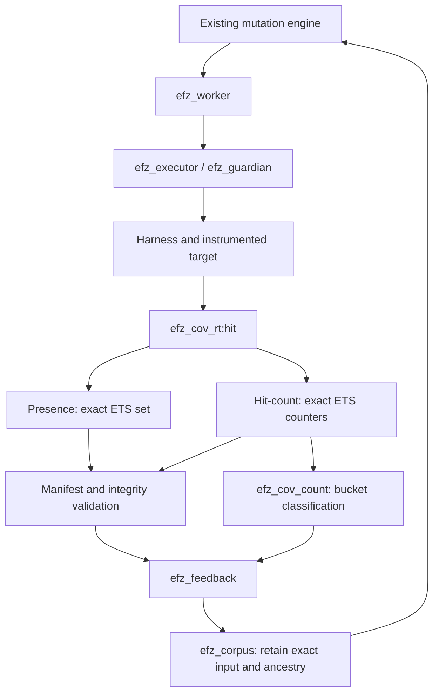

# EFZ: experimental hit-count feedback

**English** · [Русский](i18n/ru/hit-count-experiment.md) · [Español](i18n/es/hit-count-experiment.md) · [简体中文](i18n/zh-CN/hit-count-experiment.md) · [All languages](i18n/README.md)

Date: September 15, 2026. Baseline: `205e18ba172d74bd6c652a68abfc73e02e4a1f86`.
The prototype extends the exact probe-set implementation; `presence` remains
the default. Raw measurements and commands are provided below. This is a local
experiment on three small synthetic targets, not proof of effectiveness on Erlang/OTP.

## Conclusion

**RESULT B — hit-count feedback benefits some targets and should remain opt-in.**

With 3000 mutation executions per campaign and three RNG seeds per target,
hit-count reached the deep branch in 7 of 9 campaigns; presence reached it in 0
of 9. Corpus growth in the main comparison was 2–3.5 times (up to 4.5 times in a
separate bucket-saturation experiment). On a fixed long loop, total executor
time increased by about 7–8%; short executions are dominated by existing
lifecycle/integrity checks. The experiment does not demonstrate new real bugs:
all three targets return `deep`, and unique crashes are zero.

The next practical step is to repeat paired campaigns on a real parser with
known deep states, several budgets and more RNG seeds. There is no basis yet
to replace the presence default or introduce a dense bitmap.

## Contract and runtime path

```erlang
#{coverage_feedback => presence}  % default
#{coverage_feedback => hit_count} % opt-in prototype
```

CLI: add `--coverage-feedback hit_count` to an existing
`scripts/fuzz.escript` command. Unknown modes are rejected by config/CLI.
`coverage_backend` still accepts `ets`/`ets_member`: these are presence-hook
variants; in hit-count mode both use the same exact ETS-counter implementation.



Public identity is unchanged: `{Module, BuildId, ProbeId}`. This is a source
clause/outcome point, not a CFG edge. There is no `hash(Id) rem MAP_SIZE`, numeric
bitmap slot, collision aliasing or call-context hashing.

| State | Presence | Hit-count | Owner/lifetime |
|---|---|---|---|
| Per-input ETS object | `{{probe, Id}}` | `{{probe, Id}, Count}` | Guardian; fresh table per execution |
| Context backend field | ETS tid / `{ets_member,Tid}` | `{ets_count,Tid}` | Root and admitted descendants |
| Result `coverage` | Sorted exact identities | The same key projection | Snapshot after all admitted writers terminate |
| Supplemental result | None | `hit_counts`, `count_features`, `coverage_feedback` | Ordinary result terms |
| Global probes | `feedback.global` | The same set | Worker, one campaign |
| Global count features | None | `feedback.global_features` | Worker, one campaign |

`efz_cov_rt:hit/1` retains context checking through an independent registry.
Hit-count calls `ets:update_counter(T,{probe,Id},{2,1},{{probe,Id},0})`.
The first hit sends the existing guardian notification; each subsequent hit
atomically increments the integer. The absence of 64-bit wrap in ETS was checked:
`2^63−1` becomes `2^63`. This is not an 8-bit AFL counter.

`efz_guardian` retains ownership of the table, start gates, monitors and cleanup.
`efz_executor:coverage/3` validates the exact projection against the existing
manifest plan. `efz_cov_count:snapshot/1` validates row shapes and positive
integer counters; `features/2` requires an exact match between count keys and
`coverage`. A missing table, corrupted context or missing/invalid counts are
infrastructure failures, not successful empty observations. Empty `coverage=[]`,
`hit_counts=#{}` with an intact context are valid.

After confirmed cleanup, the table is deleted; the next execution receives a
new ref and ETS table. Controlled children use the same table through existing
`efz_target:spawn/1`; concurrent updates add up. A root crash/timeout does not
delete the owner-held table before snapshot. Caller/guardian/dirty-runner policy
is unchanged. Arbitrary asynchronous OTP applications remain outside the supported model.

This is a correctness contract for a cooperating harness. Public ETS is not a
security boundary: directly writing a different **positive** count into the table
is indistinguishable from a legitimate value. The guardian independently
witnesses presence but does not duplicate every hit in a second counter.
Targets must not modify EFZ rows.

## Buckets and novelty

| Count | Public bucket label |
|---|---:|
| 1 | 1 |
| 2–3 | 2 |
| 4–7 | 4 |
| 8–15 | 8 |
| 16–31 | 16 |
| 32–63 | 32 |
| 64–127 | 64 |
| 128+ | 128 |

The label is the inclusive lower bound. A feature is `{ProbeIdentity, Bucket}`.
Zero hits create no feature. These are the buckets requested; the counter stores
exact multiplicity, so 256/1000/100000 do not become zero through byte wrap.

In [efz_feedback](../src/efz_feedback.erl), for successful execution:

```text
NewProbes   = CurrentProbes   − GlobalProbes
NewFeatures = CurrentFeatures − GlobalFeatures   # hit_count only
GlobalProbes   := GlobalProbes   ∪ CurrentProbes
GlobalFeatures := GlobalFeatures ∪ CurrentFeatures
```

| Execution X | New probes | New features | Retention in hit-count mode |
|---|---|---|---|
| X×1 | X | `{X,1}` | `new_probe` |
| X×2 | empty | `{X,2}` | `new_hit_count` |
| X×3 | empty | empty | `equivalent_coverage`, do not retain |
| X×4 | empty | `{X,4}` | `new_hit_count` |

If a new probe and bucket appear together, the reason is `new_probe`; both
deltas are available in metadata. Default presence retains the old
`new_coverage` reason. Calibration updates both histories but keeps the reason
`seed_calibration`. Crash/timeout change neither global set; an infrastructure
failure stops the campaign. The worker accepts new feedback state only after a
successful retention/storage operation.

A new combination of already known count features is not novelty. Neither the
coverage-set hash, path signature nor maximum count is used for retention.

## Representation choice after measurement

Five variants were investigated in the [storage benchmark](../bench/efz_hit_count_micro.erl):

1. Baseline ETS set using `insert_new`.
2. Sparse ETS counter using `update_counter/4`.
3. Collision-free prepared identity→slot ETS + `counters` `[atomics]`.
4. The same mapping + `counters` `[write_concurrency]`.
5. The same mapping + `atomics`.

Dense lookup is included in every hit; a direct-slot-only result was not
substituted for hook cost. Identity→slot is built by enumerating manifest-like
identities without hashing. Mapping allocation is accounted for separately in
setup/memory. A real dense integration could prepare mapping once per campaign;
cold setup here should not be interpreted as mandatory per-input cost.

| Representation | Lookup/update | Reset/snapshot | Concurrent access | Integration |
|---|---|---|---|---|
| ETS set | Exact key, insert-once | Sparse scan/delete | Atomic insert | Baseline |
| ETS counter | Exact key, atomic increment | Sparse scan/delete | Atomic integer increments | Preserves ETS ownership and lifecycle |
| Dense counters/atomics | Exact mapping lookup + numeric index | Full slot scan/reset in this prototype | Atomic counters; settings have different guarantees | Requires mapping, lifetime refs, integrity/touched-slot strategy |

OTP `counters` and `atomics` use 64-bit storage and allow wrap;
`write_concurrency` changes read guarantees during concurrent writes. A snapshot
after writers terminate avoids that specific read/write overlap but does not
solve overflow. Their reference lifetime follows ref reachability rather than
ETS ownership. [OTP counters](https://www.erlang.org/docs/27/apps/erts/counters.html),
[OTP atomics](https://www.erlang.org/docs/27/apps/erts/atomics.html),
[OTP ETS update_counter](https://www.erlang.org/docs/27/apps/stdlib/ets.html#update_counter/4).

### Storage microbenchmark

Environment: OTP 27.0 / ERTS 15.0, Linux x86_64, Intel Core i7-1260P, `+S 4:4`.
Five repeats after discarded warmup, alternating variant order. No CPU pinning;
frequencies may change. Synthetic identities have the same full format,
but this is a **storage-only benchmark**, without guardian/integrity hook overhead.

Median ns/hit; `once` means each of N probes once:

| N | ETS set | ETS counter | counters atomics | counters write_concurrency | atomics |
|---:|---:|---:|---:|---:|---:|
| 100 | 220 | 280 | 127 | 127 | 118 |
| 1000 | 257 | 314 | 133 | 133 | 125 |
| 10000 | 312 | 379 | 143 | 144 | 137 |
| 100000 | 469 | 595 | 196 | 222 | 187 |

Median ns/hit; `repeated` means 10 probes ×1000 hits in a space of N:

| N | ETS set | ETS counter | counters atomics | counters write_concurrency | atomics |
|---:|---:|---:|---:|---:|---:|
| 100 | 104 | 124 | 119 | 117 | 111 |
| 1000 | 105 | 128 | 117 | 120 | 113 |
| 10000 | 107 | 148 | 117 | 116 | 110 |
| 100000 | 123 | 147 | 125 | 137 | 113 |

At N=100000 and 10 observed probes, ETS-counter snapshot took 18 µs and dense
atomics 38858 µs; reset took 6 and 3578 µs respectively. With every probe hit
once, dense atomics update much faster, but snapshot takes 257419 µs versus
192916 µs for the ETS counter. Four concurrent writers produced exactly 40000
hits in all counter variants; this checks atomicity rather than benchmarking
multi-worker EFZ. A campaign still permits only one worker.

Memory and full cold-storage lifecycle at N=100000:

| Variant | Bytes, all probes hit | Bytes, only 10 probes hit | Additional mapping bytes | Total once, ms | Total repeated, ms |
|---|---:|---:|---:|---:|---:|
| ETS set | 16007352 | 3960 | 0 | 275,46 | 1,25 |
| ETS counter | 16807352 | 4040 | 0 | 276,81 | 1,51 |
| dense counters atomics | 800040 | 800040 | 14407352 | 368,86 | 156,86 |
| dense counters write_concurrency | 4000032 | 4000032 | 14407352 | 361,04 | 156,54 |
| dense atomics | 800040 | 800040 | 14407352 | 341,90 | 111,12 |

Totals include setup, hit loop, snapshot, reset and close. Mapping setup can be
amortized separately: about 37–48 ms; this does not eliminate full
snapshot/reset scans. Dense storage itself is compact, but exact mapping in
this prototype is substantially larger than the array. It does not claim an
optimal mapping layout; the measurement shows the cost of a specific working variant.

Raw samples contain `setup_ns`, `hit_ns`, `snapshot_ns`, `reset_ns`, `close_ns`,
`total_ns`, `storage_bytes`, `mapping_bytes`. Memory is storage and mapping bytes,
**not whole-VM peak**. `total_ns` is the cold-storage lifecycle, not full target
execution. Small 100-probe batches are sensitive to timer/GC effects.
`close_ns` for dense variants measures deletion of mapping ETS; subsequent GC
reclamation of counters/atomics refs was neither measured separately nor included.

The minimal production prototype uses a **sparse ETS counter**: it supports
existing ownership, exact keys, sparse snapshot and cleanup. Dense counters
without touched-slot tracking are too costly in a large sparse space. All five
benchmark implementations are retained for the next comparison.

### Full executor on fixed inputs

An ordinary instrumented repeat target; the same input in both modes.
The timer includes context creation, hooks, validation, snapshots, cleanup and
DOWN. Warmup, five paired samples, 200 executions/sample for 1/1000 repeats and
10 for 100000. This is a separate overhead check without changing corpus/scheduling.

| Repeats | Presence, µs/input | Hit-count, µs/input | Change |
|---:|---:|---:|---:|
| 1 | 4927,6 | 4910,1 | −0,4%, noise |
| 1000 | 5679,0 | 6092,3 | +7,3% |
| 100000 | 50367,3 | 54426,7 | +8,1% |

## Controlled fuzzing comparison

Three targets are ordinary source with automatic instrumentation and no manual
coverage hooks. The benchmark adapter only reports the timestamp of a `deep`
result externally; it does not select inputs/parents or replace the mutator.

| Target | Semantics | Deep branch |
|---|---|---|
| [repeat](../fixtures/hit_count/efz_count_repeat.erl) | Prefix of identical `A` bytes | ≥16 repeats |
| [records](../fixtures/hit_count/efz_count_records.erl) | Parser of complete TLV-like records `1,1,Payload` | ≥8 records |
| [machine](../fixtures/hit_count/efz_count_machine.erl) | Tick/ack transitions `TA`, then commit `C` | ≥8 pairs before commit |

Each pair receives identical initial seeds, all three RNG seeds, timeout=1000,
max_input_bytes=128, max_iterations=3000 and staged config:
`stages=[dictionary_insert,havoc]`, `havoc_depth=1`, `max_block_bytes=32`.
The dictionary contains one byte/record/transition token respectively, not
ready-made deep inputs. RNG rounds: mutation/random `{17*R,23,41}`, selection
`{101,109*R,113}`, R=1..3. Full configs are saved in the evidence; the driver
checks their equality after removing only `coverage_feedback`.

As the corpus grows, subsequent input streams naturally diverge: this tests
feedback quality rather than an artificially fixed output sequence.
Neither a scripted mutator nor a new fuzzing engine is used.

| Target/mode | Final probes (R1/R2/R3) | Discoveries | Corpus | Count-only | Deep successes | Median exec/s |
|---|---|---|---|---|---:|---:|
| repeat / presence | 4/4/4 | 1/1/1 | 2/2/2 | 0/0/0 | 0/3 | 193,1 |
| repeat / hit_count | 5/5/5 | 6/6/6 | 7/7/7 | 4/4/4 | 3/3 | 190,9 |
| records / presence | 4/4/4 | 1/1/1 | 2/2/2 | 0/0/0 | 0/3 | 191,1 |
| records / hit_count | 4/4/5 | 3/3/5 | 4/4/6 | 2/2/3 | 1/3 | 191,7 |
| machine / presence | 5/5/5 | 2/2/2 | 3/3/3 | 0/0/0 | 0/3 | 194,6 |
| machine / hit_count | 6/6/6 | 6/8/7 | 7/9/8 | 3/5/4 | 3/3 | 183,6 |

First deep input in hit-count mode:

| Target | Mutation index R1/R2/R3 | Seconds from mutation-phase start |
|---|---|---|
| repeat | 2225 / 282 / 448 | 11,783 / 1,427 / 2,294 |
| records | not reached / not reached / 1645 | — / — / 8,671 |
| machine | 1319 / 1492 / 2298 | 7,439 / 8,713 / 10,501 |

All 18 campaigns executed 3000 mutations each, with infrastructure failures=0
and unique crashes=0. Campaign throughput includes different input distributions,
a larger corpus and scheduler work; it cannot be interpreted as isolated counter
cost. The frozen-input executor experiment above serves that purpose.

### Negative control: random mutation

Six more campaigns received the same budget=3000, initial seeds and fixed RNG
states, but used existing `efz_mutator_random`. No dictionary was added: this
mutator does not support it. Modes matched on coverage/discoveries/corpus;
no run reached deep:

| Target | Final probes, both modes | Discoveries | Corpus | Count-only | Presence / hit-count exec/s |
|---|---:|---:|---:|---:|---:|
| repeat | 3 | 0 | 1 | 0 | 192,2 / 194,4 |
| records | 3 | 0 | 1 | 0 | 193,5 / 194,6 |
| machine | 4 | 1 | 2 | 0 | 194,1 / 205,2 |

The random mutator has flip/overwrite/insert/delete, but no dictionary/duplicate.
For an empty primary it always creates `<<0>>`. Without suitable initial content,
feedback alone does not create useful input. This is a substantial limit on
generalizing the positive staged results.

### Large loops and corpus saturation

An additional real staged campaign inserted dictionary tokens
`L1,L2,L4,L8,L16,L32,L64,L128,L1000,L100000,L1000000` and invoked one
automatically instrumented probe the corresponding number of times. The trace
was checked: `L1000000` was actually generated and executed in both modes.

| Mode | Executions | Status | Probes | Corpus | Count-only | Global bucket features |
|---|---:|---|---:|---:|---:|---:|
| presence | 38 | deterministic mutation exhaustion | 1 | 2 | 0 | — |
| hit_count | 256 | configured execution budget | 1 | 9 | 7 | 8 |

Presence exhausted the dictionary-only space earlier because its corpus was
smaller. This experiment checks saturation/retention; it **does not compare
throughput at equal execution counts**. The main paired quality/performance
table above has equal budgets. Counts 1000/100000/1000000 retained no additional
inputs after bucket 128.

## Corpus, compatibility and limitations

An input novel only by bucket follows existing `efz_worker:retain` →
`efz_corpus:add` → `mutation_entries/select`. Metadata contains both deltas and
the exact reason. SHA-256 dedup, integer parent ID, primary bytes/hash and EFZR
recipe are unchanged. The mode is not part of the mutation-config hash and does
not change operations.

Actual corpus chain in `repeat / hit_count / round 1`:

| ID | Input | Parent ID | Retention |
|---:|---|---:|---|
| 1 | `<<>>` | — | initial |
| 2 | `A` | 1 | `new_probe` |
| 3 | `AA` | 2 | `new_hit_count` |
| 4 | `AAAA` | 3 | `new_hit_count` |
| 5 | `AAAAAAAA` | 4 | `new_hit_count` |
| 6 | `AAAAAAAAAAAAAAAA` | 5 | `new_probe`, deep branch |
| 7 | 32 × `A` | 6 | `new_hit_count` |

In the regression campaign, `L2` received ID 5, `parent=1`, `new_probes=[]` and
`new_count_features=[{{efz_count_sites,Build,1},2}]`. A subsequent real recipe
has `parent=5`, `primary=<<"L2">>`, `primary_id=SHA256(<<"L2">>)`,
`operations=[{dictionary_insert,0,<<"L1">>}]` and reconstructs `<<"L1L2">>`.
This next input need not be interesting: the test specifically proves scheduler
reuse. Useful multistep count ancestry appears in the table above.
Queue IDs are reassigned in a new VM; the restore test finds the parent by content.

The durable store saves count discoveries in record schema 2; initial/presence
entries stay schema 1. The EFZC envelope remains version 1. Old records are
readable; an old EFZ rejects new v2 records. Raw inputs can move between modes
with recalibration; global bucket history and cursors are not restored.
Details: [corpus contract](corpus.md).

Crash input and recipe remain authoritative bytes/provenance; replay uses the
same build/harness checks. Default replay checks the outcome, not count novelty:
that would require the history of a specific campaign. Identity, manifest and
recipe schemas are unchanged. Count mode does not bypass the guardian or input
limits, add parallel campaigns or clear arbitrary VM-global state.

In a fixed build, each probe has only eight possible bucket features. After the
first observation, at most seven count-only opportunities per probe remain.
Thus count-only retentions are bounded by `7 * number of probes`
(in practice fewer because of calibration, multiple features/input and content
dedup). Feature combinations do not multiply this space. This does not limit
total initial/restored corpus or guarantee small recipe sizes for large inputs.

Opt-in, buckets and dedup are already in effect. No new hard caps/power schedules
were added: these targets have small corpora. For larger manifests, measure
retained bytes/recipe bytes separately before choosing a count-only discovery
cap or lower scheduling priority. Dense mapping/touched slots are a possible
optimization after profiling, not a prerequisite for the new semantics.

## Reproduction and evidence

From the `efz/` root, sequentially, without concurrent test/benchmark workloads:

```sh
ERL_FLAGS='+S 4:4' rebar3 compile
escript bench/hit_count.escript micro _build/hit-count-experiment
escript bench/hit_count.escript executor _build/hit-count-experiment
escript bench/hit_count.escript campaign _build/hit-count-experiment
escript bench/hit_count.escript stress _build/hit-count-experiment
escript bench/hit_count.escript large_loops _build/hit-count-experiment
escript bench/hit_count.escript report _build/hit-count-experiment

ERL_FLAGS='+S 4:4' rebar3 eunit
ERL_FLAGS='+S 4:4' rebar3 ct
ERL_FLAGS='+S 4:4' rebar3 xref
ERL_FLAGS='+S 4:4' rebar3 dialyzer
```

Full reports/recipes and text logs remain in `_build/hit-count-experiment`.
Compact archive of all samples: [hit-count-samples.json](performance/hit-count-samples.json).
Erlang tuples are JSON arrays, binaries are `{hex: ...}` objects;
`features` in campaign rows is the feature count; exact IDs themselves are in coverage.

Regression suite: [efz_hit_count_tests](../test/efz_hit_count_tests.erl), with
additions to CLI, integrity and corpus-store tests. It checks every bucket
boundary, presence ×1/×1000, multi-probe deltas, build namespaces, concurrent
child hits, crash/timeout snapshots, corrupted counts/context, default/invalid
config, real staged retention and parent reuse, durable restore/recalibration in
a fresh VM, raw+recipe crash replay and build/harness mismatch.

Actual final validation:

| Command with `ERL_FLAGS='+S 4:4'` | Result |
|---|---|
| `rebar3 compile` | PASS |
| `rebar3 eunit` | PASS, 199 tests |
| `rebar3 ct` | PASS, 3 tests |
| `rebar3 xref` | PASS |
| `rebar3 dialyzer` | PASS |

The first EUnit attempts were unsuccessful: the old test with 5376 guarded
executions exceeded `efz:await(25000)` (and the following smoke got 0 executions);
on the second attempt the default 5-second EUnit timeout cancelled the group of
eight campaigns. Functional assertions were preserved: the first test's wait
was increased to 60 s (outer 75 s), the second to 30 s. Target timeout and
mutation budget did not change. The final full EUnit attempt passed without
failures/cancellations; the exhaustion test took 33.621 s and confirmed exactly
5120 mutation executions. Original failure logs and both validation attempts
were retained rather than replaced by success in the provenance archive.
Full logs: `_build/hit-count-experiment/`.
