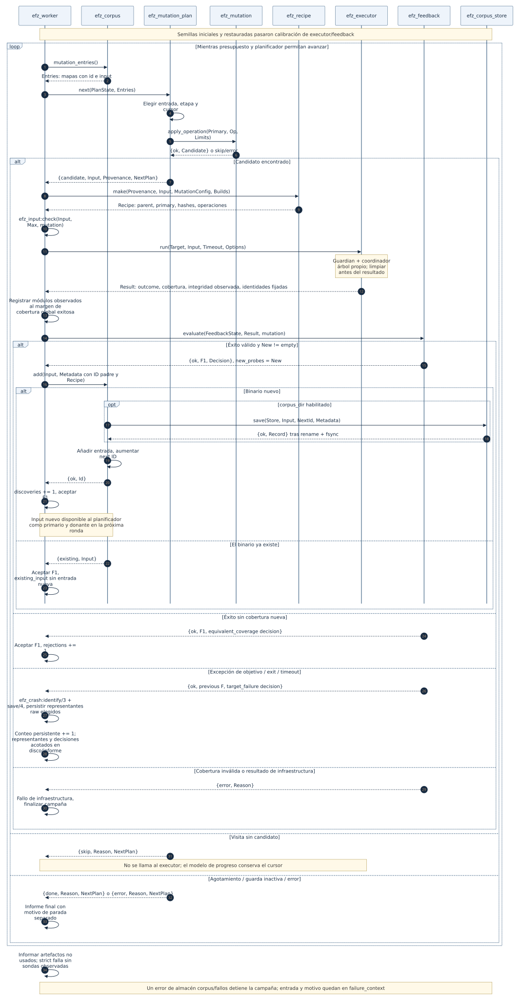
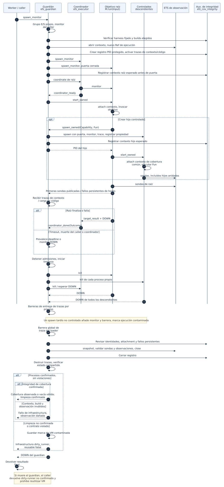

# Arquitectura de EFZ

[English](../../architecture.md) · [Русский](../ru/architecture.md) · **Español** · [简体中文](../zh-CN/architecture.md) · [Todos los idiomas](../README.md)

Este documento describe el runtime actual de EFZ a partir del código fuente a fecha de
**13 de septiembre de 2026**. EFZ es un fuzzer guiado por cobertura sobre Erlang/OTP: muta
`binary()`, ejecuta `Module:run/1`, recoge cobertura instrumentada en las fuentes y
devuelve al corpus activo las entradas exitosas que aportan cobertura nueva. Estas entradas
quedan disponibles como padres y donantes de mutaciones posteriores. El runtime
se ejecuta en una VM BEAM y admite un worker.

Esta descripción se refiere al sistema implementado. La ejecución distribuida, el aislamiento
completo de aplicaciones OTP y la reanudación exacta de campañas quedan fuera de esta
arquitectura.

La finalidad de cada directorio y archivo, incluidas pruebas, ejemplos y materiales
archivados, se describe en el [mapa del repositorio](repository-map.md).

## Navegación

- [1. Módulos principales y UML](#modules)
- [2. Procesos, supervisión y propietarios del estado](#processes)
- [3. Preparación de artefactos e inicio de campaña](#startup)
- [4. Bucle cerrado de feedback](#feedback)
- [5. Ejecución de una entrada](#execution)
- [6. Cobertura y decisiones](#coverage)
- [7. Corpus y almacenamiento persistente](#corpus)
- [8. Planificador, mutación y replay](#mutation)
- [9. Límites de entrada, errores y finalización](#failures)
- [10. Aislamiento y fronteras de integración OTP](#boundaries)
- [11. Validación y lecturas adicionales](#evidence)

Los diagramas están disponibles como SVG generados y fuentes Mermaid editables. Utilizan
diagramas UML estructurales/de clases con estereotipos `module`, `gen_server`, `process`, `ETS`
y diagramas UML de secuencia. Así se representan módulos, procesos y recursos de Erlang
en UML; la implementación no tiene clases orientadas a objetos. Una dependencia
general entre módulos no implica un proceso separado ni una llamada asíncrona.
[Formato y renderizado](diagrams/README.md).

<a id="modules"></a>
## 1. Módulos principales y UML



[Abrir SVG](diagrams/modules.svg) · [Fuente Mermaid](diagrams/modules.mmd)

El diagrama muestra las dependencias principales del runtime por etapas. El transform de compilación,
los hooks de cobertura, la vía aleatoria y los módulos auxiliares se enumeran abajo para mantener
el diagrama legible. Una flecha discontinua representa dependencia entre módulos.

| Componente | Módulos / entradas reales | Finalidad y papel durante la ejecución |
|---|---|---|
| CLI | [fuzz.escript](../../../scripts/fuzz.escript), [efz_cli](../../../src/efz_cli.erl):`main/1` | Argumentos, archivos de semillas sin procesar, descubrimiento de artefactos, llamadas API e informe final `report.term` |
| API pública | [efz](../../../src/efz.erl):`start/1`, `await/1`, `stats/0`, `stop/0` | Iniciar aplicación y campaña; esperar un informe; detener |
| Aplicación | [efz_app](../../../src/efz_app.erl), [efz_sup](../../../src/efz_sup.erl) | Supervisor raíz y ciclo de vida de aplicación |
| Configuración de campaña | [efz_config](../../../src/efz_config.erl):`prepare/1` | Esquema estricto, callbacks, límites, preflight de artefactos y restauración del corpus |
| Instrumentación | [efz_instrument](../../../src/efz_instrument.erl), [efz_instrument_pt](../../../src/efz_instrument_pt.erl) | Compilar fuentes seleccionadas con hooks y manifiesto; validar/cargar artefactos |
| Manifiesto / plan de validación | [efz_cov_manifest](../../../src/efz_cov_manifest.erl) | Identidades de sonda, compilaciones/sondas permitidas y validación de cobertura observada |
| Coordinador de campaña | [efz_fuzzer](../../../src/efz_fuzzer.erl) | Crear servicios, monitorizar worker, gestionar esperas `await` e informe final |
| Supervisión del worker | [efz_worker_sup](../../../src/efz_worker_sup.erl) | Un worker temporal; sin recuperación automática del estado de campaña |
| Bucle de fuzzing | [efz_worker](../../../src/efz_worker.erl):`handle_info/2` | Calibración → planificación → mutación → ejecución → feedback → retención/informe |
| Contrato del harness | [efz_target](../../../src/efz_target.erl), `Module:run/1` del usuario | Aceptar entrada binaria; adaptarla al parser/objetivo real |
| Executor | [efz_executor](../../../src/efz_executor.erl):`run/4` | API, resultado raíz, espera del resultado final y DOWN del guardian |
| Guardian de ciclo de vida | [efz_guardian](../../../src/efz_guardian.erl) | Propiedad independiente de raíz/descendientes, deadline, barreras DOWN/traza, snapshot y política de ejecución contaminada |
| Contexto / hooks de cobertura | [efz_cov](../../../src/efz_cov.erl), [efz_cov_rt](../../../src/efz_cov_rt.erl) | ETS específica de ejecución y `hit/1` desde código instrumentado |
| Integridad de cobertura | [efz_cov_integrity](../../../src/efz_cov_integrity.erl) | Identidades fijadas de harness/compilación, registro protegido PID/contexto, fallos persistentes de contexto/carga y estados de observación |
| Feedback | [efz_feedback](../../../src/efz_feedback.erl):`evaluate/3` | Función pura de clasificación y diferencia de cobertura; el estado reside en el worker |
| Corpus activo | [efz_corpus](../../../src/efz_corpus.erl) | Entradas, IDs enteros, deduplicación y entradas para el planificador; persistencia opcional |
| Corpus persistente | [efz_corpus_store](../../../src/efz_corpus_store.erl) | Entradas SHA-256, metadatos, política de compilación, validación y restauración |
| Planificador por etapas | [efz_mutation_plan](../../../src/efz_mutation_plan.erl):`prepare/2`, `new/1`, `next/2` | Planificador, vías de etapas, cursores diferidos, visitas acotadas y estado RNG explícito |
| Operadores de mutación | [efz_mutation](../../../src/efz_mutation.erl) | Aplicar operaciones concretas a entradas binarias verificando límites |
| Diccionario | [efz_dictionary](../../../src/efz_dictionary.erl) | Cargar/normalizar tokens y establecer identidad del diccionario durante preparación |
| Modo aleatorio | [efz_mutator](../../../src/efz_mutator.erl), [efz_mutator_random](../../../src/efz_mutator_random.erl):`mutate/2` | Vía alternativa de producción mediante callback; usa el mismo executor/feedback |
| Receta / replay | [efz_recipe](../../../src/efz_recipe.erl), [efz_replay](../../../src/efz_replay.erl), [efz_replay_cli](../../../src/efz_replay_cli.erl) | Bytes exactos, procedencia, codec EFZR, regeneración y replay explícito de ejecución |
| Contrato de entrada | [efz_input](../../../src/efz_input.erl) | Límite de bytes de campaña, validación binaria y lectura acotada de archivos |
| Política de fallos en disco | [efz_crash_store](../../../src/efz_crash_store.erl) | Conteo persistente de ocurrencias, representantes limitados, bloqueo de escritor e índice EFZG |
| Artefactos de fallo | [efz_crash](../../../src/efz_crash.erl):`save/4` | ID de ocurrencia, firma normalizada, representantes limitados, publicación atómica de entrada/resultado/receta/expectativa |
| Operaciones de archivos | [efz_fs](../../../src/efz_fs.erl) | Errores estructurados de E/S, write/fsync/close, publicación atómica de archivo/grupo |
| Estadísticas | [efz_stats](../../../src/efz_stats.erl) | Contadores de calibración/ejecución/descubrimiento/fallo/timeout/infraestructura |

`fixtures/` y `test/` contienen objetivos y comprobaciones. `examples/` contiene escenarios
de harness/campaña preparados; el ejemplo sencillo se incluye en `rebar.config`
como raíz de fuentes. `bench/` contiene controladores de medición independientes, no el
planificador de aplicación. Algunas pruebas antiguas usan `efz_scripted_mutator`, pero
no es el predeterminado ni participa en la validación real del linaje por etapas.

<a id="processes"></a>
## 2. Procesos, supervisión y propietarios del estado



[Abrir SVG](diagrams/processes.svg) · [Fuente Mermaid](diagrams/processes.mmd)

Un rombo relleno indica un hijo de supervisor o un recurso propiedad de proceso; la
relación exacta está etiquetada. Una línea continua `start_link / shutdown` es un link
OTP ordinario. Una línea discontinua `spawn_monitor` indica creación y monitorización,
**no supervisión**. `ExecutionGuardian`, `ExecutionCoordinator`, `TargetProcess`,
`ValidationPlan`, `ExecutionCoverage` son papeles de ejecución del diagrama, no
nombres nuevos de módulos Erlang.

```text
application efz
└── efz_sup                       supervisor: one_for_all, intensidad 0
    └── efz_fuzzer                hijo temporal, gen_server
        ├── efz_corpus            start_link desde init/1
        ├── efz_stats             start_link desde init/1
        └── efz_worker_sup        start_link; one_for_one, 5 reinicios / 10 seg
            └── efz_worker       un hijo temporal
                └── guardian     spawn_monitor; group leader de E/S independiente
                    ├── coordinator  clasificación de raíz
                    ├── root         proceso objetivo con puerta de inicio
                    └── descendants  todos mediante efz_target:spawn/1, spawn_link/1
```

El anidamiento bajo `efz_fuzzer` representa propiedad del ciclo de vida: **`efz_fuzzer` no es
un supervisor**. Activa `trap_exit`, crea tres servicios enlazados y los detiene
al terminar, en orden supervisor del worker → estadísticas → corpus. El worker también
se monitoriza por separado.

Si el worker falla, la campaña devuelve
`{infrastructure_failure,{worker_down,Reason}}`. No se reinicia el worker:
`restart => temporary` tiene prioridad sobre la intensidad de reinicios permitida
por el supervisor. Un `EXIT` de un servicio enlazado hace que `efz_fuzzer` termine la campaña.
Estas vías no equivalen al resultado normal de una excepción del objetivo.

| Estado | Propietario | Representación y duración |
|---|---|---|
| Cola activa y siguiente ID `next` | `efz_corpus` | Lista de mapas en estado `gen_server`; hasta detener la campaña |
| Cobertura global | `efz_worker` | `feedback.global`: conjunto exacto de sondas y compilaciones fijadas; hit-count opcional guarda también `global_features` |
| Cursores por etapas / RNG / ronda pendiente | `efz_worker` | `mutation_state` devuelto por `efz_mutation_plan`; no es un proceso separado |
| Lista de validación permitida | `efz_worker` en modo preparado predeterminado | ETS sin nombre `protected` denominada `efz_coverage_plan`; desaparece al morir su propietario |
| Cobertura de entrada actual | Guardian de ejecución | Nueva ETS sin nombre `public` denominada `efz_execution_coverage`; se elimina tras ejecutar |
| Contexto de ejecución | Raíz y descendientes controlados | Clave `'$efz_execution_context'` en el diccionario del proceso; contiene ref, handle ETS y PID propietario |
| Registro y evidencia de integridad | Guardian de ejecución | ETS protegida `efz_coverage_observers`: PID → contexto esperado, identidades fijadas; el estado del guardian guarda vinculación, sondas observadas y primer error |
| Ciclo de vida, monitores, barreras de traza | `efz_guardian` | Una ejecución; resultado final tras terminar todos los procesos admitidos |
| Marca de VM contaminada | `persistent_term` | `{efz_guardian, dirty_runner}`; no la reinicia `efz:stop/0` |
| Contadores de ejecución | `efz_stats` | Mapa en `gen_server`; `inc/1` síncrono |
| Decisiones, representantes de fallo, contexto de fallo | `efz_worker` | Estado de informe; datos completos solo para eventos significativos/una traza limitada |
| Informe y callers de `await` | `efz_fuzzer` | `report` y `waiters`; informe disponible hasta `stop` |
| Corpus / hallazgos persistidos | Sistema de archivos | Sobreviven a parada de EFZ/VM |

La cobertura global no se almacena en la tabla ETS de observación. No hay una
«entrada actual» global ni caché de feedback en `persistent_term`. Tras terminar una campaña
finita, el worker y el plan de validación siguen vivos hasta `efz:stop/0`.

<a id="startup"></a>
## 3. Preparación de artefactos e inicio de campaña

### Instrumentación previa al inicio

```text
.erl ordinario + módulos seleccionados + opciones del compilador
→ efz_instrument:compile/2
→ efz_instrument_pt:parse_transform/2
→ .beam instrumentado con atributo efz_manifest + sidecar .efz-manifest
→ efz_instrument:preflight/1
→ manifiestos validados y módulos cargados
```

El transform inserta hooks en cuerpos de cláusula/resultado, no en patrones ni guards.
El namespace de compilación depende de formas normalizadas, opciones significativas
del compilador e identidad de herramientas. El manifiesto relaciona el ordinal de una sonda con función,
aridad, ubicación fuente y ubicación estructural. Distintas compilaciones tienen identidades
completas distintas; un ordinal por sí solo no identifica cobertura.

`efz_instrument` gestiona rutas include, macros y rutas temporales de código. Solo la
fachada escribe artefactos; el transform opera sobre formas y no crea ETS de ejecución
ni estado de campaña. No admite ordenación con parse transforms adicionales arbitrarios:
los rechaza. El manifiesto incorporado se contrasta
con el sidecar decodificado de forma segura; se comparan datos, no el orden de bytes de mapas ETF.

### Inicio de campaña

1. `efz_cli:main/1` lee argumentos y archivos de semillas como binarios sin procesar, localiza
   artefactos y comprueba disponibilidad del directorio de salida. La CLI no ejecuta
   automáticamente el compilador ni implementa el bucle de fuzzing.
2. `efz:start/1` inicia la aplicación y añade un hijo temporal `efz_fuzzer`
   mediante `supervisor:start_child/2`.
3. `efz_fuzzer:start_link/1` llama a `efz_config:prepare/1` **antes** de crear el
   `gen_server` de campaña: esquema, límites de entrada, configuración de mutación, preflight,
   `code:ensure_loaded/1` y validación de exportación `run/1`. No acepta MFA arbitrario.
4. Con `corpus_dir`, se cargan y validan entradas guardadas. Entradas iniciales y restauradas
   se combinan con deduplicación por identidad del contenido.
5. `efz_fuzzer:init/1` crea corpus, estadísticas y supervisor del worker. El corpus
   asigna nuevos IDs enteros y persiste semillas iniciales si hace falta.
6. El worker prepara el plan de validación y estado por etapas, obtiene
   `efz_corpus:all()` y se envía `iterate` a sí mismo.
7. La calibración ejecuta **cada** semilla inicial/restaurada mediante executor
   y feedback. Después comienza la fase de mutación.

Actualmente calibración significa una sola pasada para inicializar cobertura, no análisis
repetido de estabilidad ni detección de sondas inestables. Incluso `max_iterations => 0` realiza
calibración; `max_iterations` limita únicamente ejecuciones de mutación.

| Contrato de entrada | Valor |
|---|---|
| Harness | `Module:run(binary()) -> term()`; adaptador separado opcional |
| Configuración de objetivo | `target => Module`; se rechazan `function` / `arity` |
| Entrada | `binary()` sin procesar, sin decodificación de cadenas ni conversión automática de términos |
| `max_input_bytes` | Clave superior de campaña: predeterminado 4096, rango inclusivo 0..1048576 |
| Número de workers | Solo `workers => 1` |
| Predeterminados de API | `mutation_mode => random`, `max_iterations => infinity` |
| Predeterminados de CLI | Por etapas, 1000 ejecuciones de mutación |
| Predeterminados de cobertura | `automatic`, backend `ets`, validación `prepared` |

El límite de tamaño se aplica a semillas, restauración, ambos modos de mutación, ejecución, entradas
de fallo y replay. El antiguo `mutation.max_input_bytes` anidado no es opción de campaña;
`efz_config` pasa el límite a la configuración normalizada del planificador.
Esquema completo y comandos: [CLI](cli.md), [contrato de entrada/almacenamiento](input-and-storage.md).

<a id="feedback"></a>
## 4. Bucle cerrado de feedback



[Abrir SVG](diagrams/feedback-loop.svg) · [Fuente Mermaid](diagrams/feedback-loop.mmd)

Vía principal de llamadas por etapas:

```text
efz_worker:handle_info(iterate, State)
→ efz_corpus:mutation_entries/0
→ efz_mutation_plan:next(PlanState, Entries)
→ efz_mutation:apply_operation(Primary, Operation, Limits)
→ efz_recipe:make(Provenance, Input, MutationConfig, Builds)
→ efz_executor:run(TargetModule, Input, Timeout, ExecutorOptions)
→ efz_feedback:evaluate(FeedbackState, Result, mutation)
→ efz_corpus:add(Input, Metadata)                 [nueva cobertura exitosa]
→ efz_corpus_store:save(Store, Input, Id, Meta)    [si corpus_dir está habilitado]
→ añadir a entries, responder {ok, Id}
→ el worker adopta FeedbackState1 y se envía iterate
→ una futura efz_mutation_plan:next/2 ve la entrada nueva
```

El diagrama muestra flujo de control; no todas las flechas son mensajes Erlang.
`mutation_entries/0` y `add/2` son `gen_server:call` síncronos; planificador,
mutación, receta y feedback son llamadas ordinarias en el proceso worker. El guardado
persistente se ejecuta en el proceso corpus y debe terminar antes de añadir/confirmar. Un error de guardado
no cambia la cola activa. El worker adopta el nuevo estado de feedback tras
una vía de retención exitosa.

Una entrada descubierta correctamente recibe un nuevo ID entero. `Metadata.parent` y
`Recipe.parent` apuntan al ID del primario. La receta contiene también el binario `primary`
y `primary_id = SHA256(primary)`. Guardar una entrada en disco no implica por sí solo
admitirla en cola: la adición en `efz_corpus:add_checked/3` proporciona
esa conexión.

Una entrada nueva no tiene que convertirse en la **inmediatamente siguiente** mutación. El planificador termina
el snapshot de la ronda actual e incorpora IDs nuevos en una futura ronda. Esto impide
que el crecimiento continuo del corpus prive de ejecución a entradas antiguas. Los donantes proceden
de las entradas actuales del corpus activo, incluidos descubrimientos.

En [efz_feedback_loop_tests](../../../test/efz_feedback_loop_tests.erl), la inserción real de diccionario
con tokens `A`, `B`, `C` separados demuestra la cadena
`<<>> → <<"A">> → <<"AB">> → <<"ABC">>`, IDs de padres, entrega exacta al harness,
sondas nuevas y replay en VM nueva. No hay salidas guionizadas, corpus simulado
ni cobertura simulada.

<a id="execution"></a>
## 5. Ejecución de una entrada



[Abrir SVG](diagrams/executor.svg) · [Fuente Mermaid](diagrams/executor.mmd)

`efz_executor:run/4` crea un `efz_guardian` independiente. El guardian posee la
raíz, descendientes controlados, ETS de observación, deadline y sesión de traza. Un
coordinador separado clasifica resultado de raíz y `DOWN`. La raíz solo inicia
cuando se confirma la instalación de monitores. La muerte del coordinador provoca
limpieza por el guardian.

Se usan un `Request` separado para responder al caller y un `Ref` de ejecución para cobertura.
El resultado final se publica después de matar/drenar todos los procesos poseídos,
barreras de traza por proceso, snapshot/validación, eliminación de ETS y
comprobaciones de contaminación de VM. El caller espera además el `DOWN` normal
del guardian antes de retornar de `run/4`.

| Interacción | Mensaje / mecanismo |
|---|---|
| Continuar bucle de fuzzing | `self() ! iterate` en el worker |
| Worker ↔ corpus | `gen_server:call` para entries/add |
| Objetivo → coordinador | `{target_result, Ref, TargetPid, Outcome}` |
| Coordinador → guardian | `{coordinator_ready, Pid}`, después `{coordinator_done, Pid, Outcome}` |
| Padre controlado → guardian | `{spawn_owned, Capability, ParentPid, Request, Fun}` |
| Guardian → padre → hijo | `{Request,{ok,Pid}}`, después `{start_owned,Capability}` |
| VM → guardian | `DOWN` por cada proceso poseído y `trace_delivered` tras su muerte |
| ETS activa dañada → guardian | `{efz_cov_failure, Ref, invalid_table}` |
| Guardian → worker | `{Request, GuardianPid, Result}` y `DOWN` del guardian |
| Worker → coordinador de campaña | `{campaign_done, WorkerPid, Report}` |

La raíz llama directamente a `M:run(Input)`. Un término retornado, incluido `{error,Reason}`,
sigue siendo éxito; error/throw capturado produce un fallo con pila y exit produce
`{exit,Reason}`. Ante timeout o finalización de raíz, el guardian deja de admitir descendientes y
mata los restantes con `kill`, independientemente de links y `trap_exit`.
Después espera confirmación.

`cleanup.status => confirmed` y `runner_reusable => true` significan que el ciclo de vida
admitido terminó sin violaciones detectadas. Un error de limpieza o estado compartido
produce `dirty_runner`, bloqueando nuevos objetivos en esta VM incluso tras stop. Si el
caller muere, el guardian limpia sin destinatario del resultado. Un timeout de
`efz:await/1` solo detiene la espera, no la campaña. Contrato completo,
API de spawn admitida y límites de las comprobaciones automáticas: [aislamiento de ejecución](execution-isolation.md).

<a id="coverage"></a>
## 6. Cobertura y decisiones

El diseño del [backend bitmap](coverage-bitmap-architecture.md) describe almacenamiento,
ciclo de vida y criterios de validación. El backend todavía no está implementado: las
reglas actuales de `ets`/`ets_member` y `efz_feedback` siguen siendo el contrato activo.

La métrica es **`clause_outcome_probe`**: puntos propios en cuerpos de cláusula/resultado.
No es cobertura nativa OTP, `cover` ni cobertura bitmap de aristas. El feedback predeterminado
usa presencia de sondas; `coverage_feedback => hit_count` opcional cuenta también buckets.
La identidad completa de una sonda automática es:

```erlang
{ModuleAtom, BuildSHA256, ProbeIdInteger}
```

Cada hit comprueba el contexto del diccionario del proceso frente al registro PID protegido
y accede síncronamente a ETS de observación. El backend `ets` realiza `insert_new`
para `{ {probe, Id} }`. `ets_member` primero busca una entrada en ETS externa
y omite inserciones repetidas. Ambos conservan el conjunto exacto de identidades, no requieren
flush final del objetivo y comprueban disponibilidad de tabla en cada hit. La primera inserción
notifica al guardian; se detecta en snapshot la pérdida de una observación publicada.

Tras terminar raíz y descendientes, el guardian realiza `snapshot/1` y
validación. `prepared` predeterminado usa la lista ETS protegida inmutable del worker.
`per_execution` usa `validate_observed/3` y manifiestos. La vía de referencia se
conserva para pruebas diferenciales y mediciones, no como otro conjunto de
semánticas de cobertura.

La decisión exacta está en [efz_feedback:evaluate/3](../../../src/efz_feedback.erl):

```text
Result.builds debe coincidir con FeedbackState.builds fijado.
Si coverage_status == ok y outcome == {ok, ReturnValue}:
    New = Observed − Global
    Global1 = Global ∪ Observed
    calibración: reason = seed_calibration
    mutación + New vacío: reason = equivalent_coverage
    mutación + New no vacío: reason = new_coverage
Fallo del objetivo: cobertura global sin cambios; reason = target_failure.
Fallo de cobertura / infraestructura: error; el worker detiene la campaña.
```

En el modo experimental hit-count, la misma ETS propiedad del guardian contiene
`{{probe, ProbeIdentity}, Count}`. `ets:update_counter/4` incrementa atómicamente
el conteo; el conjunto exacto de sondas sigue siendo proyección de las claves. `efz_cov_count`
clasifica valores en ocho buckets. `efz_feedback` calcula separadamente
`CurrentFeatures − GlobalFeatures`, manteniendo la fórmula anterior de `New` para
sondas. Los motivos de retención son `new_probe` o `new_hit_count`; la calibración actualiza
ambos conjuntos, los fallos de objetivo ninguno. El worker entrega la entrada retenida al
mismo corpus. Presence predeterminado mantiene `new_coverage`.
[Contrato y mediciones](hit-count-experiment.md).

No hay servidor independiente de recogida de cobertura ni tabla de observación compartida
por varias entradas. La serialización en un worker elimina la carrera «dos workers
comprueban y añaden simultáneamente una sonda» en la configuración actual.
No demuestra disponibilidad de planificación multiworker; la configuración rechaza
`workers > 1`.

Un hook inactivo sin contexto solo se permite fuera de procesos propiedad del executor.
Contexto borrado/sustituido, excepciones capturadas de hooks, sondas publicadas perdidas y
sustitución de un módulo fijado producen errores de infraestructura. Eventos separados de traza
conservan evidencia incluso tras restaurar contexto/BEAM. Es una protección de corrección,
no contra falsificación deliberada de protocolos internos o modificación
de EFZ. `valid_empty_coverage` significa observación íntegra sin sondas.
Los diagnósticos muestran artefactos no usados; `coverage_policy => strict` impide
finalizar correctamente sin ninguna sonda, pero no detiene la calibración
con cero hits. Detalles: [integridad](coverage-integrity.md),
[sintaxis y mapeo](coverage.md).

<a id="corpus"></a>
## 7. Corpus y almacenamiento persistente

El corpus activo almacena entradas con esta forma:

```erlang
#{id => QueueId,
  input => ExactBinary,
  metadata => Metadata,
  added_at => SystemTimeMilliseconds}
```

Durante la ejecución, la deduplicación de `efz_corpus:add/2` compara bytes exactos. La identidad de cursores
por etapas y del contenido persistente usa SHA-256. El proceso único de corpus
asigna IDs nuevos de ejecución; un binario existente no recibe un ID nuevo. Sin
`corpus_dir`, las semillas iniciales conservan la lista suministrada, incluidos duplicados;
las entradas iniciales/restauradas se combinan y deduplican durante el inicio persistente.
El modo aleatorio elige una entrada mediante `select/0`; el modo por etapas solicita
`mutation_entries/0` y planifica las entradas por sí mismo.

Con `corpus_dir`, las semillas iniciales y entradas exitosas con cobertura nueva
se persisten. Los fallos de objetivo no se añaden como descubrimientos. Persistir una semilla
inicial no demuestra ejecución exitosa: la persistencia precede a la calibración.

```text
CORPUS_DIR/
  INPUT_SHA256/
    input                    bytes exactos sin procesar
    metadata                 sobre EFZC v1 + checksum
  .tmp-RANDOM/                publicación incompleta

CRASH_DIR/
  SIGNATURE_SHA256/
    summary                  EFZG: conteo persistente + IDs/hashes seleccionados
    .lock/                   escritor exclusivo, solo durante escritura
    OCCURRENCE_ID/            representante seleccionado
      artifact.input         bytes causantes exactos
      artifact.term          Reason/pila originales completos, metadatos, límite de entrada
      artifact.replay        EFZX: compilación/harness/hash/firma esperados
      artifact.recipe        EFZR, solo si hay receta disponible
      manifest               versión + tamaños + checksums de archivos de ocurrencia
    .tmp-RANDOM/              staging, hallazgo sin publicar
```

Los metadatos persistentes contienen hash del contenido, tamaño, ID histórico de cola, origen,
hash/ID de contenido del padre, sondas de descubrimiento, identidad de objetivo/compilación y receta si
existe. La publicación usa directorio temporal, fsync/close de archivo, fsync de directorio,
rename atómico y fsync del padre. Una entrada publicada corrupta produce un
error; las entradas `.tmp-*` del corpus dan diagnósticos explícitos de escritura interrumpida.

Al restaurar, las entradas se admiten de nuevo en el corpus activo y se recalibran.
`corpus_build_policy => reject` rechaza por defecto identidades incompatibles;
`recalibrate` permite reutilización con diagnósticos y nueva calibración. No se restauran
cursores del planificador, RNG, cobertura global, IDs enteros anteriores ni orden
de ejecución. Es un corpus persistente reutilizable, **no checkpoint/reanudación**.

Los metadatos de corpus EFZC, las recetas EFZR y los manifiestos de módulos instrumentados son formatos
distintos. `artifact.term` de fallo puede contener términos diagnósticos de ejecución y no se
usa como importación segura de recetas. Formato y validación: [corpus](corpus.md),
[replay](replay.md), [almacenamiento atómico](input-and-storage.md).

<a id="mutation"></a>
## 8. Planificador, mutación y replay

En modo por etapas, el worker guarda estado de `efz_mutation_plan`: cursores indexados por
`{InputSHA256, ConfigId}`, vía de etapa, IDs de entradas pendientes, estado RNG `exsplus` y
contadores de progreso. No se materializan todas las mutaciones por adelantado.

Vías predeterminadas: `bitflip`, `byteflip`, `arithmetic`, `boundary`,
`dictionary_insert`, `dictionary_overwrite`, `havoc`, `splice`. Las vías se alternan
entre entradas y rondas; no es necesario agotar todas las etapas deterministas
antes del primer havoc. Una visita devuelve como máximo un candidato y la
configuración limita los intentos por visita. Operaciones vacías/que no caben/sin efecto
pueden devolver `skip` manteniendo el cursor avanzado.

Hay progreso cuando se genera un candidato **o avanza un cursor finito**.
`max_idle_visits` no detiene al planificador mientras quede trabajo determinista
finito. Una vez agotado, la protección de inactividad solo se aplica tras
el umbral y una pasada completa por cada vía de cada contenido actual sin
progreso. El crecimiento del corpus reinicia la contabilidad de inactividad conservando cursores, RNG
y ronda incompleta.

El modo aleatorio llama a `Mutator:mutate(Primary, #{iteration, max_input_bytes})`;
el predeterminado es `efz_mutator_random`. Es una vía alternativa real de generación
que converge con el modo por etapas en worker → executor → feedback → corpus. No
recibe cursores por etapas ni crea automáticamente recetas por etapas.

Una receta contiene bytes/hash primarios, ID del padre, operaciones concretas, bytes donantes
para splice, tamaño/hash de salida, límites de entrada/operador, IDs de configuración/diccionario,
versiones, compilaciones y semilla inicial RNG diagnóstica. El replay no necesita
corpus antiguo, archivo de diccionario ni otra ejecución del RNG.

- `regenerate/1` reconstruye bytes bajo el límite registrado en la receta.
- `regenerate/2` acepta además el límite actual de campaña y comprueba
  primario/donantes/valores intermedios/salida.
- `execute/5` / `execute_file/5` requieren objetivo/artefactos/compilaciones explícitos y
  `expected_harness`, crean un plan nuevo de validación y usan el mismo executor.
- `efz_replay:run/6` comprueba hash de entrada, compilaciones y harness y compara después
  la firma.
- `scripts/replay.escript --input/--recipe` realiza este replay verificado;
  el modo posicional antiguo solo regenera bytes. El usuario siempre especifica
  el objetivo.

Contratos detallados de operadores y presupuestos: [mutaciones](mutations.md).

<a id="failures"></a>
## 9. Límites de entrada, errores y finalización

`efz_input` define un contrato único de bytes. `0` solo permite `<<>>`; se permite `max`;
`max + 1` se rechaza sin truncar. CLI/restauración/replay leen como máximo
el límite más un byte para detectar exceso. El mutador aleatorio respeta la capacidad
restante; worker y executor validan además los candidatos.

| Estado del informe | Motivo |
|---|---|
| `completed` | Presupuesto de ejecuciones de mutación consumido; calibración contada por separado |
| `{mutation_exhausted,mutation_exhausted}` | Espacio determinista finito agotado sin vías aleatorias |
| `{mutation_stopped,idle_budget_exhausted}` | Protección aleatoria/de progreso; no prueba agotamiento matemático |
| `{infrastructure_failure,Reason}` | Error de mutación/entrada, cobertura o almacenamiento en la vía controlada de ejecución |
| `{infrastructure_failure,{worker_down,Reason}}` | Terminación inesperada del worker; informe alternativo de `efz_fuzzer` |

`efz_crash:save/4` devuelve `{ok,Crash}` o `{error,ErrorMap}`. Un error del sistema de archivos
contiene `operation`, `path`, `reason`, `input_hash`, `crash_fingerprint`; se añaden ruta
de staging/grupo y errores secundarios de limpieza/close cuando hace falta. El primer error
no se sustituye por un error de limpieza.

Cada representante seleccionado se publica como directorio atómico separado.
La identidad de entrada es SHA-256 de bytes exactos; el ID de ocurrencia es aleatorio de 128 bits;
la firma es SHA-256 de clase/Reason/pila normalizados; el ID del grupo coincide con la firma.
`Crash.path` apunta al prefijo `SIGNATURE/OCCURRENCE/artifact`.
`artifact.term` conserva Reason y pila originales completos. `artifact.replay`
contiene identidad verificable separada de los diagnósticos.

La firma v2 solo toma módulo/función/aridad de los cinco primeros marcos del objetivo,
excluyendo rutas/líneas y marcos del runtime. `crash_policy.reason` elige `category`
(predeterminado), `exact` o `ignore`; las identidades pid/ref/port/fun se normalizan
incluso con `exact`. El hash usa una estructura ordenada explícitamente, estable ante
orden de átomos/mapas en VM nueva. El informe guarda `occurrences` y, por defecto,
tres entradas representativas con hashes distintos por firma. Solo se añaden decisiones
de fallo para esos representantes. El mismo `max_representatives` limita
almacenamiento en disco mediante `efz_crash_store`: primeros N hashes distintos por firma,
entrada/Reason/receta/expectativa inmutables y `summary` atómico que cuenta todas las
ocurrencias confirmadas. El resumen mantiene el límite entre VMs.
`durable_occurrences` es independiente del conteo de la campaña actual; `storage`
distingue saved/duplicate/limit_reached. Con limit_reached, una entrada nueva no recibe
artefacto en disco; su informe actual puede conservarla entre representantes limitados.
Grupos heredados/no indexados/corruptos y un bloqueo de escritor restante producen un
error explícito en lugar de reiniciar el conteo. No se eliminan archivos históricos.

Si falla el almacenamiento durante ejecución, el worker incrementa `infrastructure_failures`,
preserva entrada exacta, resultado/pila, metadatos y receta en `failure_context`,
y termina la campaña. `unique_crashes` cuenta firmas, incluidas las no guardadas;
`crash_occurrences` cuenta todos los fallos de objetivo, incluidos timeouts y
repeticiones. Si solo la receta está corrupta, entrada/resultado/expectativa se publican
sin ella, pero la campaña recibe un error explícito de infraestructura;
`saved_artifact` identifica al representante de entrada exacta si se guardó dentro
del límite.

Las estadísticas preservan `primary_infrastructure_failure`. El fuzzer recibe la entrada
exacta actual antes de llamar al executor; ante `worker_down`, incrementa el conteo de
infraestructura e incluye el último contexto recibido en el informe
alternativo. Este no recupera cursores perdidos ni grupos parciales de fallos del worker.
La pérdida del coordinador no se oculta con mapa de compilaciones vacío, error de cobertura ni limpieza
contaminada: outcome preserva la causa primaria de infraestructura, mientras
`cleanup` / `runner_reusable` describen estado secundario del ciclo de vida. Si el guardian
se pierde tras responder, el executor preserva también error primario, `guardian_failure`
secundario y `execution_evidence` anterior; la limpieza final pasa a
no confirmada. No se reutiliza un runner contaminado. Los fallos de inicio se devuelven
desde `efz:start/1` como errores, no informes de campaña completada.

`efz_cli` escribe `OUT/report.term` de forma atómica. Si también falla escribir el informe,
la CLI incrementa el conteo de infraestructura e incluye el informe en memoria
en diagnósticos. Códigos de salida: `0` por parada normal (incluidos fallos descubiertos
del objetivo), `2` por invocación/configuración inválida, `1` por fallo de infraestructura
o almacenamiento de informe.

<a id="boundaries"></a>
## 10. Aislamiento y fronteras de integración OTP

El modelo admitido es **harness binario síncrono con ciclo de vida controlado de
descendientes**. `efz_target:spawn/1` y `spawn_link/1` transfieren contexto y crean
procesos poseídos antes de abrir la puerta de inicio. El guardian no recorre
links arbitrarios.

| Área | Garantía / limitación |
|---|---|
| Raíz y descendientes controlados | Cobertura compartida de ejecución; todos los `DOWN` antes de un resultado final normal |
| Spawn local ordinario | Detección por trazas, limpieza de procesos descubiertos, resultado de ejecución contaminada |
| Muerte del caller / coordinador | El guardian sigue siendo propietario de limpieza, incluida cancelación de aplicación |
| Muerte del guardian / deadline de limpieza | Limpieza no confirmada, infraestructura/runner contaminado; sin reutilización de VM |
| ETS y registros propios | Desaparecen con procesos; recursos escapados contaminan el runner |
| `persistent_term` / entorno de aplicación | Comparación antes/después; los cambios prohíben reutilización, sin rollback |
| Escrituras en ETS externa existente | Fuera del modelo; sin comprobación automática completa, requiere declaración explícita de contaminación / VM desechable |
| Aplicaciones OTP arbitrarias, puertos/NIF, trabajo remoto, efectos de archivos | El backend heredado no los aísla; P1-01 opcional mueve objetivo/NIF a BEAM separada, pero no revierte efectos externos y no es sandbox |
| Instrumentación / carga de código | Harness/compilaciones fijados; sustitución en caliente y corrupción de contexto se diagnostican como errores de infraestructura. Falsificar protocolo/trazas de EFZ queda fuera del modelo protegido |
| Concurrencia de campaña | Un worker y una ejecución en la VM; un segundo caller recibe runner_busy |
| Estabilidad | La calibración sigue siendo una pasada; determinismo de receta no garantiza determinismo del objetivo |

Los snapshots de estado compartido diagnostican algunas violaciones, pero no convierten la VM en
sandbox. Para recursos locales de proceso permitidos, `A → dirty → A` conserva resultado
y cobertura. Ante mutación global de VM, la tercera `A` se bloquea antes de ejecutar.
[Política detallada por recurso y evidencia de regresión](execution-isolation.md).

<a id="evidence"></a>
## 11. Validación y lecturas adicionales

| Conexión / garantía arquitectónica | Validación |
|---|---|
| Descendientes controlados, fallos de guardian, política de estado compartido | [efz_isolation_tests](../../../test/efz_isolation_tests.erl) |
| Mutación real → cobertura → retención → nuevo padre | [efz_feedback_loop_tests](../../../test/efz_feedback_loop_tests.erl) |
| Descubrimiento persistido que pasa a ser padre en otra VM | [efz_durable_tests](../../../test/efz_durable_tests.erl) |
| Progreso finito, 256 semillas y `max_idle_visits` | [efz_mutation_tests](../../../test/efz_mutation_tests.erl), [efz_phase3_tests](../../../test/efz_phase3_tests.erl) |
| Harness externo e ingesta CLI sin procesar en VM nueva | [efz_cli_tests](../../../test/efz_cli_tests.erl) |
| Identidad de cobertura, excepción/timeout y limpieza | [efz_phase2_tests](../../../test/efz_phase2_tests.erl), [efz_coverage_SUITE](../../../test/efz_coverage_SUITE.erl) |
| Integridad de cobertura y política de cero hits | [efz_integrity_tests](../../../test/efz_integrity_tests.erl), pruebas de política en VM nueva de [efz_cli_tests](../../../test/efz_cli_tests.erl) |
| Equivalencia de `ets` / `ets_member` y preparada/referencia | [efz_backend_tests](../../../test/efz_backend_tests.erl) |
| Muerte tardía del guardian y almacén persistente acotado de fallos | [efz_crash_retention_tests](../../../test/efz_crash_retention_tests.erl) |
| Agrupación de fallos, diagnósticos originales, replay verificado y 1000 ocurrencias | [efz_crash_tests](../../../test/efz_crash_tests.erl) |
| Operadores de receta y replay en VM nueva | [efz_recipe_tests](../../../test/efz_recipe_tests.erl), [efz_phase3_tests](../../../test/efz_phase3_tests.erl) |
| Entradas de corpus corruptas/interrumpidas, políticas de compilación | [efz_corpus_store_tests](../../../test/efz_corpus_store_tests.erl) |
| Límites, fallo de almacenamiento, entrada exacta en informe | [efz_limits_tests](../../../test/efz_limits_tests.erl) |

Esta documentación no constituye por sí sola una nueva ejecución de pruebas. Los últimos resultados
guardados de validación están disponibles localmente en `_build/limits-checks/`;
los diagramas se comprueban por separado con renderizador Mermaid. Para validación completa
del código:

```sh
rebar3 compile
rebar3 eunit
rebar3 ct
rebar3 xref
rebar3 dialyzer
```

Documentos adicionales:

- [CLI y esquema de campaña](cli.md), [contrato de cobertura](coverage.md),
  [ADR de cobertura automática](adr/0002-automatic-coverage.md).
- [Etapas de mutación](mutations.md), [replay](replay.md),
  [corpus persistente](corpus.md), [contrato de entrada/almacenamiento](input-and-storage.md).
- [Validación de Phase 2](phase2-validation.md),
  [Rendimiento de Phase 2.1](phase2.1-performance.md), [validación de Phase 3](phase3-validation.md).
- [Auditoría de preparación para calibración](calibration-readiness.md): estudio separado de
  estabilidad y fronteras de contexto de ejecución, no algoritmo de calibración implementado.
- [Auditoría técnica histórica](technical-audit-2026-09-12.md) describe el estado
  en aquel momento; el código actual y los documentos anteriores describen correcciones posteriores.

## Diagnósticos de ejecución P0

`runtime_oracles` opcional se incorpora al pipeline existente. `efz_runtime_config`
valida una política compartida; el worker repite bytes seleccionados mediante executor y
`efz_stability` compara snapshots acotados. Las repeticiones nunca llaman a feedback, selección
de corpus ni planificador de mutación. La retención original no cambia.
El guardian inicia el muestreador `efz_runtime`, publica pertenencia de PIDs admitidos, registra
evidencia DOWN de hijos y mata el muestreador junto con la limpieza. Nunca consulta
métricas de proceso/ETS en la vía del deadline. `runtime_observations` es independiente
de outcome. `efz_runtime_store` limita/deduplica artefactos independientes;
`efz_replay:runtime/4` delega verificación compatible a `efz_runtime_replay`.
El [contrato diagnóstico](runtime-diagnostics.md) especifica semántica y límites.

## Supervisor externo P1-01

`--supervised`, exclusivo de Linux, delega antes de buscar objetivo o iniciar aplicación.
Controlador y worker objetivo son procesos del SO y espacios de direcciones distintos;
el bucle de campaña, executor y guardian existentes permanecen dentro del worker. La
primera operación de cada `efz_executor:run/4` es una barrera PREPARE: el controlador
publica y sincroniza con fsync entrada exacta sin procesar y metadatos limitados, registra
de forma persistente la autorización y solo entonces devuelve permiso RunId ligado al digest. El modo heredado
usa la misma API executor sin IPC ni escrituras de diario.

El lanzador nativo posee un grupo de procesos worker, informa estado wait autoritativo
y limpieza confirmada, y usa pidfd/PDEATHSIG/subreaping de Linux para impedir que un worker
bloqueado sobreviva a la muerte de CLI/controlador. Fallo nativo, timeout duro externo
y resultado contaminado finalizan el registro en curso, retiran la VM anterior, restauran el
corpus persistente y lo recalibran en una nueva generación. La recuperación conserva presupuestos
globales, pero reconstruye deliberadamente cobertura, RNG y cursores por etapas
locales del worker. El protocolo fijo acotado, máquina de estados, garantías del diario, flujo
de replay, evidencias de aceptación y límites de plataforma se documentan en
[Supervisor externo P1-01](p1-01-external-supervisor.md).
