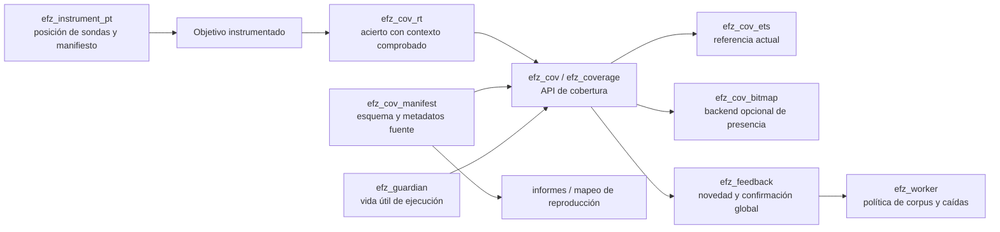

# Backend bitmap para la cobertura de EFZ

[English](../../coverage-bitmap-architecture.md) · [Русский](../ru/coverage-bitmap-architecture.md) · **Español** · [简体中文](../zh-CN/coverage-bitmap-architecture.md) · [Todos los idiomas](../README.md)

Estado: implementación opcional de cobertura automática de presencia en
OTP 27.0. El backend ETS existente sigue siendo predeterminado, referencia
y alternativa para revertir. El [informe de implementación v1](coverage-bitmap-implementation-report.md)
conserva la primera referencia; la reutilización, sellado y mediciones actuales
están en la [continuación v2](coverage-bitmap-v2-results.md).

## 1. Implementación actual, seguida en el código

| Límite | Propietario actual y evidencia |
| --- | --- |
| Selección de instrumentación | [`efz_instrument:compile_target/2`](../../../src/efz_instrument.erl) pasa `{parse_transform, efz_instrument_pt}` a `compile:noenv_file/2`; [`efz_instrument:preflight/1`](../../../src/efz_instrument.erl) carga artefactos seleccionados. |
| Posición de sondas y metadatos | [`efz_instrument_pt:parse_transform/2`, `body/5`, `probe/4`](../../../src/efz_instrument_pt.erl) anteponen un acierto a cuerpos de cláusulas/resultados, numeran sondas desde 1 por compilación de módulo, incrustan un manifiesto y emiten `efz_cov_rt:hit({M,B,Id})`. Patrones y guards no reciben sondas. BuildId es SHA-256 de versión de transformación, versión OTP, MD5 del compilador, formas canónicas y opciones de identidad. |
| Validación de manifiesto | [`efz_cov_manifest:validate/1`, `identities/1`, `prepare/2`](../../../src/efz_cov_manifest.erl) comprueban esquema, IDs locales únicos y ubicaciones estructurales, y preparan identidades exactas permitidas. Un `ProbeId` es **local al módulo**, no globalmente único; la clave de observación es `{Module, BuildId, ProbeId}`. |
| Acierto en ejecución y almacenamiento | [`efz_cov_rt:hit/1`](../../../src/efz_cov_rt.erl) comprueba el contexto esperado; [`efz_coverage:hit/2`](../../../src/efz_coverage.erl) selecciona [`efz_cov_ets:hit/2`](../../../src/efz_cov_ets.erl) o [`efz_cov_bitmap:hit/2`](../../../src/efz_cov_bitmap.erl). La presencia predeterminada usa `ets:insert_new` en una tabla pública nueva; `ets_member` comprueba primero la pertenencia. `hit_count` opcional usa `ets:update_counter/4`; presencia bitmap usa atomics sin signo y CAS. Los primeros aciertos avisan al guardian. [`efz_cov`](../../../src/efz_cov.erl) es la API pública de compatibilidad; `reset_local/0` adjunta un contexto nuevo al llamador, no reinicia globalmente la campaña. |
| Contexto y aislamiento | [`efz_guardian:start/6`, `admit/2`, `cleanup/2`, `finish/2`](../../../src/efz_guardian.erl) poseen tabla y contexto `{efz_context,1,Ref,Storage,Owner}` por ejecución. Raíz e hijos creados con [`efz_target:spawn/1`, `spawn_link/1`](../../../src/efz_target.erl) pasan una barrera de admisión; cada proceso adjunta explícitamente el contexto compartido antes de ejecutar el objetivo. `spawn` ordinario no lo hereda y se considera no controlado. Varios procesos admitidos **pueden escribir la cobertura del mismo caso**. [`efz_cov_integrity:expected/0`, `check/1`](../../../src/efz_cov_integrity.erl) comparan registro PID protegido con diccionario de proceso. |
| Resultado estable | [`efz_executor:invoke/4`, `coverage/3`](../../../src/efz_executor.erl) clasifican el resultado raíz. El guardian cierra la admisión, mata procesos propios y coordinador restantes, espera `DOWN` y barreras de traza, y sella la cobertura bitmap exitosa compacta o captura IDs exactos para compatibilidad/diagnóstico. Si no se confirma la limpieza, marca el runner contaminado; una salida anormal del guardian también lo retira. Es el contrato actual de *descendientes controlados*, no aislamiento de procesos OTP arbitrarios. |
| Comparación y política | [`efz_feedback:evaluate/3`](../../../src/efz_feedback.erl) comprueba mapa de compilaciones, resultado y estado de cobertura. Solo resultados válidos `{ok, _}` combinan sondas con el conjunto exacto de campaña; la calibración también combina cobertura exitosa. Caída/exit/tiempo límite puede llevar cobertura observada, pero no actualiza la global. En `hit_count`, los éxitos también comparan y combinan características de intervalos de recuento. |
| Corpus y artefactos de fallo | [`efz_worker:execute_checked/4`, `execute_result/6`, `retain/2`, `record_failure/4`](../../../src/efz_worker.erl) ejecutan cada semilla o mutación, evalúan feedback, conservan nueva cobertura exitosa (`new_coverage`, `new_probe` o `new_hit_count`) y guardan/deduplican aparte caídas y tiempos límite mediante `efz_crash`. [`efz_corpus:add/2`](../../../src/efz_corpus.erl) posee la inserción al corpus. [`efz_mutation_plan:next/2`](../../../src/efz_mutation_plan.erl) y mutadores consumen entradas del corpus, no una representación de almacenamiento. |

Un caso: el worker selecciona una semilla de calibración o padre de mutación,
obtiene una entrada binaria y llama a `efz_executor:run/4`. El guardian crea
un contexto nuevo, inicia la raíz tras la barrera de admisión y admite hijos
controlados. Una cláusula instrumentada seleccionada ejecuta
`efz_cov_rt:hit({M,B,Id})`; el runtime verifica el contexto esperado del PID y
escribe la identidad exacta en almacenamiento: fila ETS o ranura bitmap única.
Tras retorno, excepción, exit o tiempo límite, el guardian termina la vida de
los escritores y valida código fijado y observación. Resultados heredados y
diagnósticos llevan una lista estable de identidades; el éxito normal de
campaña bitmap lleva mapa sellado y recuento. El worker pasa el resultado a
`efz_feedback` y aplica retención y política de caídas. Una iteración bitmap
confirmada puede reactivar su mapa, propiedad del worker, después del feedback;
una limpieza contaminada lo retira. La cobertura global de campaña es
independiente. Consulte las funciones de la tabla para cada límite.

Las garantías actuales tienen límites: un acierto sin contexto fuera de un
proceso del executor está inactivo; el trabajo arbitrario de fondo o remoto
no se adjunta a esta ejecución. Fallo de hook/contexto, observación no válida,
sonda/compilación inesperada o limpieza no confirmada son fallos de
infraestructura, no observaciones vacías. La campaña actual usa un worker y
serializa las actualizaciones de feedback
([`efz_config:valid_field/2`](../../../src/efz_config.erl) comprueba backends;
[`efz_worker:init/1`](../../../src/efz_worker.erl) crea un estado de feedback).
`coverage_backend` acepta `ets`, `ets_member` y `bitmap`; bitmap requiere
cobertura automática de presencia. Su mapeo se prepara desde manifiestos antes
de la primera ejecución y rechaza capacidad insuficiente.

## 2. Límites previstos e interacción de módulos

Mantenga sin cambios la instrumentación y la identidad literal del acierto.
El hook registra alcanzabilidad; almacenamiento posee el mapa por ejecución;
comparación responde si un punto exacto es nuevo; `efz_feedback` decide si un
resultado puede avanzar la cobertura global; el worker decide retención de
corpus y caídas. Los manifiestos asignan identidades a archivo fuente, línea,
columna, función, tipo y ubicación estructural. El harness llama solo a la
lógica objetivo; no manipula el bitmap ni llama manualmente a hit en modo
automático.

`efz_cov` ya expone open/attach/snapshot/close y funciones de compatibilidad;
`efz_coverage` es el límite de selección. La implementación lo extiende con
`efz_cov_bitmap`; las decisiones siguen en `efz_feedback` y ETS permanece
seleccionable para pruebas diferenciales y reversión. Bitmap conserva
identidades e informes exactos para `presence`. Rechaza
`{coverage_backend => bitmap, coverage_feedback => hit_count}` al configurar;
los backends ETS existentes mantienen `hit_count`. Consulte el
[plan de implementación](plans/coverage-bitmap-implementation-plan.md).

## 3. Contrato de estado y ciclo de vida

| Vida útil | Estado y propietario |
| --- | --- |
| Campaña | Backend seleccionado, esquema fijado de manifiesto/compilación, mapeo identidad-bit sin colisiones, cobertura global y características opcionales de recuento. Un worker posee actualmente feedback y plan preparado; un diseño futuro con varios necesita un propietario serializado de confirmación global. |
| Iteración | Token/contexto único, registro activo de escritores y mapa nuevo o retirado con seguridad. El guardian posee su vida útil. |
| Iteración completada | Observación estable de identidades exactas (o bitmap con esquema versionado explícitamente) y estado de cobertura, disponible solo tras excluir escritores admitidos y confirmar su finalización. |
| Metadatos | Entradas validadas del manifiesto y huella del esquema, independientes de bits mutables, para informes a nivel fuente y comprobaciones de reproducción. |

Ciclo: crear campaña y validar todos los manifiestos → asignar mapeo y estado
global → iniciar iteración con token/mapa nuevos → adjuntar raíz e hijos
admitidos → ejecutar caso → cerrar admisión y detener/esperar todos los
escritores propios → establecer un punto de captura en reposo → validar
observación y compilaciones → comparar cobertura global → confirmar
condicionalmente mediante `efz_feedback` → aplicar política de corpus/caídas
en el worker → liberar o reutilizar de forma segura el estado de iteración.
Reiniciar el mapa nunca debe reiniciar la cobertura global. Ningún mapa puede
borrarse o reasignarse mientras un escritor anterior pueda alcanzarlo.

Caídas y tiempos límite conservan observación válida como evidencia, pero no
la confirman en cobertura global ni corpus exitoso. Los fallos de
infraestructura o cobertura detienen la campaña según la política actual.
Si falla la propia limpieza o puede sobrevivir un escritor, marque el resultado
no confirmado, retire/ponga en cuarentena runner y mapa y no presente una
lectura parcial como instantánea estable. Excepciones en limpieza del objetivo
no deben eludir ese límite; preserve el resultado principal cuando sea posible
y notifique aparte el fallo de limpieza. Una excepción al limpiar el backend
también debe impedir reutilizar el mapa y confirmar cobertura exitosa.

## 4. Semántica y esquema del bitmap

Es **un bit por sonda existente de punto/cláusula/resultado**, no un mapa de
aristas AFL++ ni contador de aciertos. Capacidad inicial: **65.536 bits =
8 KiB de datos útiles**, no 65.536 bytes. Las palabras atomics, tablas de mapeo,
registro y metadatos aumentan la memoria real.

Construya un índice denso determinista para cada identidad completa validada
`{Module, BuildId, ProbeId}` del conjunto fijado de manifiestos. Ordénelas
según un orden canónico documentado de bytes (por ejemplo nombre de módulo
UTF-8, todos los bytes BuildId y ProbeId sin signo), compruebe duplicados y
asigne índices `0..N-1`. Persista o calcule huella de ese mapeo ordenado y
esquema con cualquier cobertura guardada. Use búsqueda directa de identidad
*completa*, nunca `ProbeId rem MapSize`, truncamiento ni hash sin resolver
colisiones. Si `N > capacity`, amplíe el mapa **antes** del inicio cuando esté
configurado, o falle indicando bits necesarios y opción de mayor capacidad.
Nunca fusione puntos silenciosamente. La cobertura manual necesita un esquema
finito definido o un error explícito de modo no admitido al elegir bitmap.

Los módulos instrumentados se seleccionan y cargan antes de construir el mapa.
Cargar un módulo ajeno no amplía el esquema. Añadir/recargar/recompilar un
módulo seleccionado durante ejecución sigue siendo fallo de identidad/integridad.
Entre campañas, reconstruya el mapa con los manifiestos actuales; BuildId o
esquema distintos requieren cobertura nueva o migración explícita verificada.
Un bitmap persistido no puede compararse ni combinarse solo por coincidir en
tamaño. Los **bytes de entrada** del corpus pueden reproducirse en una
compilación nueva y recopilarse otra vez; los **bits de cobertura** antiguos
no deben reutilizarse sin verificar esquema. Mantenga metadatos fuente y
diagnósticos de reproducción ligados a identidades exactas de compilación.

## 5. Almacenamiento mutable, concurrencia e instantáneas

Candidato: array `atomics` de palabras sin signo de 64 bits. OTP 27.0
comprobado expone `compare_exchange/4`, pero no OR atómico. Use un bucle CAS
de reintentos, con ranura `I` desde cero, índice de palabra desde uno
`I div 64 + 1` y máscara `1 bsl (I rem 64)`. Verifique límites y coste medido
de memoria al implementar. No reconstruya un binario inmutable en cada
acierto. Una secuencia simple `read → OR → write` pierde bits vecinos cuando
dos procesos admitidos comparten palabra. Demuestre la corrección del bucle
CAS y mida su coste con contención. Ninguna operación puede perder
silenciosamente un acierto.

El worker posee la asignación reutilizable; el guardian posee contexto activo
y token. Los PID admitidos lo reciben mediante la barrera y protocolo de
adjunción existentes. El hook comprueba token activo/pertenencia del PID
antes de escribir. Esto por sí solo no detiene a un escritor que supera la
comprobación justo antes del cierre y escribe después. Un acierto tardío solo
puede alcanzar su mapa antiguo exclusivo; nunca una ejecución posterior ni
convertir en válida una captura no confirmada. La instantánea es estable solo
tras cerrar admisión, terminar todos los escritores admitidos o bloquearlos
con un protocolo demostrado de épocas, y vaciar eventos pendientes de error/
evidencia. `read+reset` no es atómico por sí mismo. V1 asigna un mapa nuevo.
V2 borra completamente y reactiva solo tras limpieza confirmada del guardian
y feedback completado; un mapa no confirmado se retira con el runner
contaminado. Esto evita la carrera de comprobar y escribir para un escritor
antiguo. La política worker/feedback posee cobertura global; almacenamiento
puede ofrecer primitivas de unión/diferencia, pero no confirmar bits globales
en caídas, tiempos límite o resultados no válidos. Si el global se vuelve
mutable o hay varios workers, serialice comparación y confirmación como una
operación de política para evitar decisiones duplicadas de novedad.

## 6. Trabajo aplazado, preguntas y aceptación

Aplazados: parches BEAM/ERTS, acceso DWARF, NIF, cobertura nativa OTP y cualquier
afirmación de que esta tiene los mismos puntos estructurales. La recopilación
nativa OTP es otra línea de investigación. No se afirma aceleración bitmap
antes de mediciones reproducibles.

Las decisiones iniciales están en el
[plan de implementación](plans/coverage-bitmap-implementation-plan.md): atomics
sin signo con CAS, bitmap solo de presencia, capacidad explícita configurada y
fallo por desbordamiento, mapas nuevos por ejecución y rechazo de bitmap con
cobertura manual o hit-count. La prueba acotada debe confirmar comportamiento
CAS y memoria en OTP admitido. Un futuro formato de cobertura persistida o
migración de esquema necesita su propio diseño versionado.

Criterios verificables de implementación:

* Reproduzca fixtures instrumentados y entradas idénticos mediante ETS y
  bitmap; compare identidades exactas por ejecución, novedad, cobertura global,
  decisiones, informes fuente y observaciones vacías válidas. Incluya casos de
  cláusulas/resultados, varios módulos/compilaciones, caídas, exits, tiempos
  límite y calibración.
* Demuestre que el mapeo es inyectivo para cada identidad; rechace esquemas
  duplicados, desconocidos o que excedan capacidad con errores explícitos.
  Pruebe diferencias por recompilación/recarga y reproducción de entradas del
  corpus con cobertura nueva.
* Someta a carga escritores simultáneos que fijan distintos bits de una
  palabra y aciertos repetidos del mismo bit. Cada bit esperado debe
  conservarse; fuerce escritores tardíos y limpieza fallida para verificar
  aislamiento de iteraciones y no reutilización de mapas.
* Preserve clasificación existente de caídas/tiempos límite, fallos de
  infraestructura, retención de corpus y comportamiento hit-count (o rechazo
  documentado de configuración). Confirme que cobertura solo de caídas no
  entra en el estado global.
* Publique comandos repetibles de benchmark, detalles OTP/ERTS y hardware,
  número/densidad de sondas, procesos, contención, asignación y mediciones de
  memoria, resultados originales, calentamiento y repeticiones. Compare
  aciertos, captura/reset y rendimiento total de casos frente a ETS antes de
  afirmar ventajas de velocidad o memoria.
