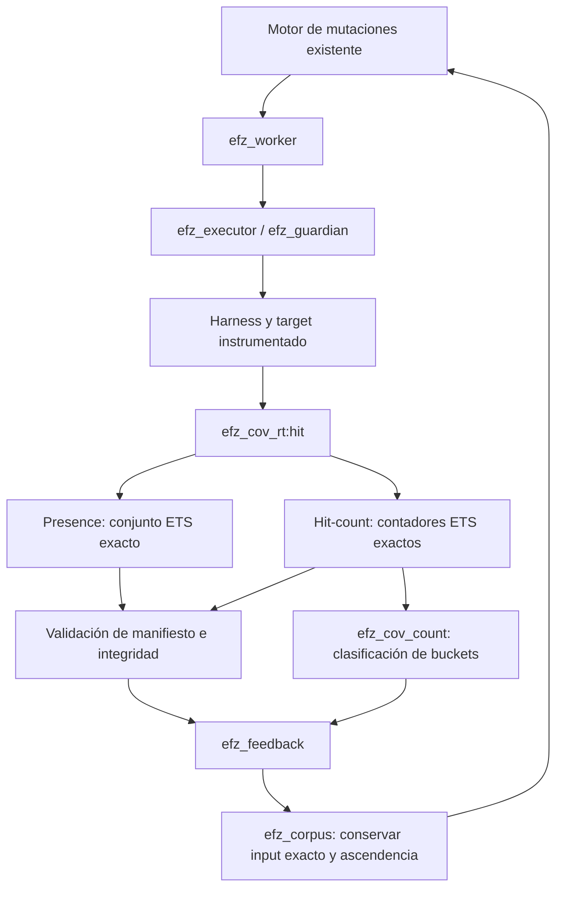

# EFZ: feedback experimental de hit-count

[English](../../hit-count-experiment.md) · [Русский](../ru/hit-count-experiment.md) · **Español** · [简体中文](../zh-CN/hit-count-experiment.md) · [Todos los idiomas](../README.md)

Fecha: 15 de septiembre de 2026. Baseline: `205e18ba172d74bd6c652a68abfc73e02e4a1f86`.
El prototipo amplía la implementación de probe-set exacto; `presence` sigue
predeterminado. Abajo se dan medidas raw y comandos. Es un experimento local
con tres objetivos sintéticos pequeños, no prueba de eficacia en Erlang/OTP.

## Conclusión

**RESULTADO B — hit-count beneficia a ciertos objetivos y debe seguir opt-in.**

Con 3000 mutation executions por campaña y tres seeds RNG por target,
hit-count alcanzó la rama profunda en 7 de 9 campañas; presence en 0
de 9. El corpus creció 2–3.5 veces en comparación principal (hasta 4.5 en
experimento aparte de saturación de buckets). En bucle largo fijo, el tiempo total executor
subió ~7–8%; en ejecuciones cortas dominan los checks lifecycle/integridad
existentes. No demuestra bugs reales nuevos:
los tres targets devuelven `deep` y unique crashes es cero.

Siguiente paso práctico: campañas emparejadas en parser real con
estados profundos conocidos, varios presupuestos y más seeds. Aún no hay base
para sustituir presence default ni introducir bitmap denso.

## Contrato y ruta runtime

```erlang
#{coverage_feedback => presence}  % default
#{coverage_feedback => hit_count} % opt-in prototype
```

CLI: añadir `--coverage-feedback hit_count` al comando existente
`scripts/fuzz.escript`. Config/CLI rechazan modos desconocidos.
`coverage_backend` admite aún `ets`/`ets_member`, variantes del presence-hook;
en hit-count ambos usan el mismo contador ETS exacto.



Identidad pública intacta: `{Module, BuildId, ProbeId}`. Es un punto
clause/outcome fuente, no arista CFG. No hay `hash(Id) rem MAP_SIZE`, slot
bitmap numérico, alias por colisión ni hashing de contexto de llamada.

| Estado | Presence | Hit-count | Dueño/vida útil |
|---|---|---|---|
| Objeto ETS por input | `{{probe, Id}}` | `{{probe, Id}, Count}` | Guardian; tabla nueva por ejecución |
| Campo backend del contexto | ETS tid / `{ets_member,Tid}` | `{ets_count,Tid}` | Raíz y descendientes admitidos |
| Resultado `coverage` | Identidades exactas ordenadas | Misma proyección de claves | Snapshot tras terminar todos los escritores admitidos |
| Resultado adicional | Ninguno | `hit_counts`, `count_features`, `coverage_feedback` | Terms normales de resultado |
| Sondas globales | `feedback.global` | Mismo conjunto | Worker, una campaña |
| Features globales de count | Ninguna | `feedback.global_features` | Worker, una campaña |

`efz_cov_rt:hit/1` conserva check de contexto por registro independiente.
Hit-count llama `ets:update_counter(T,{probe,Id},{2,1},{{probe,Id},0})`.
Primer hit envía aviso guardian existente; cada posterior
incrementa atómicamente el entero. Se comprobó ausencia de wrap 64-bit en ETS:
`2^63−1` pasa a `2^63`. No es contador AFL de 8 bits.

`efz_guardian` conserva tabla, compuertas, monitores y cleanup.
`efz_executor:coverage/3` valida proyección exacta contra plan
manifest existente. `efz_cov_count:snapshot/1` valida formas de filas y contadores
enteros positivos; `features/2` exige igualdad exacta claves/count y
`coverage`. Tabla/contexto roto o contadores ausentes/inválidos son
infraestructura, no observaciones vacías correctas. Vacíos `coverage=[]`,
`hit_counts=#{}` con contexto intacto son válidos.

Tras cleanup confirmado se borra tabla; siguiente run tiene
ref y ETS nuevos. Hijos controlados comparten tabla vía
`efz_target:spawn/1`; updates concurrentes se suman. Crash/timeout raíz no
borra tabla del dueño antes de snapshot. La política caller/guardian/dirty-runner
no cambia. OTP asíncrono arbitrario sigue fuera del modelo.

Es contrato de corrección para harness cooperativo. ETS público no es
frontera de seguridad: escribir directamente otro count **positivo**
no se distingue de valor legítimo. Guardian atestigua presencia de forma independiente
sin duplicar cada hit en segundo contador.
Targets no deben modificar filas EFZ.

## Buckets y novedad

| Count | Etiqueta pública bucket |
|---|---:|
| 1 | 1 |
| 2–3 | 2 |
| 4–7 | 4 |
| 8–15 | 8 |
| 16–31 | 16 |
| 32–63 | 32 |
| 64–127 | 64 |
| 128+ | 128 |

La etiqueta es límite inferior inclusivo. Feature: `{ProbeIdentity, Bucket}`.
Cero hits no crea feature. Son los buckets pedidos; el contador guarda
multiplicidad exacta, así 256/1000/100000 no pasan a cero por wrap de byte.

En [efz_feedback](../../../src/efz_feedback.erl), para ejecución correcta:

```text
NewProbes   = CurrentProbes   − GlobalProbes
NewFeatures = CurrentFeatures − GlobalFeatures   # hit_count only
GlobalProbes   := GlobalProbes   ∪ CurrentProbes
GlobalFeatures := GlobalFeatures ∪ CurrentFeatures
```

| Ejecución X | Sondas nuevas | Features nuevas | Retención hit-count |
|---|---|---|---|
| X×1 | X | `{X,1}` | `new_probe` |
| X×2 | vacío | `{X,2}` | `new_hit_count` |
| X×3 | vacío | vacío | `equivalent_coverage`, no conservar |
| X×4 | vacío | `{X,4}` | `new_hit_count` |

Si aparecen sonda y bucket nuevos juntos, razón `new_probe`; ambos
deltas están en metadatos. Presence default conserva razón
`new_coverage` previa. Calibration actualiza ambos historiales conservando
`seed_calibration`. Crash/timeout no cambian global; infraestructura
detiene. Worker solo acepta nuevo estado feedback tras
retención/storage correcta.

Combinar features count ya conocidas no es novedad. No se usan hash del conjunto,
firma de ruta ni count máximo para retención.

## Elección de representación tras medir

Se investigaron cinco variantes en el [benchmark de storage](../../../bench/efz_hit_count_micro.erl):

1. Baseline ETS set con `insert_new`.
2. ETS counter sparse con `update_counter/4`.
3. Identity→slot ETS preparado sin colisiones + `counters` `[atomics]`.
4. Mismo mapping + `counters` `[write_concurrency]`.
5. Mismo mapping + `atomics`.

Lookup denso se incluye por hit; no se sustituyó coste hook
por acceso solo a slot. Identity→slot enumera identidades tipo manifiesto
sin hashing. La asignación mapping se mide aparte en setup/memoria.
Una integración densa real podría preparar una vez por campaña;
el setup frío aquí no debe interpretarse como coste obligatorio por input.

| Representación | Lookup/update | Reset/snapshot | Concurrencia | Integración |
|---|---|---|---|---|
| ETS set | Clave exacta, insert-once | Recorrido/borrado sparse | Insert atómico | Baseline |
| ETS counter | Clave exacta, incremento atómico | Recorrido/borrado sparse | Incrementos enteros atómicos | Conserva propiedad/lifecycle ETS |
| Dense counters/atomics | Lookup exacto + índice numérico | Recorrido/reset de todos slots en prototipo | Contadores atómicos; ajustes con distintas garantías | Requiere mapping, refs lifetime, integridad/touched-slot |

OTP `counters` y `atomics` almacenan 64 bits y permiten wrap;
`write_concurrency` cambia garantías de lectura con escrituras concurrentes. Snapshot
tras terminar escritores evita ese solapamiento, pero no
soluciona overflow. La vida de refs depende de alcanzabilidad, no de
propiedad ETS. [OTP counters](https://www.erlang.org/docs/27/apps/erts/counters.html),
[OTP atomics](https://www.erlang.org/docs/27/apps/erts/atomics.html),
[OTP ETS update_counter](https://www.erlang.org/docs/27/apps/stdlib/ets.html#update_counter/4).

### Microbenchmark de almacenamiento

Entorno: OTP 27.0 / ERTS 15.0, Linux x86_64, Intel Core i7-1260P, `+S 4:4`.
Cinco repeticiones tras warmup descartado, orden alterno. Sin CPU pinning;
pueden variar frecuencias. Identidades sintéticas con mismo formato completo,
pero es **solo storage**, sin guardian/integrity hook overhead.

Mediana ns/hit; `once` significa cada una de N sondas una vez:

| N | ETS set | ETS counter | counters atomics | counters write_concurrency | atomics |
|---:|---:|---:|---:|---:|---:|
| 100 | 220 | 280 | 127 | 127 | 118 |
| 1000 | 257 | 314 | 133 | 133 | 125 |
| 10000 | 312 | 379 | 143 | 144 | 137 |
| 100000 | 469 | 595 | 196 | 222 | 187 |

Mediana ns/hit; `repeated` significa 10 sondas ×1000 hits en espacio N:

| N | ETS set | ETS counter | counters atomics | counters write_concurrency | atomics |
|---:|---:|---:|---:|---:|---:|
| 100 | 104 | 124 | 119 | 117 | 111 |
| 1000 | 105 | 128 | 117 | 120 | 113 |
| 10000 | 107 | 148 | 117 | 116 | 110 |
| 100000 | 123 | 147 | 125 | 137 | 113 |

Con N=100000 y 10 sondas observadas, snapshot ETS-counter tardó 18 µs y dense
atomics 38858 µs; reset 6 y 3578 µs. Con cada sonda una vez,
dense atomics actualiza mucho más rápido, pero snapshot tarda 257419 µs frente a
192916 µs ETS counter. Cuatro escritores concurrentes dieron exactamente 40000
hits en cada variante counter; comprueba atomicidad, no benchmark
multiworker EFZ. Una campaña permite solo un worker.

Memoria y ciclo completo frío storage con N=100000:

| Variante | Bytes, todas las sondas | Bytes, solo 10 sondas | Bytes adicionales mapping | Total once, ms | Total repeated, ms |
|---|---:|---:|---:|---:|---:|
| ETS set | 16007352 | 3960 | 0 | 275,46 | 1,25 |
| ETS counter | 16807352 | 4040 | 0 | 276,81 | 1,51 |
| dense counters atomics | 800040 | 800040 | 14407352 | 368,86 | 156,86 |
| dense counters write_concurrency | 4000032 | 4000032 | 14407352 | 361,04 | 156,54 |
| dense atomics | 800040 | 800040 | 14407352 | 341,90 | 111,12 |

Los totales incluyen setup, hits, snapshot, reset y close. Setup de mapping puede
amortizarse aparte: ~37–48 ms; no elimina recorridos completos
snapshot/reset. Storage denso es compacto, pero mapping exacto de este
prototipo es bastante mayor que array. No afirma layout
óptimo; muestra coste de una variante concreta funcional.

Raw samples contienen `setup_ns`, `hit_ns`, `snapshot_ns`, `reset_ns`, `close_ns`,
`total_ns`, `storage_bytes`, `mapping_bytes`. Memoria es bytes storage/mapping,
**no pico VM completo**. `total_ns` es lifecycle frío de storage, no ejecución
completa del target. Batches de 100 sondas son sensibles a reloj/GC.
`close_ns` denso mide borrar mapping ETS; recuperación posterior por GC
de refs counters/atomics no se midió aparte ni se incluyó.

El prototipo mínimo productivo usa **ETS counter sparse**: admite
propiedad previa, claves exactas, snapshot sparse y limpieza. Counters densos
sin touched-slot tracking cuestan demasiado en espacio sparse grande. Se conservan las cinco
implementaciones de benchmark para comparar después.

### Executor completo con inputs fijos

Target repeat instrumentado normal; mismo input en ambos modos.
El timer incluye creación de contexto, hooks, validación, snapshots, cleanup y
DOWN. Warmup, cinco pares, 200 ejecuciones/sample para 1/1000 repeticiones y
10 para 100000. Es control de overhead separado sin cambiar corpus/scheduling.

| Repeticiones | Presence, µs/input | Hit-count, µs/input | Cambio |
|---:|---:|---:|---:|
| 1 | 4927,6 | 4910,1 | −0,4%, ruido |
| 1000 | 5679,0 | 6092,3 | +7,3% |
| 100000 | 50367,3 | 54426,7 | +8,1% |

## Comparación controlada de fuzzing

Tres targets de fuentes normales con instrumentación automática y sin hooks manuales.
El adaptador benchmark solo informa externamente timestamp del resultado
`deep`; no elige inputs/padres ni sustituye mutator.

| Target | Semántica | Rama profunda |
|---|---|---|
| [repeat](../../../fixtures/hit_count/efz_count_repeat.erl) | Prefijo de bytes `A` idénticos | ≥16 repeticiones |
| [records](../../../fixtures/hit_count/efz_count_records.erl) | Parser de registros completos tipo TLV `1,1,Payload` | ≥8 registros |
| [machine](../../../fixtures/hit_count/efz_count_machine.erl) | Transiciones tick/ack `TA`, después commit `C` | ≥8 pares antes de commit |

Cada par recibe mismos seeds iniciales, los tres seeds RNG, timeout=1000,
max_input_bytes=128, max_iterations=3000 y configuración staged:
`stages=[dictionary_insert,havoc]`, `havoc_depth=1`, `max_block_bytes=32`.
Diccionario contiene un token byte/registro/transición respectivamente, no
inputs profundos ya listos. Rondas RNG: mutation/random `{17*R,23,41}`, selection
`{101,109*R,113}`, R=1..3. Configs completas se guardan; driver
comprueba igualdad retirando solo `coverage_feedback`.

Al crecer corpus, las secuencias siguientes divergen naturalmente: prueba
calidad de feedback, no secuencia fija artificial.
No se usa mutator scripted ni motor nuevo.

| Target/modo | Sondas finales (R1/R2/R3) | Descubrimientos | Corpus | Count-only | Éxitos deep | Mediana exec/s |
|---|---|---|---|---|---:|---:|
| repeat / presence | 4/4/4 | 1/1/1 | 2/2/2 | 0/0/0 | 0/3 | 193,1 |
| repeat / hit_count | 5/5/5 | 6/6/6 | 7/7/7 | 4/4/4 | 3/3 | 190,9 |
| records / presence | 4/4/4 | 1/1/1 | 2/2/2 | 0/0/0 | 0/3 | 191,1 |
| records / hit_count | 4/4/5 | 3/3/5 | 4/4/6 | 2/2/3 | 1/3 | 191,7 |
| machine / presence | 5/5/5 | 2/2/2 | 3/3/3 | 0/0/0 | 0/3 | 194,6 |
| machine / hit_count | 6/6/6 | 6/8/7 | 7/9/8 | 3/5/4 | 3/3 | 183,6 |

Primer deep en hit-count:

| Target | Índice mutación R1/R2/R3 | Segundos desde inicio de fase |
|---|---|---|
| repeat | 2225 / 282 / 448 | 11,783 / 1,427 / 2,294 |
| records | no alcanzado / no alcanzado / 1645 | — / — / 8,671 |
| machine | 1319 / 1492 / 2298 | 7,439 / 8,713 / 10,501 |

Las 18 campañas ejecutaron 3000 mutaciones cada una, infrastructure failures=0
y unique crashes=0. Throughput incluye distribuciones distintas,
corpus mayor y trabajo scheduler; no es coste aislado del
contador. Para ello sirve el executor con input congelado anterior.

### Control negativo: mutación aleatoria

Seis campañas más con igual budget=3000, seeds iniciales y estados RNG
fijos usaron `efz_mutator_random` existente. Sin diccionario: este
mutator no lo admite. Los modos coincidieron en coverage/discoveries/corpus;
ninguno alcanzó deep:

| Target | Sondas finales, ambos modos | Descubrimientos | Corpus | Count-only | Presence / hit-count exec/s |
|---|---:|---:|---:|---:|---:|
| repeat | 3 | 0 | 1 | 0 | 192,2 / 194,4 |
| records | 3 | 0 | 1 | 0 | 193,5 / 194,6 |
| machine | 4 | 1 | 2 | 0 | 194,1 / 205,2 |

El random mutator tiene flip/overwrite/insert/delete, no dictionary/duplicate.
Con primary vacío siempre crea `<<0>>`. Sin contenido inicial apropiado,
feedback no crea por sí solo input útil. Limita considerablemente
la generalización de resultados positivos staged.

### Bucles grandes y saturación del corpus

Una campaña staged real adicional insertó tokens
`L1,L2,L4,L8,L16,L32,L64,L128,L1000,L100000,L1000000` y llamó una
sonda automática el número correspondiente de veces. Trace
confirmó que `L1000000` se generó y ejecutó en ambos modos.

| Modo | Ejecuciones | Estado | Sondas | Corpus | Count-only | Features globales bucket |
|---|---:|---|---:|---:|---:|---:|
| presence | 38 | agotamiento determinista de mutaciones | 1 | 2 | 0 | — |
| hit_count | 256 | presupuesto configurado | 1 | 9 | 7 | 8 |

Presence agotó antes el espacio dictionary-only por corpus
menor. Comprueba saturación/retención; **no compara throughput
con igual número de ejecuciones**. La tabla principal de calidad/rendimiento
sí tiene budgets iguales. Counts 1000/100000/1000000 no retuvieron
inputs adicionales tras bucket 128.

## Corpus, compatibilidad y limitaciones

Un input nuevo solo por bucket sigue `efz_worker:retain` →
`efz_corpus:add` → `mutation_entries/select`. Metadata contiene ambos deltas y
razón exacta. SHA-256 dedup, ID padre entero, primary bytes/hash y receta EFZR
no cambian. El modo no forma parte del hash mutation-config ni
cambia operaciones.

Cadena real de `repeat / hit_count / round 1`:

| ID | Input | ID padre | Retención |
|---:|---|---:|---|
| 1 | `<<>>` | — | inicial |
| 2 | `A` | 1 | `new_probe` |
| 3 | `AA` | 2 | `new_hit_count` |
| 4 | `AAAA` | 3 | `new_hit_count` |
| 5 | `AAAAAAAA` | 4 | `new_hit_count` |
| 6 | `AAAAAAAAAAAAAAAA` | 5 | `new_probe`, rama deep |
| 7 | 32 × `A` | 6 | `new_hit_count` |

En regresión, `L2` recibió ID 5, `parent=1`, `new_probes=[]` y
`new_count_features=[{{efz_count_sites,Build,1},2}]`. Una receta real siguiente
tiene `parent=5`, `primary=<<"L2">>`, `primary_id=SHA256(<<"L2">>)`,
`operations=[{dictionary_insert,0,<<"L1">>}]` y reconstruye `<<"L1L2">>`.
Ese input no necesita ser interesante: demuestra específicamente
reutilización del scheduler. La ascendencia útil count multietapa está en la tabla.
Los queue IDs se reasignan en VM nueva; restore test busca padre por contenido.

Durable store guarda discoveries count en record schema 2; initial/presence
siguen schema 1. EFZC envelope sigue versión 1. Records viejos son
legibles; EFZ antiguo rechaza v2. Raw inputs pueden pasar entre modos
recalibrados; historial global buckets y cursors no se restauran.
Detalles: [contrato corpus](corpus.md).

Crash input/recipe siguen siendo bytes/provenance autoritativos; replay usa
mismos checks build/harness. Default replay comprueba outcome, no novedad count:
requeriría historial de una campaña concreta. Schemas identity/manifest/
recipe intactas. Count no evita guardian ni input
limits ni añade campañas paralelas ni limpia estado global arbitrario.

En build fijo cada sonda tiene ocho features bucket posibles. Después de la
primera observación quedan máximo siete oportunidades count-only por sonda.
Por tanto, retenciones count-only acotadas por `7 * number of probes`
(en práctica menos por calibration, varias features/input y content
dedup). Combinaciones no multiplican espacio. No limita
corpus total inicial/restaurado ni garantiza recetas pequeñas con inputs grandes.

Opt-in, buckets y dedup ya funcionan. Sin caps duros/power schedules
nuevos: estos targets tienen corpus pequeño. En manifests mayores medir
bytes retenidos/recetas por separado antes de escoger cap count-only
o prioridad menor. Dense mapping/touched slots puede optimizar
tras perfilar, no es requisito de semántica nueva.

## Reproducción y evidencia

Desde raíz `efz/`, secuencialmente, sin tests/benchmarks concurrentes:

```sh
ERL_FLAGS='+S 4:4' rebar3 compile
escript bench/hit_count.escript micro _build/hit-count-experiment
escript bench/hit_count.escript executor _build/hit-count-experiment
escript bench/hit_count.escript campaign _build/hit-count-experiment
escript bench/hit_count.escript stress _build/hit-count-experiment
escript bench/hit_count.escript large_loops _build/hit-count-experiment
escript bench/hit_count.escript report _build/hit-count-experiment

ERL_FLAGS='+S 4:4' rebar3 eunit
ERL_FLAGS='+S 4:4' rebar3 ct
ERL_FLAGS='+S 4:4' rebar3 xref
ERL_FLAGS='+S 4:4' rebar3 dialyzer
```

Informes/recetas completos y logs permanecen en `_build/hit-count-experiment`.
Archivo compacto de todos samples: [hit-count-samples.json](../../performance/hit-count-samples.json).
Tuples Erlang son arrays JSON, binaries objetos `{hex: ...}`;
`features` en filas de campaña es recuento; los ID exactos están en coverage.

Suite: [efz_hit_count_tests](../../../test/efz_hit_count_tests.erl), con
adiciones a CLI, integrity y corpus-store tests. Comprueba cada frontera
bucket, presence ×1/×1000, multi-probe deltas, build namespaces, child hits
concurrentes, crash/timeout snapshots, counts/context corruptos, config default/inválida,
retención staged real y parent reuse, durable restore/recalibration en
VM nueva, raw+recipe crash replay y build/harness mismatch.

Validación final real:

| Comando con `ERL_FLAGS='+S 4:4'` | Resultado |
|---|---|
| `rebar3 compile` | PASS |
| `rebar3 eunit` | PASS, 199 tests |
| `rebar3 ct` | PASS, 3 tests |
| `rebar3 xref` | PASS |
| `rebar3 dialyzer` | PASS |

Primeros EUnit fallidos: test previo con 5376 ejecuciones protegidas
superó `efz:await(25000)` (el smoke siguiente tuvo 0 ejecuciones);
en segundo intento timeout EUnit default de 5 segundos canceló grupo de
ocho campañas. Se conservaron assertions funcionales: espera del primer test
subió a 60 s (externa 75 s), segundo a 30 s. Target timeout y
mutation budget no cambiaron. EUnit completo final pasó sin
fallos/cancelaciones; exhaustion tardó 33.621 s y confirmó exactamente
5120 mutation executions. Se conservaron logs de fallo y ambos intentos
sin reemplazarlos por éxito en provenance archive.
Logs completos: `_build/hit-count-experiment/`.
