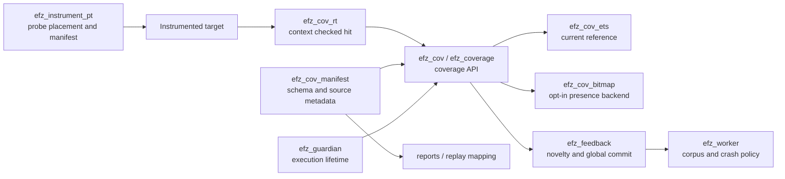

# Bitmap backend для покрытия EFZ

[English](../../coverage-bitmap-architecture.md) · **Русский** · [Español](../es/coverage-bitmap-architecture.md) · [简体中文](../zh-CN/coverage-bitmap-architecture.md) · [Все языки](../README.md)

Статус: opt-in реализация automatic presence coverage на OTP 27.0.
Существующий ETS backend остаётся default, reference и rollback path.
[Отчёт реализации v1](coverage-bitmap-implementation-report.md) сохраняет первый
baseline; текущие reuse, seal и измерения описаны в
[продолжении v2](coverage-bitmap-v2-results.md).

## 1. Текущая реализация, прослеженная по коду

| Граница | Текущий владелец и evidence |
| --- | --- |
| Выбор инструментирования | [`efz_instrument:compile_target/2`](../../../src/efz_instrument.erl) передаёт `{parse_transform, efz_instrument_pt}` в `compile:noenv_file/2`; [`efz_instrument:preflight/1`](../../../src/efz_instrument.erl) загружает выбранные artifacts. |
| Размещение probes и metadata | [`efz_instrument_pt:parse_transform/2`, `body/5`, `probe/4`](../../../src/efz_instrument_pt.erl) добавляют hit в начало clause/outcome bodies, нумеруют probes от 1 на каждую компиляцию модуля, встраивают manifest и выдают `efz_cov_rt:hit({M,B,Id})`. Patterns и guards не получают probes. BuildId — SHA-256 от версии transform, OTP release, compiler MD5, canonical forms и identity options. |
| Проверка manifest | [`efz_cov_manifest:validate/1`, `identities/1`, `prepare/2`](../../../src/efz_cov_manifest.erl) проверяют schema, уникальные module-local IDs и structural locations, подготавливают допустимые exact identities. `ProbeId` **локален для модуля**, а не глобально уникален; observation key — `{Module, BuildId, ProbeId}`. |
| Runtime hit и хранилище execution | [`efz_cov_rt:hit/1`](../../../src/efz_cov_rt.erl) проверяет ожидаемый context, затем [`efz_coverage:hit/2`](../../../src/efz_coverage.erl) диспетчеризует в [`efz_cov_ets:hit/2`](../../../src/efz_cov_ets.erl) или [`efz_cov_bitmap:hit/2`](../../../src/efz_cov_bitmap.erl). Default presence mode использует `ets:insert_new` в новой public table; `ets_member` сначала проверяет membership. Opt-in `hit_count` использует `ets:update_counter/4`; bitmap presence — unsigned atomics и CAS. Первые hits уведомляют guardian. [`efz_cov`](../../../src/efz_cov.erl) — публичный compatibility API; `reset_local/0` подключает новый context в вызывающем процессе, а не сбрасывает всю кампанию. |
| Context и изоляция | [`efz_guardian:start/6`, `admit/2`, `cleanup/2`, `finish/2`](../../../src/efz_guardian.erl) владеют table и context `{efz_context,1,Ref,Storage,Owner}` для одного execution. Root и children, созданные через [`efz_target:spawn/1`, `spawn_link/1`](../../../src/efz_target.erl), проходят admission gate; каждый процесс явно подключает общий context до начала target code. Обычный `spawn` его не наследует и считается uncontrolled. Несколько admitted processes **могут писать coverage одного testcase**. [`efz_cov_integrity:expected/0`, `check/1`](../../../src/efz_cov_integrity.erl) сравнивают защищённый PID registry с process dictionary. |
| Стабильный результат | [`efz_executor:invoke/4`, `coverage/3`](../../../src/efz_executor.erl) классифицируют root result. Guardian прекращает admission, убивает оставшиеся owned processes и coordinator, ждёт `DOWN` и trace barriers, затем запечатывает compact successful bitmap coverage или делает exact snapshot для legacy/diagnostics. Если cleanup нельзя подтвердить, runner помечается dirty; abnormal guardian exit также выводит его из использования. Это текущий контракт *controlled descendant*, а не изоляция произвольных OTP processes. |
| Сравнение и политика | [`efz_feedback:evaluate/3`](../../../src/efz_feedback.erl) проверяет build map, outcome и coverage status. Только корректные outcomes `{ok, _}` объединяют observed probes с exact set кампании; калибровка также объединяет успешное coverage. Crash/exit/timeout может нести observed coverage в результате, но не обновляет global coverage. В `hit_count` mode успешные results также сравнивают и объединяют count-bucket features. |
| Корпус и failure artifacts | [`efz_worker:execute_checked/4`, `execute_result/6`, `retain/2`, `record_failure/4`](../../../src/efz_worker.erl) исполняют каждый seed или mutation, вычисляют feedback, сохраняют успешное новое coverage (`new_coverage`, `new_probe` или `new_hit_count`), отдельно сохраняют/дедуплицируют crashes и timeouts через `efz_crash`. [`efz_corpus:add/2`](../../../src/efz_corpus.erl) владеет добавлением в корпус. [`efz_mutation_plan:next/2`](../../../src/efz_mutation_plan.erl) и mutators потребляют corpus inputs, а не представление хранилища. |

Один testcase: worker выбирает calibration seed или mutation parent, получает
binary input и вызывает `efz_executor:run/4`. Guardian создаёт новый context,
запускает root за admission gate и допускает controlled children. Выбранная
инструментированная clause исполняет `efz_cov_rt:hit({M,B,Id})`; runtime проверяет,
что у этого PID ожидаемый context, и записывает exact identity в execution
storage: ETS row или уникальный bitmap slot. После target return, exception,
exit или timeout guardian завершает время жизни writers и проверяет pinned code
и observation. Legacy и diagnostic results несут стабильный список identities;
обычный bitmap campaign success вместо него несёт sealed map и count. Worker
передаёт результат в `efz_feedback`, затем применяет retention и crash policy.
Подтверждённая bitmap iteration может повторно активировать worker-owned map
после завершения feedback; dirty cleanup выводит его из использования. Global
coverage кампании независимо. Функции каждой границы указаны в таблице.

У текущих гарантий есть границы: unattached hit вне executor-owned process
неактивен; произвольная фоновая или remote работа не подключена к этому execution.
Hook/context failure, invalid observation, неожиданный probe/build или
неподтверждённый cleanup — infrastructure failure, а не пустое observation.
Текущая кампания использует один worker и сериализует feedback updates
([`efz_config:valid_field/2`](../../../src/efz_config.erl) проверяет backend values;
[`efz_worker:init/1`](../../../src/efz_worker.erl) создаёт одно feedback state).
`coverage_backend` принимает `ets`, `ets_member` и `bitmap`; bitmap требует
automatic presence coverage. Его mapping подготавливается из manifests до
первого execution и отклоняет недостаточную capacity.

## 2. Границы target и взаимодействия модулей

Сохранить instrumentation и literal hit identity неизменными. Runtime hook
регистрирует достижимость; storage владеет execution map; comparison отвечает,
новая ли exact point; `efz_feedback` решает, может ли outcome продвинуть global
coverage; worker решает, что сохранять в корпус и crash artifacts. Manifests
отображают identities в source file, line, column, function, kind и structural
location. Harness вызывает только свою target logic; он не манипулирует bitmap
и не вызывает hit вручную в automatic mode.

`efz_cov` уже предоставляет open/attach/snapshot/close и compatibility functions,
а `efz_coverage` — dispatch boundary. Реализация расширяет эту границу через
`efz_cov_bitmap`; feedback decisions остаются в `efz_feedback`, ETS доступен для
differential tests и rollback. Bitmap сохраняет exact identities и reports для
`presence`. Он отклоняет
`{coverage_backend => bitmap, coverage_feedback => hit_count}`
при конфигурации; существующие ETS backends сохраняют поведение `hit_count`.
См. [план реализации](plans/coverage-bitmap-implementation-plan.md).

## 3. Контракт состояния и lifecycle

| Время жизни | Состояние и владелец |
| --- | --- |
| Кампания | Выбранный backend, pinned manifest/build schema, collision-free mapping identity-to-bit, global coverage и optional count features. Сейчас один worker владеет feedback и prepared plan; будущий multi-worker design требует одного сериализованного владельца global commit. |
| Итерация | Уникальный execution token/context, реестр активных writers и новая или безопасно выведенная из прошлого использования execution map. Guardian владеет её lifecycle. |
| Завершённая итерация | Стабильное observation exact identities (или явно versioned bitmap плюс schema) и coverage status, доступные лишь после исключения admitted writers и подтверждения их завершения. |
| Metadata | Проверенные manifest entries и schema fingerprint, независимые от изменяемых map bits, для source-level reporting и replay checks. |

Lifecycle: создать кампанию и проверить все выбранные manifests → выделить
mapping и global state → начать iteration с новым token/map → подключить root
и admitted children → выполнить testcase → закрыть admission и остановить/
дождаться всех owned writers → установить quiescent snapshot boundary → проверить
observation и builds → сравнить с global coverage → условно выполнить commit
через `efz_feedback` → применить corpus/crash policy в worker → освободить или
безопасно повторно использовать iteration state. Сброс execution map никогда
не должен сбрасывать global coverage. Нельзя очищать или переназначать map, пока
предыдущий writer ещё может к нему обратиться.

Crash и timeout сохраняют корректное execution observation как evidence, но не
commit-ят его в global coverage или success corpus. Infrastructure или coverage
failures останавливают кампанию согласно текущей политике. Если сам cleanup
падает или writer может выжить, пометить result unconfirmed, вывести из работы/
карантинировать runner и map и не представлять частичное чтение как стабильный
snapshot. Исключения в target cleanup не должны обходить эту границу; по
возможности сохранить primary outcome и отдельно сообщить cleanup failure.
Исключение в backend cleanup также должно запрещать map reuse и успешный
coverage commit.

## 4. Семантика bitmap и schema

Это **один бит на существующий point/clause/outcome probe**, а не AFL++ edge
map и не hit counter. Исходная capacity — **65,536 bits = 8 KiB полезных map
data**, а не 65,536 bytes. Atomics words, mapping tables, registry и metadata
увеличивают фактическое потребление памяти.

Построить детерминированный плотный index для каждой проверенной полной identity
`{Module, BuildId, ProbeId}` в pinned campaign manifest set. Отсортировать exact
identities в документированном canonical порядке на уровне bytes (например,
UTF-8 module name, затем все bytes BuildId, затем unsigned ProbeId), проверить
дубликаты и присвоить indexes `0..N-1`. Сохранять или fingerprint-ить этот ordered
mapping и manifest schema вместе с любым сохранённым coverage. Использовать
прямой lookup *полной* identity, никогда не `ProbeId rem MapSize`, truncation
или hash без разрешения коллизий. Если `N > capacity`, увеличить map **до**
начала кампании, если это настроено, либо завершить ошибкой с требуемым числом
bits и опцией большей capacity. Никогда не совмещать точки молча. Для manual
coverage нужна заданная finite schema либо явная ошибка unsupported mode при
выборе bitmap.

Инструментированные модули выбираются и загружаются до построения map. Загрузка
постороннего модуля не расширяет schema. Добавление/reload/rebuild выбранного
модуля во время execution остаётся identity/integrity failure. Между кампаниями
перестроить map из текущих manifests; изменённый BuildId или schema требуют
fresh coverage либо явной проверенной migration. Сохранённый bitmap нельзя
сравнивать или объединять лишь потому, что совпадает его размер. Corpus **input
bytes** можно replay-ить на новой сборке и собрать coverage заново; старые
**coverage bits** нельзя использовать без schema verification. Сохранить текущие
source metadata и replay diagnostics привязанными к exact build identities.

## 5. Изменяемое хранилище, конкурентность и snapshot

Кандидат: unsigned массив `atomics` из 64-битных words. Проверенный runtime OTP
27.0 предоставляет `compare_exchange/4`, но не atomic OR. Использовать CAS retry
loop с zero-based slot `I`, one-based word index `I div 64 + 1` и маской
`1 bsl (I rem 64)`. Проверить границы и измерить memory cost при реализации.
Не перестраивать immutable binary на каждый hit. Обычная последовательность
`read → OR → write` теряет соседние bits, когда два admitted processes разделяют
word. Доказать корректность CAS retry loop и измерить стоимость retries при
конкуренции. Ни одна operation не должна молча терять hit.

Worker владеет reusable execution allocation; guardian — её active context и
token. Admitted PIDs получают этот token через существующие gate и attach
protocol. Hook проверяет active token/PID membership до записи. Одна эта
проверка не останавливает writer, который проходит её непосредственно до close
и доходит до записи после него. Поэтому late hit может достичь лишь своей
старой уникальной map; он никогда не должен попадать в последующий execution
или делать unconfirmed snapshot корректным. Snapshot стабилен только после
закрытия admission, завершения всех admitted writers либо их блокировки
доказанным epoch protocol и вычитки ожидающих error/evidence events.
`read+reset` сам по себе не атомарен. V1 выделяет новую map. V2 полностью очищает
и повторно активирует map только после confirmed guardian cleanup и завершённого
feedback; unconfirmed map выводится из работы вместе с dirty runner. Это
устраняет check-then-write race старого writer. Политика worker/feedback владеет
global coverage; storage может предоставлять union/difference primitives, но
не может commit-ить global bits на crash, timeout или invalid result. Если global
state станет mutable или появятся несколько workers, сериализовать
compare-and-commit как одну policy operation, чтобы исключить повторные novelty
decisions.

## 6. Отложенная работа, вопросы планирования и приёмка

Отложены: BEAM/ERTS patches, доступ к DWARF, NIFs, native OTP coverage и любые
утверждения, что native coverage имеет те же structural points. OTP-native
collection — отдельное направление исследования. До воспроизводимых измерений
никакого bitmap speedup не заявляется.

Решения первой реализации описаны в
[плане реализации](plans/coverage-bitmap-implementation-plan.md): unsigned atomics
с CAS, presence-only bitmap, явно настроенная capacity и ошибка при overflow,
новые execution maps и отклонение конфигурации bitmap с manual coverage или
hit-count feedback. Ограниченный spike должен подтвердить поведение CAS и
memory cost на поддерживаемом OTP. Будущий persisted coverage format или schema
migration требуют собственного versioned design.

Проверяемые implementation gates:

* Replay идентичных инструментированных fixtures и inputs через ETS и bitmap;
  сравнить exact per-execution identities, novelty, global coverage, decisions,
  source reports и корректные пустые observations. Включить clause/outcome
  cases, несколько modules/builds, crashes, exits, timeouts и calibration.
* Доказать инъективность mapping для каждой выбранной identity; отклонять
  duplicate, unknown и over-capacity schemas явными ошибками. Проверить
  rebuild/reload mismatch и corpus-input replay с fresh coverage.
* Нагрузить одновременных writers, устанавливающих разные bits одного word,
  и повторные hits одного bit. Каждый ожидаемый bit должен сохраниться;
  принудительно вызвать late writers и failed cleanup, чтобы проверить
  изоляцию итераций и отсутствие map reuse.
* Сохранить существующие crash/timeout classification, infrastructure failures,
  corpus retention и hit-count behavior (либо документированное отклонение
  конфигурации). Подтвердить, что crash-only coverage не попадает в global state.
* Опубликовать повторяемые benchmark commands, детали OTP/ERTS и hardware,
  число/плотность probes, число processes, конкуренцию, allocation и memory
  measurements, raw results, warmup и repeats. Сравнить hit, snapshot/reset и
  полную testcase throughput с ETS до заявлений о скорости или памяти.
