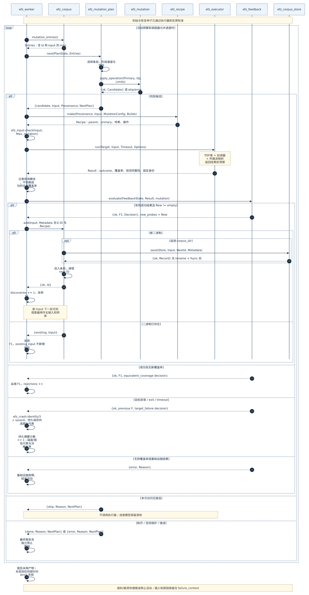
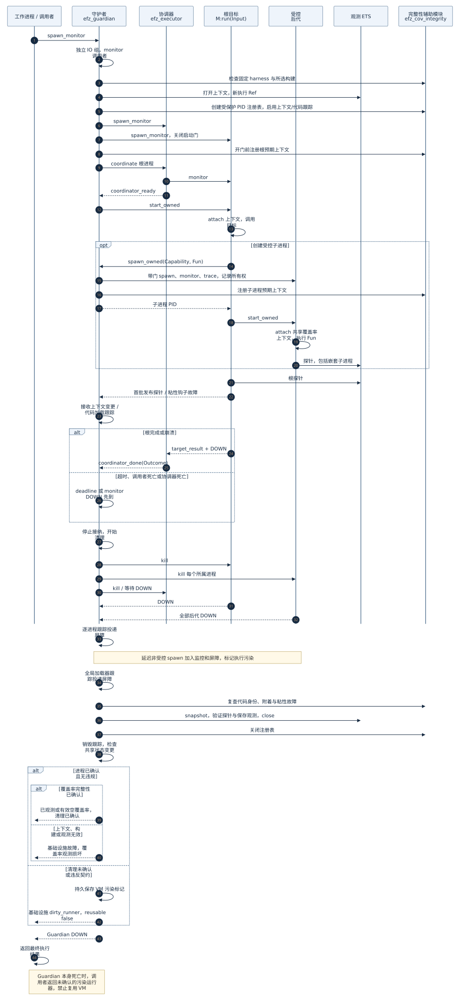

# EFZ 架构

[English](../../architecture.md) · [Русский](../ru/architecture.md) · [Español](../es/architecture.md) · **简体中文** · [所有语言](../README.md)

本文根据截至 **2026 年 9 月 13 日**的源代码，描述当前 EFZ
运行时。EFZ 是基于 Erlang/OTP 的覆盖率引导模糊测试器：它变异
`binary()`，执行 `Module:run/1`，收集源插桩覆盖率，
将具有新覆盖率的成功输入送回活跃语料。这些输入随后
可成为后续变异的父输入和供体。运行时
在单个 BEAM VM 中运行，允许一个工作进程。

本文描述已实现的系统。分布式执行、OTP 应用的完整
隔离和活动精确恢复不在此
架构范围内。

每个目录和文件的用途（包括测试、示例和历史
材料）见[仓库地图](repository-map.md)。

## 导航

- [1. 主要模块与 UML](#modules)
- [2. 进程、监督与状态所有者](#processes)
- [3. 准备产物与启动活动](#startup)
- [4. 闭合反馈循环](#feedback)
- [5. 执行单个输入](#execution)
- [6. 覆盖率与决策](#coverage)
- [7. 语料与持久存储](#corpus)
- [8. 调度器、变异与重放](#mutation)
- [9. 输入限制、错误与结束](#failures)
- [10. 隔离与 OTP 集成边界](#boundaries)
- [11. 验证与延伸阅读](#evidence)

图表提供已生成 SVG 和可编辑 Mermaid 源。使用带 `module`、`gen_server`、`process`、`ETS`
构造型的 UML 结构/类图，
以及 UML 时序图。这将 Erlang 模块、进程和
资源映射到 UML；实现中没有面向对象的类。一般
模块依赖不表示独立进程或异步调用。
[格式与渲染](diagrams/README.md)。

<a id="modules"></a>
## 1. 主要模块与 UML



[打开 SVG](diagrams/modules.svg) · [Mermaid 源](diagrams/modules.mmd)

图中展示主要分阶段运行时依赖。构建变换、
覆盖率钩子、随机路径和辅助模块列在下方，以保证
图形清晰。虚线箭头表示模块依赖。

| 组件 | 实际模块 / 入口 | 用途及运行时角色 |
|---|---|---|
| CLI | [fuzz.escript](../../../scripts/fuzz.escript)、[efz_cli](../../../src/efz_cli.erl):`main/1` | 参数、原始种子文件、产物发现、API 调用与最终 `report.term` |
| 公共 API | [efz](../../../src/efz.erl):`start/1`、`await/1`、`stats/0`、`stop/0` | 启动应用与活动；等待报告；停止 |
| 应用 | [efz_app](../../../src/efz_app.erl)、[efz_sup](../../../src/efz_sup.erl) | 根监督器与应用生命周期 |
| 活动配置 | [efz_config](../../../src/efz_config.erl):`prepare/1` | 严格模式、回调、限制、产物预检与语料恢复 |
| 插桩 | [efz_instrument](../../../src/efz_instrument.erl)、[efz_instrument_pt](../../../src/efz_instrument_pt.erl) | 编译带钩子与清单的选定源文件；验证/加载产物 |
| 清单 / 验证计划 | [efz_cov_manifest](../../../src/efz_cov_manifest.erl) | 探针身份、允许构建/探针及观测覆盖率验证 |
| 活动协调器 | [efz_fuzzer](../../../src/efz_fuzzer.erl) | 创建服务、监控工作进程、管理 `await` 等待者与最终报告 |
| 工作进程监督 | [efz_worker_sup](../../../src/efz_worker_sup.erl) | 一个临时工作进程；不自动恢复活动状态 |
| 模糊测试循环 | [efz_worker](../../../src/efz_worker.erl):`handle_info/2` | 校准 → 调度 → 变异 → 执行 → 反馈 → 保留/报告 |
| Harness 契约 | [efz_target](../../../src/efz_target.erl)，用户 `Module:run/1` | 接受二进制输入；适配真实解析器/目标 |
| 执行器 | [efz_executor](../../../src/efz_executor.erl):`run/4` | API、根结果、等待最终结果及 guardian DOWN |
| 生命周期 guardian | [efz_guardian](../../../src/efz_guardian.erl) | 独立拥有根/后代、截止时间、DOWN/跟踪屏障、快照与污染运行器策略 |
| 覆盖率上下文 / 钩子 | [efz_cov](../../../src/efz_cov.erl)、[efz_cov_rt](../../../src/efz_cov_rt.erl) | 逐执行 ETS 与插桩代码的 `hit/1` |
| 覆盖率完整性 | [efz_cov_integrity](../../../src/efz_cov_integrity.erl) | 固定 harness/构建、受保护 PID/上下文注册表、粘性上下文/代码加载故障及观测状态 |
| 反馈 | [efz_feedback](../../../src/efz_feedback.erl):`evaluate/3` | 纯分类及覆盖率差集函数；状态位于工作进程 |
| 活跃语料 | [efz_corpus](../../../src/efz_corpus.erl) | 条目、整数 ID、去重和调度器输入；可选持久化 |
| 持久语料 | [efz_corpus_store](../../../src/efz_corpus_store.erl) | SHA-256 条目、元数据、构建策略、验证及恢复 |
| 分阶段计划器 | [efz_mutation_plan](../../../src/efz_mutation_plan.erl):`prepare/2`、`new/1`、`next/2` | 调度器、阶段通道、惰性游标、有界访问及显式 RNG 状态 |
| 变异操作 | [efz_mutation](../../../src/efz_mutation.erl) | 有边界检查地对二进制输入应用具体操作 |
| 字典 | [efz_dictionary](../../../src/efz_dictionary.erl) | 准备时加载/规范化 token 并确定字典身份 |
| 随机模式 | [efz_mutator](../../../src/efz_mutator.erl)、[efz_mutator_random](../../../src/efz_mutator_random.erl):`mutate/2` | 通过回调的替代生产路径；共用执行器/反馈 |
| 配方 / 重放 | [efz_recipe](../../../src/efz_recipe.erl)、[efz_replay](../../../src/efz_replay.erl)、[efz_replay_cli](../../../src/efz_replay_cli.erl) | 精确字节、来源、EFZR 编解码、再生及显式执行重放 |
| 输入契约 | [efz_input](../../../src/efz_input.erl) | 活动字节上限、二进制验证及有界文件读取 |
| 崩溃磁盘策略 | [efz_crash_store](../../../src/efz_crash_store.erl) | 持久发生计数、有界代表、写锁及 EFZG 索引 |
| 崩溃产物 | [efz_crash](../../../src/efz_crash.erl):`save/4` | 发生 ID、规范签名、有界代表、原子原始输入/结果/配方/预期 |
| 文件系统操作 | [efz_fs](../../../src/efz_fs.erl) | 结构化 I/O 错误、write/fsync/close、原子文件/组发布 |
| 统计 | [efz_stats](../../../src/efz_stats.erl) | 校准/执行/发现/崩溃/超时/基础设施计数 |

`fixtures/` 和 `test/` 包含目标与检查。`examples/` 包含现成
harness/活动场景；简单示例在 `rebar.config` 中
作为源根。`bench/` 包含独立测量驱动，不是
应用调度器。部分旧测试使用 `efz_scripted_mutator`，但它
不是默认变异器，也不参与真实分阶段谱系验证。

<a id="processes"></a>
## 2. 进程、监督与状态所有者



[打开 SVG](diagrams/processes.svg) · [Mermaid 源](diagrams/processes.mmd)

实心菱形表示监督器子进程或进程所属资源；
标签注明具体关系。实线 `start_link / shutdown` 表示普通
OTP 链接。虚线 `spawn_monitor` 表示创建与监控，
**不是监督**。`ExecutionGuardian`、`ExecutionCoordinator`、`TargetProcess`、
`ValidationPlan`、`ExecutionCoverage` 是图中的运行时角色，不是
新 Erlang 模块名。

```text
application efz
└── efz_sup                       监督器：one_for_all，强度 0
    └── efz_fuzzer                临时子进程，gen_server
        ├── efz_corpus            从 init/1 调用 start_link
        ├── efz_stats             从 init/1 调用 start_link
        └── efz_worker_sup        start_link；one_for_one，5 次重启 / 10 秒
            └── efz_worker       一个临时子进程
                └── guardian     spawn_monitor；独立 I/O 组长
                    ├── coordinator  根结果分类
                    ├── root         有启动门的目标进程
                    └── descendants  全部通过 efz_target:spawn/1、spawn_link/1
```

`efz_fuzzer` 下的嵌套表示生命周期所有权：**`efz_fuzzer` 本身不是
监督器**。它设置 `trap_exit`，创建三个链接服务，结束时按
工作进程监督器 → 统计 → 语料顺序停止。工作进程
还被独立监控。

若工作进程崩溃，活动返回
`{infrastructure_failure,{worker_down,Reason}}`。工作进程不重启：
`restart => temporary` 优先于监督器允许的重启
强度。链接服务的 `EXIT` 使 `efz_fuzzer` 终止活动。
这些故障路径不等同于普通目标异常结果。

| 状态 | 所有者 | 表示与生命周期 |
|---|---|---|
| 活跃队列与下一个 `next` ID | `efz_corpus` | `gen_server` 状态中的 map 列表；直到活动停止 |
| 全局覆盖率 | `efz_worker` | `feedback.global`：精确探针集与固定构建；可选 hit-count 还保存 `global_features` |
| 分阶段游标 / RNG / 待执行轮次 | `efz_worker` | `mutation_state` 由 `efz_mutation_plan` 返回；非独立进程 |
| 验证允许列表 | 默认预备模式的 `efz_worker` | 无名 `protected` ETS `efz_coverage_plan`；所有者死亡即消失 |
| 当前输入覆盖率 | 执行 guardian | 新的无名 `public` ETS `efz_execution_coverage`；执行后删除 |
| 执行上下文 | 根与受控后代 | 进程字典键 `'$efz_execution_context'`；包含 ref、ETS 句柄、所有者 PID |
| 完整性注册表与证据 | 执行 guardian | 保护 ETS `efz_coverage_observers`：PID → 预期上下文、固定身份；guardian 状态保存附着、观测探针与首个错误 |
| 生命周期、监控器、跟踪屏障 | `efz_guardian` | 单次执行；全部支持进程终止后给出最终结果 |
| VM 污染标记 | `persistent_term` | `{efz_guardian, dirty_runner}`；`efz:stop/0` 不重置 |
| 运行时计数 | `efz_stats` | `gen_server` 中的 map；同步 `inc/1` |
| 决策、崩溃代表、故障上下文 | `efz_worker` | 报告状态；仅重要事件/有界轨迹保留完整数据 |
| 报告与 `await` 调用者 | `efz_fuzzer` | `report`、`waiters`；直到 `stop` 前报告可用 |
| 持久语料 / 发现 | 文件系统 | EFZ/VM 停止后保留 |

全局覆盖率不存于观测 ETS 表。不存在全局
“当前输入”或 `persistent_term` 反馈缓存。有限活动
结束后，工作进程与验证计划继续存活，直到 `efz:stop/0`。

<a id="startup"></a>
## 3. 准备产物与启动活动

### 启动前插桩

```text
普通 .erl + 所选模块 + 编译器选项
→ efz_instrument:compile/2
→ efz_instrument_pt:parse_transform/2
→ 带 efz_manifest 属性的插桩 .beam + .efz-manifest sidecar
→ efz_instrument:preflight/1
→ 已验证清单与已加载模块
```

变换将钩子插入子句/结果体，而非模式或守卫。
构建命名空间取决于规范化形式、重要编译选项
及工具链身份。清单将探针序号映射到函数、
元数、源位置与结构位置。不同构建的完整
探针身份不同；仅序号无法标识覆盖率。

`efz_instrument` 管理 include 路径、宏和临时代码路径。仅
门面写入产物；变换处理形式，不分配运行时
ETS 或活动状态。不支持与任意额外 parse transform 的排序：
会拒绝这些变换。嵌入清单与安全解码的
sidecar 比较；比较数据，而非 ETF map 字节顺序。

### 活动启动

1. `efz_cli:main/1` 将参数和种子文件读取为原始二进制，查找
   产物并检查输出目录可用性。CLI 本身不
   自动运行编译器或实现模糊测试循环。
2. `efz:start/1` 启动应用，添加临时 `efz_fuzzer` 子进程，
   使用 `supervisor:start_child/2`。
3. `efz_fuzzer:start_link/1` **先**调用 `efz_config:prepare/1`，再创建活动
   `gen_server`：检查模式、输入限制、变异设置、预检、
   `code:ensure_loaded/1` 和 `run/1` 导出。不接受任意 MFA。
4. 配置 `corpus_dir` 后加载并验证保存条目。初始和恢复
   输入按内容身份去重合并。
5. `efz_fuzzer:init/1` 创建语料、统计和工作进程监督器。语料
   分配新的整数 ID，必要时持久保存初始种子。
6. 工作进程准备验证计划及分阶段状态，取得
   `efz_corpus:all()`，向自身发送 `iterate`。
7. 校准通过执行器和反馈执行 **每一个** 初始/恢复种子，
   然后开始变异阶段。

当前校准指初始化覆盖率的单次遍历，不是重复
稳定性分析或不稳定探针检测。即使 `max_iterations => 0` 也进行
校准；`max_iterations` 仅限制变异执行次数。

| 输入契约 | 值 |
|---|---|
| Harness | `Module:run(binary()) -> term()`；独立适配器可选 |
| 目标配置 | `target => Module`；拒绝 `function` / `arity` |
| 输入 | 原始 `binary()`，不解码字符串或自动转换项 |
| `max_input_bytes` | 顶层活动键：默认 4096，包含端点的 0..1048576 |
| 工作进程数 | 仅 `workers => 1` |
| API 默认值 | `mutation_mode => random`、`max_iterations => infinity` |
| CLI 默认值 | 分阶段，1000 次变异执行 |
| 覆盖率默认值 | `automatic`，后端 `ets`，验证 `prepared` |

大小限制应用于种子、恢复、两种变异模式、执行、崩溃
输入和重放。旧的嵌套 `mutation.max_input_bytes` 不是活动
选项；`efz_config` 将限制传入规范化计划器配置。
完整模式与启动命令：[CLI](cli.md)、[输入/存储契约](input-and-storage.md)。

<a id="feedback"></a>
## 4. 闭合反馈循环



[打开 SVG](diagrams/feedback-loop.svg) · [Mermaid 源](diagrams/feedback-loop.mmd)

主要分阶段调用路径：

```text
efz_worker:handle_info(iterate, State)
→ efz_corpus:mutation_entries/0
→ efz_mutation_plan:next(PlanState, Entries)
→ efz_mutation:apply_operation(Primary, Operation, Limits)
→ efz_recipe:make(Provenance, Input, MutationConfig, Builds)
→ efz_executor:run(TargetModule, Input, Timeout, ExecutorOptions)
→ efz_feedback:evaluate(FeedbackState, Result, mutation)
→ efz_corpus:add(Input, Metadata)                 [新的成功覆盖率]
→ efz_corpus_store:save(Store, Input, Id, Meta)    [启用 corpus_dir 时]
→ 加入 entries，回复 {ok, Id}
→ 工作进程采用 FeedbackState1 并向自身发送 iterate
→ 未来 efz_mutation_plan:next/2 可见新条目
```

图展示控制流；并非每个箭头都是 Erlang 消息。
`mutation_entries/0` 和 `add/2` 是同步 `gen_server:call`；计划器、
变异、配方和反馈是工作进程内的普通调用。持久
保存由语料进程执行，必须在加入/确认前完成。保存失败
不改变活跃队列。保留路径成功后，工作进程采用
新反馈状态。

成功发现的输入得到新整数 ID。`Metadata.parent` 和
`Recipe.parent` 指向主输入 ID。配方还含 `primary`
二进制和 `primary_id = SHA256(primary)`。仅写入磁盘
不意味着入队：`efz_corpus:add_checked/3` 的加入操作
建立这一连接。

新条目不一定成为 **紧接着的** 下一次变异。调度器完成
当前轮次快照，在未来轮次纳入新 ID。这避免
持续增长的语料饿死旧条目。供体来自当前
活跃语料条目，包括新发现。

[efz_feedback_loop_tests](../../../test/efz_feedback_loop_tests.erl) 使用独立 `A`、`B`、`C`
token 的真实字典插入，证明链
`<<>> → <<"A">> → <<"AB">> → <<"ABC">>`、父 ID、harness 精确送达、
新探针及新 VM 重放。没有脚本化输出、模拟语料
或模拟覆盖率。

<a id="execution"></a>
## 5. 执行单个输入



[打开 SVG](diagrams/executor.svg) · [Mermaid 源](diagrams/executor.mmd)

`efz_executor:run/4` 创建独立 `efz_guardian`。Guardian 拥有
根、受控后代、观测 ETS、截止时间与跟踪会话。
独立协调器分类根结果及 `DOWN`。只有确认
安装监控器后根才开始。协调器死亡触发
guardian 清理。

分别使用给调用者回复的 `Request` 和覆盖率执行 `Ref`。
最终结果在杀死/收集全部自有进程、逐进程跟踪
屏障、快照/验证、删除 ETS 以及
VM 污染检查之后发布。调用者还等待正常 guardian
`DOWN` 后才从 `run/4` 返回。

| 交互 | 消息 / 机制 |
|---|---|
| 继续模糊测试循环 | 工作进程中的 `self() ! iterate` |
| 工作进程 ↔ 语料 | entries/add 的 `gen_server:call` |
| 目标 → 协调器 | `{target_result, Ref, TargetPid, Outcome}` |
| 协调器 → guardian | `{coordinator_ready, Pid}`，随后 `{coordinator_done, Pid, Outcome}` |
| 受控父进程 → guardian | `{spawn_owned, Capability, ParentPid, Request, Fun}` |
| Guardian → 父进程 → 子进程 | `{Request,{ok,Pid}}`，随后 `{start_owned,Capability}` |
| VM → guardian | 每个所属进程的 `DOWN` 及死亡后的 `trace_delivered` |
| 损坏活动 ETS → guardian | `{efz_cov_failure, Ref, invalid_table}` |
| Guardian → 工作进程 | `{Request, GuardianPid, Result}` 和 guardian `DOWN` |
| 工作进程 → 活动协调器 | `{campaign_done, WorkerPid, Report}` |

根直接调用 `M:run(Input)`。返回项（包括 `{error,Reason}`）
仍视为成功；捕获 error/throw 产生带栈崩溃，exit 产生
`{exit,Reason}`。超时或根完成时，guardian 停止接纳，并
用 `kill` 终止剩余后代，不受链接和 `trap_exit` 影响。
随后等待确认。

`cleanup.status => confirmed` 与 `runner_reusable => true` 表示受支持的
生命周期完成且未检测到违规。清理或共享状态错误
产生 `dirty_runner`，即使停止后也阻止此 VM 执行新目标。若
调用者死亡，guardian 无结果接收者也会清理。
`efz:await/1` 超时只停止等待，不停止活动。完整契约、
支持的 spawn API 及自动检查限制见[执行隔离](execution-isolation.md)。

<a id="coverage"></a>
## 6. 覆盖率与决策

[Bitmap 后端](coverage-bitmap-architecture.md)设计说明存储、
生命周期和验证标准。该后端尚未实现：当前
`ets`/`ets_member` 和 `efz_feedback` 规则仍为有效契约。

指标为 **`clause_outcome_probe`**：子句/结果体中的自定义点。
不是 OTP 原生覆盖率、`cover` 或 bitmap 边覆盖率。默认反馈
使用探针存在性；可选 `coverage_feedback => hit_count` 还计数桶。
自动探针的完整身份为：

```erlang
{ModuleAtom, BuildSHA256, ProbeIdInteger}
```

每次命中对照受保护 PID 注册表检查进程字典上下文，
并同步访问观测 ETS。`ets` 后端执行 `insert_new`，
写入 `{ {probe, Id} }`。`ets_member` 先查询外部 ETS 是否已有条目，
跳过重复插入。二者都保留精确身份集合，不要求
目标最后 flush，并在每次命中检查表可用性。首次插入
通知 guardian；已发布观测丢失会在快照时被发现。

根及后代完成后，guardian 执行 `snapshot/1` 和
验证。默认 `prepared` 使用工作进程不可变的受保护 ETS 允许列表。
`per_execution` 使用 `validate_observed/3` 和清单。保留参考路径
用于差分测试和测量，不是另一套
覆盖率语义。

精确决策见 [efz_feedback:evaluate/3](../../../src/efz_feedback.erl)：

```text
Result.builds 必须匹配固定的 FeedbackState.builds。
若 coverage_status == ok 且 outcome == {ok, ReturnValue}：
    New = Observed − Global
    Global1 = Global ∪ Observed
    校准：reason = seed_calibration
    变异 + New 为空：reason = equivalent_coverage
    变异 + New 非空：reason = new_coverage
目标故障：全局覆盖率不变；reason = target_failure。
覆盖率 / 基础设施故障：error；工作进程停止活动。
```

实验性 hit-count 模式下，同一个 guardian 所属 ETS 包含
`{{probe, ProbeIdentity}, Count}`。`ets:update_counter/4` 原子递增
计数；精确探针集合仍是键的投影。`efz_cov_count`
将值分为八个桶。`efz_feedback` 单独计算
`CurrentFeatures − GlobalFeatures`，保持原有探针 `New` 公式。
保留原因是 `new_probe` 或 `new_hit_count`；校准更新
两个集合，目标故障两个都不更新。工作进程将保留输入交给
同一个语料。默认 presence 保留 `new_coverage`。
[契约与测量](hit-count-experiment.md)。

没有独立覆盖率收集服务器，也没有多输入
共享观测表。单工作进程序列化消除了当前配置中“两个工作进程
同时检查并加入探针”的竞争。
这不证明已支持多工作进程调度；配置拒绝
`workers > 1`。

无上下文的非活动钩子仅允许在执行器所属进程之外使用。
擦除/替换上下文、捕获钩子异常、丢失已发布探针以及
替换固定模块都会产生基础设施故障。独立跟踪
事件使上下文/BEAM 恢复后仍保留证据。这是正确性
保护，不防御蓄意伪造内部协议或修改 EFZ。
`valid_empty_coverage` 表示完好但没有探针的观测。
活动诊断显示未使用产物；`coverage_policy => strict` 阻止
一个探针都没有的活动成功结束，但不在零命中
校准时停止。详见[完整性](coverage-integrity.md)、
[语法与映射](coverage.md)。

<a id="corpus"></a>
## 7. 语料与持久存储

活跃语料保存以下形式条目：

```erlang
#{id => QueueId,
  input => ExactBinary,
  metadata => Metadata,
  added_at => SystemTimeMilliseconds}
```

运行时，`efz_corpus:add/2` 通过精确字节比较去重。分阶段游标
身份与持久内容身份使用 SHA-256。唯一语料进程
分配新运行时 ID；已有二进制不分配新 ID。不配置
`corpus_dir` 时，初始种子保留传入列表及重复项；
持久启动时会合并、去重初始/恢复输入。
随机模式通过 `select/0` 选择随机条目；分阶段模式请求
`mutation_entries/0` 后自行调度条目。

设置 `corpus_dir` 时，初始种子和成功的新覆盖率输入
会持久保存。目标故障不作为发现加入。保存初始
种子本身不证明成功执行：持久化先于校准。

```text
CORPUS_DIR/
  INPUT_SHA256/
    input                    精确原始字节
    metadata                 EFZC v1 封装 + 校验和
  .tmp-RANDOM/                未完成发布

CRASH_DIR/
  SIGNATURE_SHA256/
    summary                  EFZG：持久计数 + 选定 ID/哈希
    .lock/                   独占写者，仅写入时存在
    OCCURRENCE_ID/            选定代表
      artifact.input         精确触发字节
      artifact.term          完整原始 Reason/栈、元数据、输入上限
      artifact.replay        EFZX：预期构建/harness/哈希/签名
      artifact.recipe        EFZR，仅有配方时存在
      manifest               版本 + 发生文件大小 + 校验和
    .tmp-RANDOM/              暂存，尚未发布的发现
```

持久元数据包含内容哈希、输入大小、历史队列 ID、来源、
父内容哈希/ID、发现探针、目标/构建身份，以及可用时的
配方。发布使用临时目录、文件 fsync/close、目录
fsync、原子重命名与父目录 fsync。已发布条目损坏产生
错误；`.tmp-*` 语料条目会给出明确中断写入诊断。

恢复时，输入重新进入活跃语料并重新校准。
默认 `corpus_build_policy => reject` 拒绝身份不匹配；
`recalibrate` 允许带诊断和重新校准的复用。不恢复调度器
游标、RNG、全局覆盖率、旧整数 ID 或执行
顺序。这是可复用持久语料，**不是检查点/精确恢复**。

EFZC 语料元数据、EFZR 配方及插桩模块清单是不同
格式。崩溃 `artifact.term` 可能包含运行时诊断项，不
用于安全配方导入。格式和验证见[语料](corpus.md)、
[重放](replay.md)、[原子存储](input-and-storage.md)。

<a id="mutation"></a>
## 8. 调度器、变异与重放

分阶段模式下，工作进程保存 `efz_mutation_plan` 状态：以
`{InputSHA256, ConfigId}` 为键的游标、阶段通道、待执行条目 ID、`exsplus` RNG 状态与
进度计数。不会事先物化全部变异。

默认通道：`bitflip`、`byteflip`、`arithmetic`、`boundary`、
`dictionary_insert`、`dictionary_overwrite`、`havoc`、`splice`。通道在
条目和轮次间交替；不要求首次 havoc 前先耗尽所有确定性
阶段。每次访问最多返回一个候选，
访问内尝试次数受配置限制。空/放不下/无效果的
操作可返回 `skip`，同时保留已推进游标。

生成候选 **或有限游标推进** 都算进度。
只要仍有有限确定性工作，`max_idle_visits` 不会停止
调度器。确定性工作耗尽后，空闲保护仅在
达到阈值且完整遍历全部当前内容的全部通道
仍无进度时适用。语料增长会重置空闲计数，保留游标、RNG
及未完成轮次。

随机模式调用 `Mutator:mutate(Primary, #{iteration, max_input_bytes})`；
默认实现为 `efz_mutator_random`。这是真实替代生成路径，
与分阶段模式在工作进程 → 执行器 → 反馈 → 语料处汇合。它
不接收分阶段游标，也不自动创建分阶段配方。

配方包含主输入字节/哈希、父 ID、具体操作、splice 的供体
字节、输出大小/哈希、输入/操作限制、配置/字典 ID、
版本、构建及诊断初始 RNG 种子。重放不需要
旧语料、字典文件或再次运行 RNG。

- `regenerate/1` 在配方所记录限制下重建字节。
- `regenerate/2` 额外接受当前活动上限，检查
  主输入/供体/中间值/输出。
- `execute/5` / `execute_file/5` 要求显式目标/产物/构建和
  `expected_harness`，创建新验证计划并使用同一个执行器。
- `efz_replay:run/6` 检查输入哈希、构建和 harness，然后比较
  签名。
- `scripts/replay.escript --input/--recipe` 执行此已验证重放；
  旧位置参数模式仅再生字节。始终由用户指定
  目标。

详细操作契约与预算见[变异](mutations.md)。

<a id="failures"></a>
## 9. 输入限制、错误与结束

`efz_input` 定义统一字节契约。`0` 仅允许 `<<>>`；允许
`max`；拒绝 `max + 1` 且不截断。CLI/恢复/重放最多读取
限制加一个字节以检测超限。随机变异器遵守剩余
容量，工作进程和执行器额外验证候选。

| 报告状态 | 原因 |
|---|---|
| `completed` | 变异执行预算耗尽；校准单独计数 |
| `{mutation_exhausted,mutation_exhausted}` | 无随机通道时有限确定性搜索空间耗尽 |
| `{mutation_stopped,idle_budget_exhausted}` | 随机/进度保护；不证明数学意义上的耗尽 |
| `{infrastructure_failure,Reason}` | 受控运行路径中的变异/输入、覆盖率或存储错误 |
| `{infrastructure_failure,{worker_down,Reason}}` | 工作进程意外终止；`efz_fuzzer` 生成备用报告 |

`efz_crash:save/4` 返回 `{ok,Crash}` 或 `{error,ErrorMap}`。文件系统错误
含 `operation`、`path`、`reason`、`input_hash`、`crash_fingerprint`；需要时添加暂存/组
路径和次要清理/关闭错误。首个错误
不会被清理错误替换。

每个所选代表发布到独立原子目录。
输入身份是精确字节 SHA-256；发生 ID 是随机 128 位；
签名是规范化类别/Reason/栈的 SHA-256；组 ID 等于签名。
`Crash.path` 指向 `SIGNATURE/OCCURRENCE/artifact` 前缀。
`artifact.term` 保留完整原始 Reason 与栈。`artifact.replay`
将可验证身份与诊断分开。

签名 v2 仅取前五个目标栈帧的模块/函数/元数，
排除路径/行号和运行时帧。`crash_policy.reason` 设置 `category`
（默认）、`exact` 或 `ignore`；即使用 `exact`，运行时 pid/ref/port/fun 身份也
会规范化。哈希使用显式有序结构，在新 VM 中
对原子/map 顺序保持稳定。报告保存 `occurrences`，默认
每个签名有三个哈希不同的代表输入。仅为这些代表加入崩溃
决策。相同 `max_representatives` 通过
`efz_crash_store` 限制磁盘存储：每签名前 N 个不同哈希、
不可变原始输入/Reason/配方/预期，以及计入所有已提交
发生的原子 `summary`。摘要跨 VM 保持上限。
`durable_occurrences` 与当前活动计数分开；`storage`
区分 saved/duplicate/limit_reached。达到 limit_reached 时，新输入
不获得磁盘产物；当前报告可将其保留在有界代表中。
旧版/未索引/损坏组及遗留写锁会产生显式
错误，而非重置计数。不删除旧档案。

运行中存储失败时，工作进程递增 `infrastructure_failures`，
将精确输入、结果/栈、元数据和配方保留到 `failure_context`，
然后结束活动。`unique_crashes` 统计签名，包括未保存的
签名；`crash_occurrences` 统计全部目标故障，包括超时与
重复。若仅配方损坏，则不带配方发布原始输入/结果/预期，
但活动得到显式基础设施错误；
`saved_artifact` 标识在上限内保存的精确输入
代表。

统计保留 `primary_infrastructure_failure`。执行器调用前，模糊测试器先接收当前
精确输入；`worker_down` 时递增基础设施
计数，并在备用报告中包含最近收到的上下文。
备用报告不恢复丢失的工作进程游标或部分崩溃组。
协调器丢失不会被空构建 map、覆盖率错误或污染清理
掩盖：outcome 保留首要基础设施原因，而
`cleanup` / `runner_reusable` 描述次要生命周期状态。若 guardian
回复后丢失，执行器仍保留首要错误、次要
`guardian_failure` 及先前 `execution_evidence`；最终清理变为
未确认。污染运行器不可复用。启动失败从
`efz:start/1` 返回错误，不是已完成活动报告。

`efz_cli` 原子写入 `OUT/report.term`。若报告写入也失败，
CLI 递增基础设施计数，并在诊断中包含内存报告。
退出码：正常停止为 `0`（包括发现目标崩溃），
无效调用/配置为 `2`，运行时基础设施
或报告存储故障为 `1`。

<a id="boundaries"></a>
## 10. 隔离与 OTP 集成边界

支持的模型是 **同步二进制 harness，具有受控后代
生命周期**。`efz_target:spawn/1` 和 `spawn_link/1` 传递上下文，
在打开启动门前创建所属进程。Guardian 不遍历
任意链接。

| 范围 | 保证 / 限制 |
|---|---|
| 根与受控后代 | 共用执行覆盖率；正常最终结果前收到全部进程 `DOWN` |
| 普通本地 spawn | 跟踪发现、清理已发现进程，返回污染运行器结果 |
| 调用者 / 协调器死亡 | Guardian 仍负责清理，包括应用取消 |
| Guardian 死亡 / 清理截止 | 清理未确认，基础设施/污染运行器；不复用 VM |
| 所有的 ETS 与注册 | 随进程消失；逃逸资源使运行器污染 |
| `persistent_term` / 应用环境 | 前后比较；更改禁止复用，不回滚 |
| 写入既有外部 ETS | 模型之外；无完整自动检查，需显式声明污染 / 一次性 VM |
| 任意 OTP 应用、port/NIF、远程任务、文件系统副作用 | 旧后端不隔离；可选 P1-01 将目标/NIF 移至独立 BEAM，但不回滚外部副作用，也不是沙箱 |
| 插桩 / 代码加载 | 固定 harness/构建；热替换和上下文损坏诊断为基础设施故障。伪造 EFZ 协议/跟踪不在保护模型内 |
| 活动并发 | VM 中一个工作进程和一次执行；第二调用者收到 runner_busy |
| 稳定性 | 校准仍为单次遍历；配方确定性不保证目标确定性 |

共享状态快照可诊断部分违规，但不会将 VM 变成
沙箱。允许的进程局部资源中，`A → dirty → A` 保持结果
和覆盖率；VM 全局变更时，第三次 `A` 会在执行前阻止。
详见[逐资源策略与回归证据](execution-isolation.md)。

<a id="evidence"></a>
## 11. 验证与延伸阅读

| 架构连接 / 保证 | 验证 |
|---|---|
| 受控后代、guardian 故障、共享状态策略 | [efz_isolation_tests](../../../test/efz_isolation_tests.erl) |
| 真实变异 → 覆盖率 → 保留 → 新父输入 | [efz_feedback_loop_tests](../../../test/efz_feedback_loop_tests.erl) |
| 持久发现成为另一 VM 的父输入 | [efz_durable_tests](../../../test/efz_durable_tests.erl) |
| 有限进度、256 个种子与 `max_idle_visits` | [efz_mutation_tests](../../../test/efz_mutation_tests.erl)、[efz_phase3_tests](../../../test/efz_phase3_tests.erl) |
| 新 VM 中外部 harness 与 CLI 原始摄取 | [efz_cli_tests](../../../test/efz_cli_tests.erl) |
| 覆盖率身份、异常/超时与清理 | [efz_phase2_tests](../../../test/efz_phase2_tests.erl)、[efz_coverage_SUITE](../../../test/efz_coverage_SUITE.erl) |
| 覆盖率完整性与零命中策略 | [efz_integrity_tests](../../../test/efz_integrity_tests.erl)，[efz_cli_tests](../../../test/efz_cli_tests.erl) 中新 VM 策略测试 |
| `ets` / `ets_member`、预备/参考等价性 | [efz_backend_tests](../../../test/efz_backend_tests.erl) |
| Guardian 延迟死亡与有界持久崩溃存储 | [efz_crash_retention_tests](../../../test/efz_crash_retention_tests.erl) |
| 崩溃分组、原始诊断、已验证重放与 1000 次发生 | [efz_crash_tests](../../../test/efz_crash_tests.erl) |
| 配方操作与新 VM 重放 | [efz_recipe_tests](../../../test/efz_recipe_tests.erl)、[efz_phase3_tests](../../../test/efz_phase3_tests.erl) |
| 损坏/中断语料条目、构建策略 | [efz_corpus_store_tests](../../../test/efz_corpus_store_tests.erl) |
| 边界、存储故障、报告中的精确输入 | [efz_limits_tests](../../../test/efz_limits_tests.erl) |

本文档本身不代表一次新测试运行。最近保存的运行时
验证结果在本地 `_build/limits-checks/`；
图表由 Mermaid 渲染器单独检查。完整代码
验证命令：

```sh
rebar3 compile
rebar3 eunit
rebar3 ct
rebar3 xref
rebar3 dialyzer
```

其他文档：

- [CLI 与活动模式](cli.md)、[覆盖率契约](coverage.md)、
  [自动覆盖率 ADR](adr/0002-automatic-coverage.md)。
- [变异阶段](mutations.md)、[重放](replay.md)、
  [持久语料](corpus.md)、[输入/存储契约](input-and-storage.md)。
- [Phase 2 验证](phase2-validation.md)、
  [Phase 2.1 性能](phase2.1-performance.md)、[Phase 3 验证](phase3-validation.md)。
- [校准就绪审计](calibration-readiness.md) 是稳定性和执行上下文
  边界的独立研究，不是已实现校准算法。
- [历史技术审计](technical-audit-2026-09-12.md) 说明审计
  当时状态；后续修复以当前代码及上文文档为准。

## P0 运行时诊断

可选 `runtime_oracles` 加入既有流水线。`efz_runtime_config`
验证统一策略；工作进程通过执行器重复所选字节，
`efz_stability` 比较有界快照。重复执行不调用反馈、语料
选择或变异计划器。原有保留策略不变。
Guardian 启动 `efz_runtime` 采样器，发布已接纳 PID 成员，记录
子进程 DOWN 证据，并在清理时终止采样器。它绝不在
截止时间路径轮询进程/ETS 指标。结果 `runtime_observations` 与
outcome 分开。`efz_runtime_store` 限制/去重独立产物；
`efz_replay:runtime/4` 将兼容验证委托给 `efz_runtime_replay`。
[诊断契约](runtime-diagnostics.md)定义语义与限制。

## P1-01 外部监督器

仅 Linux 的 `--supervised` 在查找目标或启动应用前委托。
控制器和目标工作进程是不同操作系统进程与地址空间；
既有活动循环、执行器和 guardian 仍位于工作进程内。
每次 `efz_executor:run/4` 首先执行 PREPARE 屏障：控制器
发布并 fsync 精确原始输入及有界元数据，持久记录
授权，之后才返回绑定摘要的 RunId 许可。旧模式
共用执行器 API，不执行 IPC 或日志写入。

原生启动器拥有工作进程组，报告权威 wait 状态
与确认清理，并用 Linux pidfd/PDEATHSIG/subreaping 防止挂起工作进程
在 CLI/控制器死亡后存活。原生崩溃、外部硬超时
与污染结果使在途记录结束、旧 VM 退役、恢复
持久语料，并在新代重新校准。恢复保留全局
预算，但有意重建工作进程本地覆盖率、RNG 及分阶段
游标。固定有界协议、状态机、日志保证、重放
流程、验收证据和平台限制见
[P1-01 外部监督器](p1-01-external-supervisor.md)。
