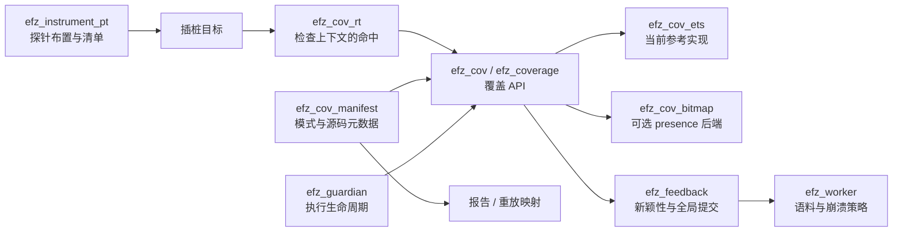

# EFZ 覆盖位图后端

[English](../../coverage-bitmap-architecture.md) · [Русский](../ru/coverage-bitmap-architecture.md) · [Español](../es/coverage-bitmap-architecture.md) · **简体中文** · [所有语言](../README.md)

状态：OTP 27.0 上用于自动 presence 覆盖的可选实现。
现有 ETS 后端仍是默认、参考及回滚路径。
[v1 实现报告](coverage-bitmap-implementation-report.md)保留首次基线；
当前复用、封存和测量见 [v2 后续报告](coverage-bitmap-v2-results.md)。

## 1. 通过代码追踪当前实现

| 边界 | 当前所有者与证据 |
| --- | --- |
| 插桩选择 | [`efz_instrument:compile_target/2`](../../../src/efz_instrument.erl)向 `compile:noenv_file/2` 传入 `{parse_transform, efz_instrument_pt}`；[`efz_instrument:preflight/1`](../../../src/efz_instrument.erl)加载所选产物。 |
| 探针布置与元数据 | [`efz_instrument_pt:parse_transform/2`、`body/5`、`probe/4`](../../../src/efz_instrument_pt.erl)在子句和结果体前插入命中调用，每次模块编译从 1 编号，嵌入清单并生成 `efz_cov_rt:hit({M,B,Id})`。模式和守卫不加探针。BuildId 是转换版本、OTP 版本、编译器 MD5、规范化 forms 和标识选项的 SHA-256。 |
| 清单验证 | [`efz_cov_manifest:validate/1`、`identities/1`、`prepare/2`](../../../src/efz_cov_manifest.erl)检查模式、模块本地唯一 ID 和结构位置，准备允许的精确标识。`ProbeId` 是**模块本地**的，不是全局唯一；观察键为 `{Module, BuildId, ProbeId}`。 |
| 运行时命中与执行存储 | [`efz_cov_rt:hit/1`](../../../src/efz_cov_rt.erl)检查预期上下文，然后 [`efz_coverage:hit/2`](../../../src/efz_coverage.erl)分发到 [`efz_cov_ets:hit/2`](../../../src/efz_cov_ets.erl)或 [`efz_cov_bitmap:hit/2`](../../../src/efz_cov_bitmap.erl)。默认 presence 模式向全新公开表执行 `ets:insert_new`；`ets_member` 先检查成员资格。可选 `hit_count` 使用 `ets:update_counter/4`；位图 presence 使用无符号 atomics 和 CAS。首次命中通知 guardian。[`efz_cov`](../../../src/efz_cov.erl)是公开兼容 API；`reset_local/0` 在调用方附加全新上下文，不是活动级全局重置。 |
| 上下文与隔离 | [`efz_guardian:start/6`、`admit/2`、`cleanup/2`、`finish/2`](../../../src/efz_guardian.erl)拥有单次执行的表和上下文 `{efz_context,1,Ref,Storage,Owner}`。根进程及通过 [`efz_target:spawn/1`、`spawn_link/1`](../../../src/efz_target.erl)创建的子进程通过接纳门；各进程在目标代码开始前显式附加共享上下文。普通 `spawn` 不继承它，被视为不受控。多个已接纳进程**可以写入同一测试案例覆盖**。[`efz_cov_integrity:expected/0`、`check/1`](../../../src/efz_cov_integrity.erl)比较受保护 PID 注册表和进程字典。 |
| 稳定结果 | [`efz_executor:invoke/4`、`coverage/3`](../../../src/efz_executor.erl)分类根进程结果。guardian 停止接纳，杀死剩余所属进程及协调器，等待 `DOWN` 加追踪屏障，然后封存紧凑成功位图覆盖，或为旧路径和诊断获取精确快照。无法确认清理时把运行器标记 dirty；guardian 异常退出也使其退役。这是当前*受控后代*契约，不是任意 OTP 进程隔离。 |
| 比较与策略 | [`efz_feedback:evaluate/3`](../../../src/efz_feedback.erl)检查构建映射、结果和覆盖状态。只有合法 `{ok, _}` 结果才把观察探针合并到活动精确集合；校准也合并成功覆盖。崩溃、退出或超时结果可以携带观察覆盖，但不更新全局覆盖。`hit_count` 模式还会比较和合并成功结果的计数桶特征。 |
| 语料与故障产物 | [`efz_worker:execute_checked/4`、`execute_result/6`、`retain/2`、`record_failure/4`](../../../src/efz_worker.erl)运行每个种子或变异、评估反馈、保留成功新覆盖（`new_coverage`、`new_probe` 或 `new_hit_count`），并通过 `efz_crash` 单独保存及去重崩溃和超时。[`efz_corpus:add/2`](../../../src/efz_corpus.erl)拥有语料插入。[`efz_mutation_plan:next/2`](../../../src/efz_mutation_plan.erl)和变异器使用语料输入，而非存储表示。 |

单个测试案例：worker 选择校准种子或变异父输入，取得二进制输入并调用 `efz_executor:run/4`。
guardian 创建新上下文，在接纳门后启动根进程并接纳受控子进程。
所选插桩子句执行 `efz_cov_rt:hit({M,B,Id})`；运行时检查该 PID 拥有预期上下文，
将精确标识写入执行存储：ETS 行或唯一位图槽位。
目标返回、异常、退出或超时后，guardian 结束写入者生命周期并验证固定代码及观察。
旧路径和诊断结果携带稳定标识列表；普通位图活动成功结果则携带封存映射和计数。
worker 将结果传给 `efz_feedback`，再应用保留与崩溃策略。
已确认位图迭代可在反馈完成后重新激活 worker 拥有的映射；dirty 清理使其退役。
活动全局覆盖独立存在。各边界详见表中函数。

当前保证存在边界：在执行器所属进程外、未附加上下文的命中不生效；
任意后台或远程工作不会附加到本执行。
钩子或上下文故障、无效观察、意外探针或构建、未确认清理都是基础设施故障，不是空观察。
当前活动使用一个 worker 并串行更新反馈
（[`efz_config:valid_field/2`](../../../src/efz_config.erl)检查后端值；
[`efz_worker:init/1`](../../../src/efz_worker.erl)创建一个反馈状态）。
`coverage_backend` 接受 `ets`、`ets_member` 和 `bitmap`；位图要求自动 presence 覆盖。
映射在首次执行前从清单准备，容量不足会拒绝。

## 2. 目标边界与模块交互

保持插桩及字面命中标识不变。运行时钩子记录可达性；存储拥有执行映射；
比较回答某精确点是否为新；`efz_feedback` 决定结果能否推进全局覆盖；
worker 决定语料和崩溃保留。
清单把标识映射到源文件、行、列、函数、种类与结构位置。
测试驱动只调用目标逻辑；自动模式下既不操作位图，也不手动调用命中。

`efz_cov` 已公开 open/attach/snapshot/close 和兼容函数，`efz_coverage` 是分发边界。
实现通过 `efz_cov_bitmap` 扩展此边界；反馈决策仍在 `efz_feedback`，
ETS 仍可选择，用于差分测试与回滚。
位图为 `presence` 保留精确标识与报告。
配置期间拒绝 `{coverage_backend => bitmap, coverage_feedback => hit_count}`；
现有 ETS 后端保留其 `hit_count` 行为。
参见[实现计划](plans/coverage-bitmap-implementation-plan.md)。

## 3. 状态与生命周期契约

| 生命周期 | 状态与所有者 |
| --- | --- |
| 活动 | 所选后端、固定清单与构建模式、无碰撞标识到位的映射、全局覆盖及可选计数特征。当前单 worker 拥有反馈和已准备计划；未来多 worker 设计需要一个串行全局提交所有者。 |
| 迭代 | 独有执行令牌和上下文、活动写入者注册表、全新或安全退役的执行映射。guardian 拥有其生命周期。 |
| 已完成迭代 | 精确标识稳定观察（或显式版本化位图及模式）与覆盖状态，只有排除已接纳写入者并确认其完成后可用。 |
| 元数据 | 已验证清单条目及模式指纹，独立于可变映射位，用于源码级报告和重放检查。 |

生命周期：创建活动并验证全部所选清单 → 分配映射与全局状态 → 用全新令牌和映射开始迭代
→ 附加根进程及已接纳子进程 → 执行测试案例 → 关闭接纳、停止并等待全部所属写入者
→ 建立静止快照边界 → 验证观察与构建 → 与全局覆盖比较 → 经 `efz_feedback` 有条件提交
→ worker 应用语料和崩溃策略 → 释放或安全复用迭代状态。
重置执行映射绝不能重置全局覆盖。旧写入者仍可访问映射时，不得清零或重新分配该映射。

崩溃和超时保留合法执行观察作为证据，但不提交到全局覆盖或成功语料。
当前策略下，基础设施或覆盖故障会停止活动。
清理自身失败或写入者可能存活时，将结果标为未确认，退役或隔离运行器及映射，
不得把部分读取展示为稳定快照。
目标清理异常不得绕过该边界；尽可能保留主要结果，单独报告清理故障。
后端清理异常也必须阻止映射复用及成功覆盖提交。

## 4. 位图语义与模式

这是**每个既有点、子句或结果探针对应一位**，不是 AFL++ 边映射，也不是命中计数器。
初始容量为 **65,536 位 = 8 KiB 有效映射数据**，不是 65,536 字节。
atomics 字、映射表、注册表和元数据会增加实际内存使用。

为固定活动清单集合中每个已验证完整标识 `{Module, BuildId, ProbeId}` 构建确定性稠密索引。
按有文档规定的字节级规范顺序对精确标识排序（例如 UTF-8 模块名，再全部 BuildId 字节，
再无符号 ProbeId），检查重复并分配索引 `0..N-1`。
任何保存覆盖都应附带此有序映射和清单模式的持久化数据或指纹。
使用*完整*标识直接查找，绝不能使用 `ProbeId rem MapSize`、截断或没有碰撞消解的哈希。
若 `N > capacity`，按配置在活动开始**之前**扩容，或报错给出所需位数及更大容量选项。
绝不静默把不同点折叠到一起。手动覆盖要么有明确有限模式，要么在选择位图时明确返回不支持模式错误。

插桩模块在构建映射前选择并加载。加载无关模块不会扩展模式。
执行期间添加、重载或重建所选模块仍是标识或完整性故障。
不同活动之间，根据当前清单重建映射；BuildId 或模式改变要求全新覆盖，或显式验证的迁移。
不能仅因大小相同就比较或合并持久化位图。
语料**输入字节**可对新构建重放并重新收集；
未验证模式不得复用旧**覆盖位**。
现有源码元数据和重放诊断仍应绑定精确构建标识。

## 5. 可变存储、并发与快照

候选实现：无符号 `atomics` 64 位字数组。
已检查 OTP 27.0 运行时公开 `compare_exchange/4`，没有原子 OR。
使用 CAS 重试循环，零基槽位 `I`、一基字索引 `I div 64 + 1`、掩码 `1 bsl (I rem 64)`。
实现期间验证边界及实测内存成本。不要每次命中都重建不可变二进制。
当两个已接纳进程共享一个字时，简单 `read → OR → write` 会丢失相邻位。
证明 CAS 重试循环正确，并测量竞争下重试成本。任何操作都不能静默丢失命中。

worker 拥有可复用执行分配；guardian 拥有其活动上下文和令牌。
已接纳 PID 通过现有门控及附加协议收到该令牌。
钩子写入前检查活动令牌及 PID 成员资格。
仅靠此检查无法阻止刚在关闭前通过检查、之后才到达写入的写入者。
因此晚到命中最多只能访问自己旧的独有映射；绝不能访问后续执行，也不能使未确认快照变为有效。
快照稳定的条件是接纳已关闭、所有已接纳写入者终止，或通过已证明的 epoch 协议受到阻止，
且待处理错误与证据事件排空。`read+reset` 自身不具原子性。
v1 分配新映射。v2 仅在 guardian 确认清理且反馈完成后完整清零并重新激活；
未确认映射随 dirty runner 退役。这避免旧写入者的先检查后写入竞争。
worker 和反馈策略拥有全局覆盖；存储可提供并集或差集原语，
但不能在崩溃、超时或无效结果时提交全局位。
若全局状态变为可变或引入多 worker，应将比较及提交串行为单个策略操作，
避免重复新颖性决策。

## 6. 延后工作、规划问题与验收

延后事项：BEAM/ERTS 补丁、DWARF 访问、NIF、OTP 原生覆盖，
以及任何原生覆盖等同于结构点的主张。
OTP 原生收集是独立研究方向。在可复现测量之前，不声称位图加速。

首个实现的决策位于[实现计划](plans/coverage-bitmap-implementation-plan.md)：
无符号 atomics 加 CAS、仅 presence 位图、显式配置容量及溢出失败、全新执行映射，
并通过配置拒绝位图与手动覆盖或 hit-count 反馈的组合。
有界技术验证必须在受支持 OTP 上确认 CAS 行为和内存成本。
未来持久化覆盖格式或模式迁移需独立版本化设计。

可验证实现门槛：

* 通过 ETS 和位图重放相同插桩样例及输入；比较精确单次执行标识、新颖性、全局覆盖、
  决策、源码报告及合法空观察。包括子句和结果案例、多个模块与构建、崩溃、退出、超时和校准。
* 证明每个所选标识的映射具有单射性；以明确错误拒绝重复、未知和容量不足模式。
  测试重建或重载不匹配，以及使用全新覆盖的语料输入重放。
* 对并发写入者在同一字设置不同位、重复命中同一位进行压力测试。
  每个预期位都必须保留；强制晚到写入者和清理失败，以验证迭代隔离及不复用映射。
* 保留现有崩溃与超时分类、基础设施故障、语料保留和 hit-count 行为
  （或文档明确的配置拒绝）。确认仅在崩溃中出现的覆盖不进入全局状态。
* 发布可重复基准命令、OTP/ERTS 和硬件详情、探针数量与密度、进程数、竞争、
  分配和内存测量、原始结果、预热及重复次数。
  在声称速度或内存改善前，针对命中、快照与重置、完整案例吞吐与 ETS 比较。
