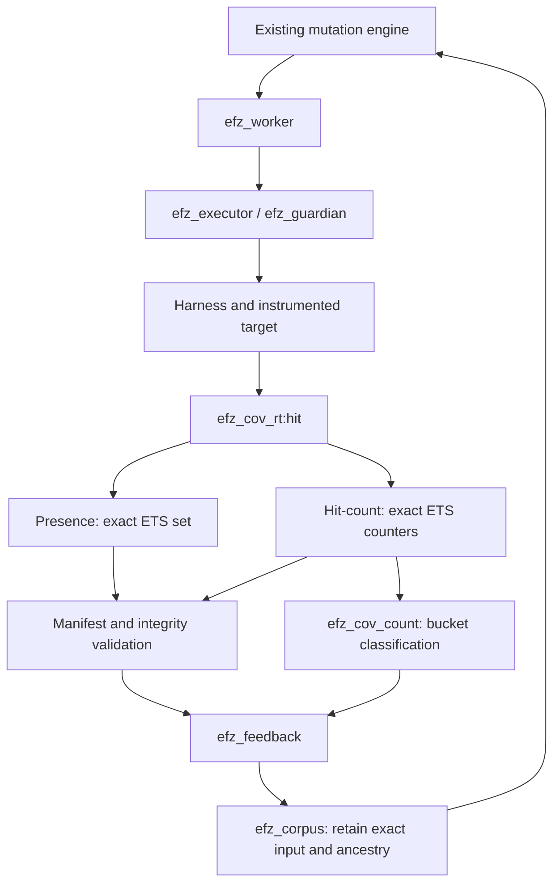

# EFZ：实验性命中计数反馈

[English](../../hit-count-experiment.md) · [Русский](../ru/hit-count-experiment.md) · [Español](../es/hit-count-experiment.md) · **简体中文** · [所有语言](../README.md)

日期：2026 年 9 月 15 日。基线：`205e18ba172d74bd6c652a68abfc73e02e4a1f86`。
原型在精确探针集合实现上扩展，默认仍为 `presence`。
原始测量和命令见下文。这是三个小型合成目标上的本地实验，不证明 Erlang/OTP 上的有效性。

## 结论

**RESULT B——命中计数反馈对部分目标有益，应保持可选启用。**

每活动 3000 次变异执行、每目标三个 RNG 种子时，hit-count 在 9 个活动中有 7 个到达深分支；
presence 为 0/9。
主要比较中语料增长 2–3.5 倍（独立桶饱和实验最高 4.5 倍）。
固定长循环中执行器总时间增加约 7–8%；短执行主要由既有生命周期和完整性检查主导。
实验没有证明新的真实缺陷：全部三个目标返回 `deep`，唯一崩溃数为零。

下一实际步骤是在有已知深状态的真实解析器上，以多个预算和更多 RNG 种子重复配对活动。
目前没有依据替换 presence 默认值或引入稠密位图。

## 契约与运行路径

```erlang
#{coverage_feedback => presence}  % default
#{coverage_feedback => hit_count} % opt-in prototype
```

CLI：在现有 `scripts/fuzz.escript` 命令添加 `--coverage-feedback hit_count`。
未知模式由配置和 CLI 拒绝。
`coverage_backend` 仍接受 `ets`/`ets_member`：它们是 presence 钩子变体；
hit-count 下两者使用同一精确 ETS 计数器实现。



公开标识不变：`{Module, BuildId, ProbeId}`。
这是源码子句或结果点，不是 CFG 边。
没有 `hash(Id) rem MAP_SIZE`、数字位图槽、碰撞别名或调用上下文哈希。

| 状态 | Presence | Hit-count | 所有者与生命周期 |
|---|---|---|---|
| 每输入 ETS 对象 | `{{probe, Id}}` | `{{probe, Id}, Count}` | guardian；每执行新表 |
| 上下文后端字段 | ETS tid / `{ets_member,Tid}` | `{ets_count,Tid}` | 根及已接纳后代 |
| 结果 `coverage` | 排序精确标识 | 相同键投影 | 全部已接纳写入者终止后快照 |
| 补充结果 | 无 | `hit_counts`、`count_features`、`coverage_feedback` | 普通结果 term |
| 全局探针 | `feedback.global` | 相同集合 | worker，单活动 |
| 全局计数特征 | 无 | `feedback.global_features` | worker，单活动 |

`efz_cov_rt:hit/1` 保留经独立注册表检查上下文。
hit-count 调用 `ets:update_counter(T,{probe,Id},{2,1},{{probe,Id},0})`。
首命中发送现有 guardian 通知；后续每次原子增加整数。
已检查 ETS 不在 64 位回绕：`2^63−1` 后为 `2^63`。这不是 8 位 AFL 计数器。

`efz_guardian` 保留表、开始门、监视器及清理所有权。
`efz_executor:coverage/3` 依据既有清单计划验证精确投影。
`efz_cov_count:snapshot/1` 检查行形状和正整数计数，
`features/2` 要求计数键与 `coverage` 精确匹配。
表消失、上下文损坏、缺少或无效计数都为基础设施故障，不是成功空观察。
上下文完整时空 `coverage=[]`、`hit_counts=#{}` 合法。

确认清理后删除表；下一执行获得新 ref 和 ETS。
受控子进程经现有 `efz_target:spawn/1` 共用表，并发更新相加。
根崩溃或超时不会在快照前删除所有者持有的表。
调用方、guardian 和 dirty-runner 策略不变。
任意异步 OTP 应用仍在支持模型外。

这是合作测试驱动的正确性契约。公开 ETS 不是安全边界：
直接写入其他**正**计数与合法值无法区分。
guardian 独立见证 presence，但不在第二个计数器重复每次命中。
目标不得修改 EFZ 行。

## 桶与新颖性

| 计数 | 公开桶标签 |
|---|---:|
| 1 | 1 |
| 2–3 | 2 |
| 4–7 | 4 |
| 8–15 | 8 |
| 16–31 | 16 |
| 32–63 | 32 |
| 64–127 | 64 |
| 128+ | 128 |

标签是包含式下界。特征为 `{ProbeIdentity, Bucket}`。
零命中不创建特征。这些是需求指定桶；计数器保存精确次数，
因此 256/1000/100000 不会因字节回绕变成零。

[efz_feedback](../../../src/efz_feedback.erl) 对成功执行采用：

```text
NewProbes   = CurrentProbes   − GlobalProbes
NewFeatures = CurrentFeatures − GlobalFeatures   # hit_count only
GlobalProbes   := GlobalProbes   ∪ CurrentProbes
GlobalFeatures := GlobalFeatures ∪ CurrentFeatures
```

| 执行 X | 新探针 | 新特征 | hit-count 模式保留 |
|---|---|---|---|
| X×1 | X | `{X,1}` | `new_probe` |
| X×2 | 空 | `{X,2}` | `new_hit_count` |
| X×3 | 空 | 空 | `equivalent_coverage`，不保留 |
| X×4 | 空 | `{X,4}` | `new_hit_count` |

新探针与桶同时出现时，原因是 `new_probe`，元数据含两种增量。
默认 presence 保留旧原因 `new_coverage`。
校准更新两种历史，但原因仍为 `seed_calibration`。
崩溃和超时不改任何全局集合；基础设施故障停止活动。
worker 只在保留或存储成功后接受新反馈状态。

已知计数特征的新组合不算新颖性。
不使用覆盖集合哈希、路径签名或最大计数决定保留。

## 测量后的表示选择

[存储基准](../../../bench/efz_hit_count_micro.erl)研究五种变体：

1. 使用 `insert_new` 的基线 ETS 集合。
2. 使用 `update_counter/4` 的稀疏 ETS 计数器。
3. 无碰撞预备 identity→slot ETS 加 `counters` `[atomics]`。
4. 相同映射加 `counters` `[write_concurrency]`。
5. 相同映射加 `atomics`。

稠密查找包含于每次命中；未用仅 direct-slot 结果代替钩子成本。
identity→slot 通过枚举类似清单标识构建，无哈希。
映射分配在设置及内存中单独记账。
实际稠密集成可每活动只准备一次映射；这里冷设置不应被解释为必需的每输入成本。

| 表示 | 查找与更新 | 重置与快照 | 并发访问 | 集成 |
|---|---|---|---|---|
| ETS 集合 | 精确键，只插一次 | 稀疏扫描或删除 | 原子插入 | 基线 |
| ETS 计数器 | 精确键、原子增加 | 稀疏扫描或删除 | 原子整数增加 | 保留 ETS 所有权与生命周期 |
| 稠密 counters/atomics | 精确映射查找加数字索引 | 本原型全槽扫描和重置 | 原子计数，不同设置保证不同 | 要求映射、生命周期引用、完整性或 touched-slot 策略 |

OTP `counters` 和 `atomics` 使用 64 位存储并允许回绕；
`write_concurrency` 改变并发写入时读取保证。
写入者终止后快照避免该读写重叠，但不解决溢出。
引用生命周期依可达性，而非 ETS 所有者。
[OTP counters](https://www.erlang.org/docs/27/apps/erts/counters.html)、
[OTP atomics](https://www.erlang.org/docs/27/apps/erts/atomics.html)、
[OTP ETS update_counter](https://www.erlang.org/docs/27/apps/stdlib/ets.html#update_counter/4)。

### 存储微基准

环境：OTP 27.0 / ERTS 15.0、Linux x86_64、Intel Core i7-1260P、`+S 4:4`。
丢弃预热后重复五次，交替变体顺序。不固定 CPU，频率可能变化。
合成标识使用相同完整格式，但这是**仅存储基准**，不含 guardian 或完整性钩子开销。

中位数 ns/命中；`once` 表示 N 个探针各一次：

| N | ETS set | ETS counter | counters atomics | counters write_concurrency | atomics |
|---:|---:|---:|---:|---:|---:|
| 100 | 220 | 280 | 127 | 127 | 118 |
| 1000 | 257 | 314 | 133 | 133 | 125 |
| 10000 | 312 | 379 | 143 | 144 | 137 |
| 100000 | 469 | 595 | 196 | 222 | 187 |

中位数 ns/命中；`repeated` 表示在 N 空间中 10 探针 ×1000 命中：

| N | ETS set | ETS counter | counters atomics | counters write_concurrency | atomics |
|---:|---:|---:|---:|---:|---:|
| 100 | 104 | 124 | 119 | 117 | 111 |
| 1000 | 105 | 128 | 117 | 120 | 113 |
| 10000 | 107 | 148 | 117 | 116 | 110 |
| 100000 | 123 | 147 | 125 | 137 | 113 |

N=100000、观察 10 探针时，ETS counter 快照 18 µs，稠密 atomics 为 38858 µs；
重置分别 6 和 3578 µs。
每探针一次时，稠密 atomics 更新更快，但快照 257419 µs，对比 ETS counter 的 192916 µs。
四个并发写入者在全部计数变体中恰好产生 40000 命中；这是原子性检查，不是多 worker EFZ 基准。
活动仍只允许一个 worker。

N=100000 的内存及完整冷存储生命周期：

| 变体 | 字节，全部命中 | 字节，仅 10 探针命中 | 额外映射字节 | Total once，ms | Total repeated，ms |
|---|---:|---:|---:|---:|---:|
| ETS set | 16007352 | 3960 | 0 | 275,46 | 1,25 |
| ETS counter | 16807352 | 4040 | 0 | 276,81 | 1,51 |
| dense counters atomics | 800040 | 800040 | 14407352 | 368,86 | 156,86 |
| dense counters write_concurrency | 4000032 | 4000032 | 14407352 | 361,04 | 156,54 |
| dense atomics | 800040 | 800040 | 14407352 | 341,90 | 111,12 |

总时间含设置、命中循环、快照、重置和关闭。
映射设置约 37–48 ms，可单独摊销，但不能消除全快照或重置扫描。
稠密存储自身紧凑，但本原型精确映射比数组大得多。
不声称最优映射布局；测量给出特定可运行方案成本。

原始样本含 `setup_ns`、`hit_ns`、`snapshot_ns`、`reset_ns`、`close_ns`、
`total_ns`、`storage_bytes`、`mapping_bytes`。
内存仅为存储及映射字节，**不是整 VM 峰值**。
`total_ns` 是冷存储生命周期，不是完整目标执行。
100 探针小批对计时和 GC 敏感。
稠密变体 `close_ns` 测删除映射 ETS；后续 GC 释放 counters/atomics 引用未单独测量，也未包含。

最小生产原型选择**稀疏 ETS 计数器**，支持既有所有权、精确键、稀疏快照和清理。
不追踪 touched-slot 的稠密计数器在大稀疏空间太昂贵。
五种基准实现全部保留供下次比较。

### 固定输入的完整执行器

普通插桩 repeat 目标；两模式输入相同。
计时包含上下文创建、钩子、验证、快照、清理和 DOWN。
预热、五个配对样本，1/1000 重复时每样本 200 执行，100000 重复时 10 执行。
这是独立开销检查，不改变语料或调度。

| 重复数 | Presence，µs/输入 | Hit-count，µs/输入 | 变化 |
|---:|---:|---:|---:|
| 1 | 4927,6 | 4910,1 | −0,4%，噪声 |
| 1000 | 5679,0 | 6092,3 | +7,3% |
| 100000 | 50367,3 | 54426,7 | +8,1% |

## 受控模糊测试比较

三个目标是带自动插桩的普通源码，不含手动覆盖钩子。
基准适配器只把 `deep` 结果时间戳报告到外部，不选输入或父输入，不替换变异器。

| 目标 | 语义 | 深分支 |
|---|---|---|
| [repeat](../../../fixtures/hit_count/efz_count_repeat.erl) | 相同 `A` 字节前缀 | ≥16 重复 |
| [records](../../../fixtures/hit_count/efz_count_records.erl) | 完整 TLV 类记录 `1,1,Payload` 解析器 | ≥8 记录 |
| [machine](../../../fixtures/hit_count/efz_count_machine.erl) | tick/ack 转换 `TA`，再 commit `C` | 提交前 ≥8 对 |

每配对获得相同初始种子、全部三个 RNG 种子、timeout=1000、max_input_bytes=128、
max_iterations=3000 及 staged 配置：
`stages=[dictionary_insert,havoc]`、`havoc_depth=1`、`max_block_bytes=32`。
字典分别含单个字节、记录或转换 token，不含现成深输入。
RNG 轮次：mutation/random `{17*R,23,41}`，selection `{101,109*R,113}`，R=1..3。
证据保存完整配置；驱动只移除 `coverage_feedback` 后检查相等。

语料增长后，后续输入流自然分化：测试的是反馈质量，而非人为固定输出序列。
不使用脚本式变异器或新模糊引擎。

| 目标与模式 | 最终探针（R1/R2/R3） | 发现 | 语料 | 仅计数 | 深路径成功 | exec/s 中位数 |
|---|---|---|---|---|---:|---:|
| repeat / presence | 4/4/4 | 1/1/1 | 2/2/2 | 0/0/0 | 0/3 | 193,1 |
| repeat / hit_count | 5/5/5 | 6/6/6 | 7/7/7 | 4/4/4 | 3/3 | 190,9 |
| records / presence | 4/4/4 | 1/1/1 | 2/2/2 | 0/0/0 | 0/3 | 191,1 |
| records / hit_count | 4/4/5 | 3/3/5 | 4/4/6 | 2/2/3 | 1/3 | 191,7 |
| machine / presence | 5/5/5 | 2/2/2 | 3/3/3 | 0/0/0 | 0/3 | 194,6 |
| machine / hit_count | 6/6/6 | 6/8/7 | 7/9/8 | 3/5/4 | 3/3 | 183,6 |

hit-count 首个深输入：

| 目标 | 变异索引 R1/R2/R3 | 变异阶段开始后秒数 |
|---|---|---|
| repeat | 2225 / 282 / 448 | 11,783 / 1,427 / 2,294 |
| records | 未到达 / 未到达 / 1645 | — / — / 8,671 |
| machine | 1319 / 1492 / 2298 | 7,439 / 8,713 / 10,501 |

全部 18 活动各执行 3000 变异，infrastructure failures=0、unique crashes=0。
活动吞吐包含不同输入分布、更大语料及调度工作，不能解释为隔离计数器成本。
上述固定输入执行器实验用于该目的。

### 负向控制：随机变异

另六个活动获得相同 budget=3000、初始种子及固定 RNG 状态，但使用既有 `efz_mutator_random`。
未加字典，因为该变异器不支持。
两模式覆盖、发现和语料相同；全部未到达 deep：

| 目标 | 最终探针，两模式 | 发现 | 语料 | 仅计数 | Presence / hit-count exec/s |
|---|---:|---:|---:|---:|---:|
| repeat | 3 | 0 | 1 | 0 | 192,2 / 194,4 |
| records | 3 | 0 | 1 | 0 | 193,5 / 194,6 |
| machine | 4 | 1 | 2 | 0 | 194,1 / 205,2 |

随机变异器有 flip/overwrite/insert/delete，无 dictionary/duplicate。
空 primary 总创建 `<<0>>`。
若无合适初始内容，仅反馈本身不能创建有用输入。
这是推广正向 staged 结果的重要限制。

### 大循环与语料饱和

额外真实 staged 活动插入字典 token
`L1,L2,L4,L8,L16,L32,L64,L128,L1000,L100000,L1000000`，
并调用一个自动插桩探针对应次数。
轨迹确认 `L1000000` 确实在两模式生成并执行。

| 模式 | 执行数 | 状态 | 探针 | 语料 | 仅计数 | 全局桶特征 |
|---|---:|---|---:|---:|---:|---:|
| presence | 38 | 确定性变异耗尽 | 1 | 2 | 0 | — |
| hit_count | 256 | 配置执行预算 | 1 | 9 | 7 | 8 |

Presence 因语料较小提前耗尽仅字典空间。
实验检查饱和及保留，**不比较相同执行次数下吞吐**。
上方主要质量与性能配对表使用相同预算。
计数 1000/100000/1000000 在桶 128 后未保留额外输入。

## 语料、兼容与限制

仅桶新颖的输入仍走 `efz_worker:retain` → `efz_corpus:add` → `mutation_entries/select`。
元数据含两种增量及精确原因。
SHA-256 去重、整数父 ID、primary 字节和哈希、EFZR 配方不变。
模式不进入变异配置哈希，也不改操作。

`repeat / hit_count / round 1` 实际语料链：

| ID | 输入 | 父 ID | 保留 |
|---:|---|---:|---|
| 1 | `<<>>` | — | initial |
| 2 | `A` | 1 | `new_probe` |
| 3 | `AA` | 2 | `new_hit_count` |
| 4 | `AAAA` | 3 | `new_hit_count` |
| 5 | `AAAAAAAA` | 4 | `new_hit_count` |
| 6 | `AAAAAAAAAAAAAAAA` | 5 | `new_probe`，深分支 |
| 7 | 32 × `A` | 6 | `new_hit_count` |

回归活动中 `L2` 获得 ID 5、`parent=1`、`new_probes=[]`、
`new_count_features=[{{efz_count_sites,Build,1},2}]`。
随后真实配方有 `parent=5`、`primary=<<"L2">>`、`primary_id=SHA256(<<"L2">>)`、
`operations=[{dictionary_insert,0,<<"L1">>}]`，重建 `<<"L1L2">>`。
下一输入不必有趣：测试特指证明调度器复用。
上表展示有用的多步计数祖先链。
新 VM 中队列 ID 重新分配；恢复测试按内容找父输入。

持久存储以记录模式 2 保存计数发现；初始和 presence 条目仍为模式 1。
EFZC 封装仍为版本 1。旧记录可读；旧 EFZ 拒绝新 v2 记录。
原始输入可跨模式迁移并重新校准；全局桶历史和游标不恢复。
详情见[语料契约](corpus.md)。

崩溃输入与配方仍是权威字节及来源信息；重放保持相同构建和测试驱动检查。
默认重放检查结果，不复现计数新颖性：后者需要特定活动历史。
标识、清单和配方模式不变。
计数模式不绕过 guardian 或输入限制，不增加并行活动，不清理任意 VM 全局状态。

固定构建每探针只有八个桶特征。
首次观察后每探针最多七个仅计数机会。
因此仅计数保留次数上界 `7 * number of probes`
（实际因校准、多特征输入及内容去重而更少）。
特征组合不乘大此空间。
这不限制全部初始或恢复语料，也不保证大输入配方大小较小。

已有可选启用、桶和去重。未加新硬上限或能量调度，因为这些目标语料小。
更大清单应先单独测量保留字节和配方字节，再选择仅计数发现上限或更低调度优先级。
稠密映射和 touched slots 是分析后可能优化，不是新语义前提。

## 复现与证据

从 `efz/` 根目录串行执行，不并发其他测试或基准：

```sh
ERL_FLAGS='+S 4:4' rebar3 compile
escript bench/hit_count.escript micro _build/hit-count-experiment
escript bench/hit_count.escript executor _build/hit-count-experiment
escript bench/hit_count.escript campaign _build/hit-count-experiment
escript bench/hit_count.escript stress _build/hit-count-experiment
escript bench/hit_count.escript large_loops _build/hit-count-experiment
escript bench/hit_count.escript report _build/hit-count-experiment

ERL_FLAGS='+S 4:4' rebar3 eunit
ERL_FLAGS='+S 4:4' rebar3 ct
ERL_FLAGS='+S 4:4' rebar3 xref
ERL_FLAGS='+S 4:4' rebar3 dialyzer
```

完整报告、配方和文本日志留在 `_build/hit-count-experiment`。
全部样本紧凑归档：[hit-count-samples.json](../../performance/hit-count-samples.json)。
Erlang 元组表示为 JSON 数组，二进制表示为 `{hex: ...}` 对象；
活动行中 `features` 为特征数量，精确 ID 位于 coverage。

回归套件：[efz_hit_count_tests](../../../test/efz_hit_count_tests.erl)，
并补充 CLI、完整性和语料存储测试。
检查全部桶边界、presence ×1/×1000、多探针增量、构建命名空间、并发子命中、
崩溃与超时快照、损坏计数或上下文、默认及无效配置、真实 staged 保留和父输入复用、
新 VM 持久恢复及重新校准、原始与配方崩溃重放、构建或测试驱动不匹配。

实际最终验证：

| 带 `ERL_FLAGS='+S 4:4'` 的命令 | 结果 |
|---|---|
| `rebar3 compile` | PASS |
| `rebar3 eunit` | PASS，199 项 |
| `rebar3 ct` | PASS，3 项 |
| `rebar3 xref` | PASS |
| `rebar3 dialyzer` | PASS |

首次 EUnit 尝试不成功：旧 5376 次受保护执行测试超过 `efz:await(25000)`
（随后 smoke 得到 0 执行）；第二次默认 5 秒 EUnit 超时取消八活动组。
保留功能断言：首测试等待增加至 60 s（外层 75 s），第二测试至 30 s。
目标超时和变异预算未改。
最终完整 EUnit 无失败或取消；耗尽测试耗时 33.621 s，确认精确 5120 次变异执行。
原始失败日志和两次验证尝试都保留，未在来源归档中用成功替换。
完整日志：`_build/hit-count-experiment/`。
